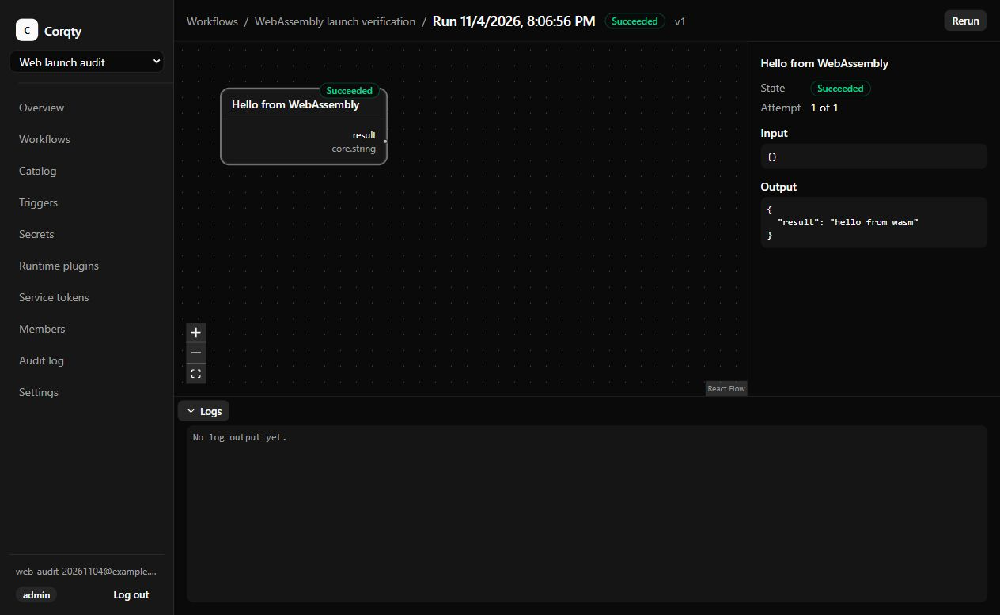

# Corqty

Visual workflow orchestration with a Rust execution engine, a React studio, and
PostgreSQL as the durable queue. Build typed DAGs, publish immutable versions,
and run them across horizontally scaled workers.

- Accounts, organizations, invitations, four fixed roles, and audit history.
- A visual node catalog and editor with schema-driven configuration, typed
  connections, cycle checks, draft autosave, and versioned blueprints.
- Manual, REST, cron, and signed-webhook runs, with idempotency, retries,
  cancellation, lease recovery, logs, and replayable live events.
- Encrypted organization secrets and capability-approved WebAssembly Components.
- Built-in mock and opt-in trusted shell executors.
- Docker Compose for local development and an HTTPS deployment configuration.

The infrastructure blueprint is explicitly simulated; real Terraform, Helm,
Pulumi, and kubectl integrations are outside this release. Billing, OIDC,
email delivery, a plugin marketplace, and collaborative editing are also out of
scope. See the [documentation index](docs/README.md), [visual tour](docs/visual-tour.md),
and [release checklist](docs/release-checklist.md) for guides, product visuals,
verification evidence, and remaining deployment checks.



Recorded with synthetic data. The [visual tour](docs/visual-tour.md) includes
another real capture and clearly labeled placeholders with briefs for future images.

## Start locally

Install Docker with Compose 2.24.4 or newer. The first build compiles Rust and
Wasmtime and can take several minutes. On Windows, start Docker Desktop first.

PowerShell:

```powershell
./scripts/init-local.ps1
docker compose up --build --wait
```

Linux/macOS (requires OpenSSL for credential generation):

```sh
sh scripts/init-local.sh
docker compose up --build --wait
```

The initializer creates an ignored `.env` with fresh database passwords and a
32-byte encryption master key. It preserves an existing `.env`. Keep a secure
backup of that key; losing it makes stored secrets and webhook keys unrecoverable.

Open [localhost:3000](http://localhost:3000), register, and create your first
organization. Apply a blueprint from Workflows, edit it, publish it, and run it.
Local ports bind only to loopback; adjust `CORQTY_POSTGRES_PORT`,
`CORQTY_API_PORT`, and `CORQTY_WEB_PORT` in `.env` if needed.

## Run and extend workflows

The built-in `mock` executor supports fixed output, input echo, delays, and
deterministic failures. It powers both starter blueprints without external
infrastructure credentials.

Admins can add secrets, install runtime plugins, and create service tokens.
Editors can configure workflows and pinned cron/webhook triggers. Runners can
start, retry, and cancel runs; viewers have read access. Secret plaintext is
never returned by a later secret API read.

For a runtime plugin example, install
[`plugins/example-wasm/hello.wasm`](plugins/example-wasm/hello.wasm) with its
[`manifest.json`](plugins/example-wasm/manifest.json) from the Plugins page. Add a
node definition bound to `hello` version `1.0.0`, with a string output named
`result`; its output is
`{"result":"hello from wasm"}`. The versioned host interface lives in
[`crates/plugin-sdk/wit`](crates/plugin-sdk/wit).

Runtime components receive only logging by default. Secret access, scratch
storage, approved host/port connections, and named commands require explicit
approval for that organization's exact version, checksum, and manifest. Host
commands additionally require the deployment's trusted-execution switch.

Shell is disabled by default. Setting `CORQTY_SHELL_EXECUTOR=enabled` for the
API and workers allows an admin to enable it in Settings. Commands run as the
shared worker user and can reach its credentials; enable it only for
single-tenant or fully trusted deployments. Container limits do not make shell
a tenant security boundary. See [operations](docs/operations.md).

## Scale workers

```sh
docker compose up --build --wait --scale worker=3
```

Each worker runs up to `CORQTY_WORKER_CAPACITY` attempts concurrently (default
4), advertises compatible executors, and claims jobs transactionally. Workers
expose no ports. A stopped worker drains for up to 25 seconds; expired leases
recover unfinished work. Execution is at least once, so side-effecting plugins
should use the stable execution ID for their own deduplication.

## Test

Local development uses the versions pinned in `rust-toolchain.toml` and
`package.json`; CI uses Node 24. Start the disposable integration database, then:

```sh
docker compose -f docker/compose.test.yml up -d --wait
cargo fmt --check
cargo clippy --workspace --all-targets -- -D warnings
cargo test --workspace
pnpm install --frozen-lockfile
pnpm web:lint
pnpm web:test
pnpm web:build
pnpm audit --audit-level=low
```

On memory-constrained hosts, add `-j 2` to Cargo commands. Do not run multiple
integration-test processes against port 55432 at once: they reset shared test
data. Shell contract tests require Linux; CI runs them there. For the guarded
Rust dependency audit, install `cargo-audit` 0.22.2 and run
`./scripts/audit-rust.ps1` in PowerShell. Its single lockfile-only exception is
documented in the [security guide](docs/security.md#dependency-audit-scope).

The full smoke suites use a disposable stack with three workers and trusted
shell enabled. In PowerShell:

```powershell
$env:CORQTY_SHELL_EXECUTOR = "enabled"
$env:CORQTY_WORKER_CAPACITY = "1"
docker compose --project-name corqty-check up --build --wait --scale worker=3
./scripts/smoke-foundation.ps1 -ProjectName corqty-check -ExpectedWorkers 3
./scripts/smoke-automation.ps1
```

The foundation suite covers the studio API, execution, live events, shell, and
the precompiled runtime component. The automation suite covers tokens,
idempotency, signed webhooks through the web proxy, secrets metadata, and cron.
Use `docker compose --project-name corqty-check down` to stop the stack while
preserving its data. Remove volumes only when intentionally discarding a test
environment.

## Documentation and deployment

Use the [operations guide](docs/operations.md) for HTTPS, backups, upgrades,
worker limits, and incident recovery. The [automation guide](docs/automation.md)
documents service tokens, cron, webhook signing, retention, and deployment limits.

Use the [development guide](docs/development.md), [testing guide](docs/testing.md),
and [security policy](docs/security.md) when changing or extending the project.
Dockerfiles and Compose overrides are organized under [docker/](docker/README.md);
the WASM example lives under [plugins/example-wasm](plugins/example-wasm/README.md).
Corqty is licensed under [Apache-2.0](LICENSE).

## Agent documentation requirements

For **every task**, agents must review the relevant Markdown documentation under
`docs/` and keep it accurate as part of completing that task:

- Update affected guides in the same change as code, API, schema, configuration,
  deployment, command, file-layout, or user-interface changes.
- Document new behavior, defaults, permissions, limits, examples, and operational
  implications. Remove obsolete instructions and repair links after moves/deletions.
- Keep the [documentation index](docs/README.md), diagrams, screenshots, and
  [image capture briefs](docs/assets/README.md) consistent with the product.
  Clearly label image placeholders; never present invented UI as a screenshot.
- Check relevant links, examples, and commands. Do not mark a task complete while
  its documentation is missing or stale. If a task needs no documentation change,
  confirm that the relevant docs were reviewed in the completion summary.
- Commit each completed task, including its documentation updates, and follow the
  repository owner's branch and push instructions.
