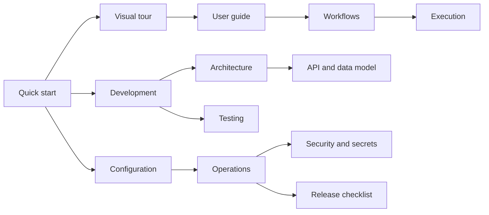

# Corqty documentation

Corqty is a visual workflow orchestrator: author typed graphs, publish immutable
versions, and execute them with durable PostgreSQL scheduling and Rust workers.
These guides describe the implemented product, its extension contracts, and how
to develop and operate it. Start with the [repository quick start](../README.md).

## Find your guide

| Audience or task | Guide | What it covers |
|---|---|---|
| Explore the product visually | [Visual tour](visual-tour.md) | Real product screenshots and clearly marked capture placeholders |
| Use Corqty | [User guide](user-guide.md) | Accounts, organizations, roles, studio, runs, and administration |
| Author workflows | [Workflows and catalog](workflows.md) | Definitions, types, bindings, validation, drafts, and publishing |
| Understand the system | [Architecture](architecture.md) | Services, crate boundaries, request paths, and design constraints |
| Integrate an application | [HTTP API](api.md) | Routes, authentication, payloads, errors, pagination, and SSE |
| Automate execution | [Automation](automation.md) | Service tokens, idempotency, cron, webhooks, and retention |
| Understand execution | [Execution engine](execution.md) | Scheduling, states, retries, leases, cancellation, and events |
| Build an executor | [Plugins](plugins.md) | Component contract, manifests, capabilities, approvals, and examples |
| Handle credentials | [Secrets](secrets.md) | Encryption, bindings, retrieval, redaction, and lifecycle |
| Review trust boundaries | [Security](security.md) | Security policy, vulnerability reporting, authentication, and isolation |
| Work with persistence | [Data model](data-model.md) | Schema relationships, roles, RLS, migrations, and invariants |
| Change the web app | [Frontend](frontend.md) | Routes, state, studio, events, styling, accessibility, and tests |
| Configure a deployment | [Configuration](configuration.md) | Environment variables, defaults, ceilings, and runtime settings |
| Develop locally | [Development](development.md) | Repository map, toolchains, local services, and change workflows |
| Verify a change | [Testing](testing.md) | Test layers, commands, disposable databases, smoke tests, and CI |
| Deploy and recover | [Operations](operations.md) | HTTPS, backups, restore, upgrades, scaling, monitoring, and incidents |
| Diagnose a problem | [Troubleshooting](troubleshooting.md) | Symptoms, evidence, and recovery steps |
| Assess release evidence | [Release checklist](release-checklist.md) | Recorded acceptance checks and deployment-owner responsibilities |
| Replace visual placeholders | [Visual assets](assets/README.md) | Capture briefs, filenames, sanitization, and replacement instructions |

## Suggested reading paths

For a first workflow, read the user guide and workflows guide. For an external
caller, read the API and automation guides together. For a public deployment,
read configuration, security, operations, and the deployment-owner checklist
before accepting customer traffic.

## Documentation conventions

- Examples use synthetic data. Values such as organization UUIDs and tokens must
  be replaced with values from your own environment.
- Commands run from the repository root unless a guide says otherwise.
- Relative source links identify the code behind behavior. Public JSON uses the
  spelling in the API examples; Rust and database names may use different casing.
- Mermaid diagrams render directly on GitHub and compatible Markdown viewers.
  Screenshots show particular recorded states, not continuously updated live data.
- A labeled image placeholder is a capture request, not a representation of a
  screen that has already been verified. Its adjacent brief explains replacement.

## Scope and maintenance

The release includes mock and opt-in trusted shell execution plus approved
WebAssembly Components. Infrastructure blueprints are simulated. Billing, OIDC,
SMTP/account recovery, a public plugin marketplace, collaborative editing, and
real Terraform/Helm/Pulumi/kubectl integrations are not implemented.

For every task, agents and contributors must review and update the affected
documentation as part of the same change. The [README agent instructions](../README.md#agent-documentation-requirements)
define this requirement. Keep these guides about the current product; do not
replace them with transient task lists or generated implementation plans.

Corqty uses the [Apache-2.0 license](../LICENSE). Security reports follow the
[security policy](security.md#reporting-a-vulnerability).
