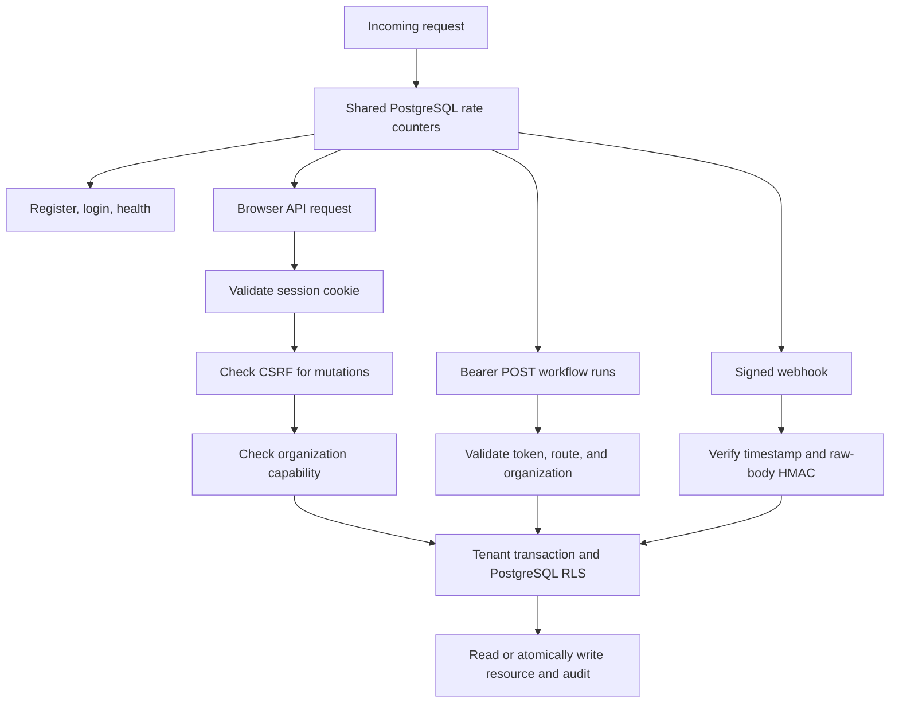

# HTTP API reference

The Rust API serves JSON under `/api/v1` and signed webhooks under `/hooks/v1`.
The web application forwards both prefixes to the API, so browser clients can use
the same origin. Local defaults are `http://localhost:3000` for the web app and
`http://localhost:8080` for the API. Production clients should use the configured
HTTPS origin. See [configuration](configuration.md) and [operations](operations.md).

This reference describes the routes in [router.rs](../crates/api/src/router.rs).
There is currently no generated OpenAPI document or API discovery endpoint.

## Authentication and authorization



Registration and login set `corqty_session` and `corqty_csrf` cookies. The session
cookie is `HttpOnly`; both use `Path=/`, `SameSite=Lax`, and a 30-day lifetime.
`Secure` is enabled by production configuration. For authenticated browser
`POST`, `PUT`, `PATCH`, and `DELETE` requests, send the readable CSRF cookie's
value in `X-CSRF-Token`. The server checks both equality and the session's stored
CSRF hash. Reading a resource does not require that header.

A service token uses `Authorization: Bearer <token>` and can only start runs at
`POST /api/v1/orgs/{org}/workflows/{workflow}/runs`. It needs no cookie or CSRF
header. Providing an `Authorization` header selects this authentication path;
it does not fall back to a browser session. Tokens cannot read runs, open event
streams, cancel, rerun, or manage resources. See [automation](automation.md).

Webhooks use HMAC authentication rather than session or bearer authentication.
Registration, login, and health are public. Invitation acceptance requires a
logged-in user whose email matches the invitation.

The tables below use these access labels:

| Label | Allowed organization roles |
|---|---|
| Member | `admin`, `editor`, `runner`, `viewer` |
| Editor | `admin`, `editor` |
| Runner | `admin`, `editor`, `runner` |
| Admin | `admin` |
| Session | Any authenticated user; no existing organization membership required |

Editors can edit and publish workflows and manage triggers. Runners can start,
cancel, and rerun. Only admins manage members, service tokens, secrets, plugins,
and the shell gate. Secret metadata is exposed to editors and admins. An unknown
organization or a nonmember receives `404`; a member lacking the capability
receives `403`. Tenant-owned identifiers from another organization also return
`404`. See [RBAC source](../crates/domain/src/rbac.rs),
[middleware](../crates/api/src/auth/middleware.rs), and [security](security.md).

## Conventions and errors

- Send `Content-Type: application/json` for JSON request bodies. Empty objects
  are still required where a body is listed, such as starting or rerunning a run.
- UUIDs and timestamps are strings; timestamps are RFC 3339. JSON field names
  generally use camelCase; role and capability values use snake_case.
- `?` in the request tables means optional. `—` means no request body.
- Most request structures reject unknown fields. The flattened node-definition
  request is an exception: unknown top-level fields are ignored.
- Success responses are JSON unless the table says `204`. Lists generally use
  `{"items": [...]}`; sessions and members return bare arrays.
- No ETag or conditional-request protocol is implemented. Draft revisions provide
  optimistic concurrency control.

Application errors use `Content-Type: application/problem+json`:

```json
{
  "type": "about:blank",
  "title": "Conflict",
  "status": 409,
  "code": "draft_revision_conflict"
}
```

Validation errors may also include
`"diagnostics": [{"code":"...","pointer":"/nodes/0/config","message":"..."}]`.
Pointers identify JSON locations. Internal responses use the generic code
`internal`; database details are logged rather than returned.

| Status | Typical meaning / code |
|---|---|
| `400` | Malformed JSON: `invalid_json`; invalid idempotency header |
| `401` | Missing/expired credentials or invalid webhook signature: `unauthorized` |
| `403` | Insufficient capability, invalid CSRF, or unsupported bearer route: `forbidden` |
| `404` | Missing/inaccessible resource or malformed path identifier: `not_found` |
| `405` | Unsupported method: `method_not_allowed` |
| `409` | Concurrent change or conflicting state, such as `draft_revision_conflict`, `idempotency_conflict`, `final_admin_required` |
| `413` | HTTP/raw payload too large: `payload_too_large` |
| `415` | JSON route without a supported JSON content type: `unsupported_media_type` |
| `422` | Invalid body shape, schema, graph, or semantic limit; e.g. `invalid_json`, `graph_invalid`, `run_input_too_large` |
| `429` | `rate_limited` or `too_many_streams` |
| `500` | Unexpected server error: `internal` |

Malformed query strings and raw-body extractor failures can use framework error
responses instead of this JSON envelope. Clients must check status and content
type before parsing. Current `429` responses do not include `Retry-After`.
See [error mapping](../crates/api/src/error.rs) and
[JSON/path extraction](../crates/api/src/extract.rs).

The default JSON request body ceiling is 2 MiB; plugin upload routes allow
36 MiB to accommodate base64. Webhook bodies have a 1 MiB hard ceiling, which
operators may lower. A run's serialized input object also has a separate default
1 MiB limit. Graph, node, output, log, timeout, component, and WASM memory limits
are described in [configuration](configuration.md).

## Account and session routes

The paths in this table are relative to `/api/v1`.

| Method | Path | Access | Body | Success |
|---|---|---|---|---|
| GET | `/health` | Public | — | `204` |
| POST | `/auth/register` | Public | `{email,password,organizationName}` | `201 {"ok":true}` and cookies |
| POST | `/auth/login` | Public | `{email,password}` | `200 {"ok":true}` and cookies |
| GET | `/auth/me` | Session | — | User and organization memberships |
| POST | `/auth/logout` | Session | — | `204`, clears current session cookies |
| PATCH | `/auth/password` | Session | `{currentPassword,newPassword}` | `204`; revokes other sessions |
| GET | `/auth/sessions` | Session | — | Array of session summaries |
| DELETE | `/auth/sessions/{session}` | Session | — | `204`, only the user's own session |

Emails are trimmed and lowercased. Passwords must contain 12–128 characters.
Registration creates the user, initial organization, admin membership, and session.
A duplicate email returns `409 email_already_registered`; incorrect login details
return `401`. Password changes retain the current session. No email verification,
password reset, account deletion, or external identity-provider endpoint exists.
Health is a process liveness response, not a per-request database readiness test.

Example `/auth/me` response (IDs and timestamps throughout this page are illustrative):

```json
{
  "user": {"id":"11111111-1111-4111-8111-111111111111","email":"operator@example.com"},
  "organizations": [{
    "organizationId":"22222222-2222-4222-8222-222222222222",
    "name":"Example team",
    "slug":"example-team-abc123",
    "role":"runner",
    "capabilities":["view_organization","run_workflows"]
  }]
}
```

A session summary contains `id`, `createdAt`, `lastSeenAt`, and `expiresAt`.
Session tokens and hashes are never returned in this list.
Source: [account handlers](../crates/api/src/auth/handlers.rs).

## Organizations, members, settings, and audit

In this and subsequent organization tables, `O` means `/api/v1/orgs/{org}`.

| Method | Path | Access | Body / query | Success |
|---|---|---|---|---|
| POST | `/api/v1/organizations` | Session | `{name}` | `201 {organizationId,name,slug,role:"admin"}` |
| POST | `O/invitations` | Admin | `{email,role}` | `201 {token,inviteUrl,expiresAt}` |
| POST | `/api/v1/invitations/accept` | Session | `{token}` | `{organizationId,role}` |
| GET | `O/members` | Member | — | Array of `{userId,email,role}` |
| PATCH | `O/members/{user}` | Admin | `{role}` | `204` |
| DELETE | `O/members/{user}` | Admin | — | `204` |
| GET | `O/settings` | Member | — | `{shellAvailable,shellEnabled}` |
| PUT | `O/settings/shell` | Admin | `{enabled}` | `{shellAvailable,shellEnabled}` |
| GET | `O/audit-events` | Member | `?beforeId=<id>&limit=<n>` | `{items:[AuditEvent]}` |

Organization names contain 1–100 characters after trimming. Use `/auth/me` to
list the user's organizations; there is no organization list, rename, or delete
route. Invitation tokens expire after seven days and can be accepted once.
The returned URL carries the token in its fragment. Corqty returns the invitation
link to the administrator; it does not send an invitation email. Acceptance can
update an existing member's role. Removing or demoting the final admin returns
`409 final_admin_required`.

`shellAvailable` is the deployment gate; `shellEnabled` is the organization's
choice. Enabling an unavailable shell returns `409 shell_unavailable`. Changing
the gate affects new publishes/runs, not an already-created run.

Audit events contain `id`, nullable `actorUserId`, `action`, `resourceType`,
`resourceId`, `metadata`, and `occurredAt`. Results use descending IDs. `limit`
defaults to 50 and clamps to 1–100; use the final item's ID as `beforeId` for the
next page. There is no total count or returned next-cursor field. Automation
audits may have a null user actor and identify their token/trigger in metadata.
Sources: [organization handlers](../crates/api/src/organizations/),
[audit handler](../crates/api/src/audit.rs).

## Node definitions and blueprints

| Method | Path | Access | Body | Success |
|---|---|---|---|---|
| GET | `O/node-definitions` | Member | — | `{items:[NodeDefinition]}` |
| POST | `O/node-definitions` | Editor | Definition fields below | `201 NodeDefinition` |
| POST | `O/node-definitions/{definition}/deprecate` | Editor | — | Updated `NodeDefinition` |
| GET | `O/blueprints` | Member | — | `{items:[Blueprint]}` |
| POST | `O/blueprints` | Editor | `{key,displayName,description?,graph}` | `201 Blueprint` |

Lists combine system and current-organization versions, ordered by key/version,
without pagination. System keys begin `corqty.` and cannot be created or
deprecated by an organization. Creating an existing organization key appends its
next integer version. Versions cannot be edited or deleted through this API.
Deprecation is idempotent and does not remove historical records.

A definition creation body contains:

| Field | Shape |
|---|---|
| `key`, `displayName`, `category` | Strings; category is required |
| `description` | Optional string, defaults to `""` |
| `inputs`, `outputs` | Arrays of `{name,dataType,schema,required?,description?}` |
| `configSchema` | JSON Schema for config |
| `uiSchema` | Object mapping config keys to `{widget,label?,help?}` |
| `defaults` | JSON config defaults |
| `executor` | `{key,version}`; executor version is a string such as `"1.0.0"` |

The response adds `id`, `scope`, integer definition `version`, `deprecated`, and
`createdAt`; spec fields stay at the top level. A blueprint response adds `id`,
`scope`, integer `version`, and `createdAt` to its creation fields. Schema, defaults,
references, and executor configuration are validated before creation. Concurrent
same-key creation can return `409 node_definition_version_conflict` or
`blueprint_version_conflict`. See [workflow/catalog formats](workflows.md),
[catalog handler](../crates/api/src/catalog.rs), and
[definition schema](../crates/domain/src/catalog.rs).

## Workflow drafts and published versions

| Method | Path | Access | Body | Success |
|---|---|---|---|---|
| GET | `O/workflows` | Member | — | `{items:[WorkflowSummary]}` |
| POST | `O/workflows` | Editor | `{name,blueprintId?}` | `201 Workflow` |
| GET | `O/workflows/{workflow}` | Member | — | `Workflow` |
| PUT | `O/workflows/{workflow}/draft` | Editor | `{revision,graph}` | `{revision}` with next revision |
| POST | `O/workflows/{workflow}/validate` | Editor | `{graph}` | `{valid,diagnostics}` |
| POST | `O/workflows/{workflow}/publish` | Editor | `{revision}` | `201 VersionSummary` |
| GET | `O/workflows/{workflow}/versions` | Member | — | `{items:[VersionSummary]}` |
| GET | `O/workflows/{workflow}/versions/{version}` | Member | — | `VersionSummary` plus `graph` |

New drafts start at revision 1. A blueprint copy receives fresh node and edge
IDs. `PUT /draft` replaces the graph; it accepts a structurally parsed graph
within size limits even when full semantic validation fails. Saving with a stale
revision returns `409 draft_revision_conflict`. Validation examines the supplied
graph without saving it and reports ordinary graph errors with `200 valid:false`.

Publishing validates the stored draft, pins exact definition/executor versions,
and calculates its canonical SHA-256 checksum, including viewport data. It
returns `422 graph_invalid` for invalid graphs, `409 draft_revision_conflict` for
a stale revision, or `409 draft_already_published` if that revision was already
published. There are no workflow rename/delete or published-version mutation
routes.

`WorkflowSummary` contains `id`, `name`, `slug`, `draftRevision`, nullable
`publishedVersion`, nullable `publishedDraftRevision`, and `updatedAt`.
`Workflow` contains `id`, `name`, `slug`, both published fields, and
`draft:{revision,graph,updatedAt}`. `VersionSummary` contains `id`, `version`,
`checksum`, `draftRevision`, and `publishedAt`. Workflow lists are newest-updated
first; version lists are highest-version first. Neither is paginated.

Example empty graph, accepted for a new workflow and runnable immediately after
publication:

```json
{
  "schemaVersion":1,
  "workflowInputSchema":{"type":"object","properties":{}},
  "nodes":[],
  "edges":[],
  "viewport":{"x":0.0,"y":0.0,"zoom":1.0}
}
```

For node, edge, input binding, retry, schema, and viewport fields, see
[workflows](workflows.md) and [graph.rs](../crates/domain/src/graph.rs).
Sources: [workflow handler](../crates/api/src/workflows.rs),
[response records](../crates/persistence/src/workflows.rs).

## Runs and server-sent events

| Method | Path | Access | Body / query | Success |
|---|---|---|---|---|
| GET | `O/workflows/{workflow}/runs` | Member | — | `{items:[RunSummary]}`, newest 50 |
| POST | `O/workflows/{workflow}/runs` | Runner or scoped token | `{input?:{},version?}`; optional `Idempotency-Key` | `201 Run`, or `200` replay |
| GET | `O/runs/{run}` | Member | — | `Run` |
| POST | `O/runs/{run}/cancel` | Runner | — | `RunSummary` |
| POST | `O/runs/{run}/rerun` | Runner | `{version?}` | `201 Run` |
| GET | `O/runs/{run}/events` | Member | `?after=<seq>` or `Last-Event-ID` | `text/event-stream`, or `204` when already caught up on a finished run |

Run input must be an object matching the selected version's workflow input schema.
Omitting `version` when starting selects the current published version; a workflow
without one returns `409 workflow_not_published`. A rerun reuses the source run's
input and, by default, its version. Rerun has no idempotency-key handling. Canceling
an already-finished run returns `409 run_finished`; active execution stops
cooperatively through worker cancellation. Worker compatibility can keep a run
queued. See [execution](execution.md).

`RunSummary` has `id`, `workflowId`, `version`, `status`, `triggerSource`,
`createdAt`, nullable `startedAt`/`finishedAt`, and `cancelRequested`.
`Run` adds `workflowName`, `input`, `lastEventSeq`, pinned `graph`, and `nodes`.
Each node has `nodeId`, `state`, `attempt`, `maxAttempts`, `executor` (`key@version`),
nullable `queueReason`, `input`, `output`, `error`, `startedAt`, and `finishedAt`.
The derived queue reason is `waiting_for_compatible_worker` or null.

Run states are `queued`, `running`, `succeeded`, `failed`, `canceled`. Node states
also include `blocked`, `retry_wait`, and `skipped`. `triggerSource` is `manual`
for browser starts/reruns, `api` for token starts, or `cron`/`webhook`.

An SSE connection first sends a two-second retry directive, then unnamed events
whose `id` is a per-run integer sequence and whose JSON `data` is the payload:

```text
retry: 2000

id: 2
data: {"seq":2,"type":"run.state","state":"running"}

id: 3
data: {"seq":3,"type":"node.state","nodeId":"33333333-3333-4333-8333-333333333333","state":"running","attempt":1}

id: 4
data: {"seq":4,"type":"node.log","nodeId":"33333333-3333-4333-8333-333333333333","stream":"stdout","text":"started\n"}

```

Other payloads include `node.log_truncated`; completed `node.state` events can
carry input/output/error. Top-level null payload values are omitted. Consume
these with `EventSource.onmessage`, not named-event listeners. A valid
`Last-Event-ID` takes precedence over `after`; otherwise the cursor defaults to 0.
Replay reads events strictly after the cursor in internal batches of 500.

The database is the event source; PostgreSQL notifications only wake readers.
Streams send a keepalive every 15 seconds and check for missed notifications
every 30 seconds. Each connection ends after ten minutes or at a terminal run
event; reconnect from the last received ID. A finished run already covered by
the supplied cursor returns `204` to stop reconnection. Limits are 256 open
streams per API process and eight per user per process (`429 too_many_streams`).
Session validity is checked on connection; membership is checked on each database
read. A revoked session's existing stream can therefore outlive logout until its
connection ends, at most ten minutes.

Events expire after 30 days, without a special gap/reset event. A saved cursor is
not a permanent log archive. Fetch the run snapshot to establish current state,
then use its `lastEventSeq` to follow updates; after a long absence refetch the
snapshot. Historical run lists expose only the latest 50 and have no page cursor.
Sources: [runs](../crates/api/src/runs.rs), [SSE](../crates/api/src/events.rs),
[run response records](../crates/persistence/src/runs.rs).

## Secrets, plugins, and automation routes

| Method | Path | Access | Body | Success |
|---|---|---|---|---|
| GET | `O/secrets` | Editor | — | `{items:[{id,name,createdAt,updatedAt}]}` |
| POST | `O/secrets` | Admin | `{name,value}` | `201` metadata |
| PUT | `O/secrets/{secret}` | Admin | `{name,value}` | Updated metadata |
| DELETE | `O/secrets/{secret}` | Admin | — | `204` |
| GET | `O/plugins` | Admin | — | `{items:[Plugin]}` |
| POST | `O/plugins` | Admin | `{manifest,componentBase64}` | `201 Plugin` |
| PUT | `O/plugins/{plugin}/approval` | Admin | `{checksum,capabilities}` | `Plugin` |
| PUT | `O/plugins/{plugin}/enabled` | Admin | `{enabled}` | `Plugin` |
| GET | `O/service-tokens` | Admin | — | `{items:[ServiceToken]}` |
| POST | `O/service-tokens` | Admin | `{name}` | `201 ServiceToken` plus one-time `token` |
| DELETE | `O/service-tokens/{token}` | Admin | — | `204`, revokes |
| GET | `O/triggers` | Member | — | `{items:[Trigger]}` |
| POST | `O/triggers` | Editor | Trigger request described in [automation](automation.md) | `201 Trigger`, with one-time webhook fields for a webhook |
| PUT | `O/triggers/{trigger}` | Editor | Full trigger request | Updated `Trigger` |
| DELETE | `O/triggers/{trigger}` | Editor | — | `204` |
| POST | `/hooks/v1/{trigger}` | HMAC | Raw workflow-input JSON object plus signed headers | `201 Run`, or `200` replay |

Secret values must be nonempty strings up to 65,536 UTF-8 bytes, without NUL.
Names are trimmed, 1–100 characters, unique within the organization. Update
replaces both name and value while retaining the ID. No response reveals the
value. References in saved workflow drafts or any published version block
deletion with `409 secret_in_use`; duplicate names return `409 secret_name_conflict`.
See [secrets](secrets.md).

`Plugin` contains `id`, `key`, `version`, `hostContract`, `manifest`, `checksum`,
`enabled`, `approved`, and `createdAt`; it never includes component bytes. The
upload uses standard base64 for a WASM component, with a default decoded ceiling
of 25 MiB. Manifest identity and runtime exports are verified. Approval must
exactly match the stored checksum and capability list. Log-only/no-capability
components need no elevated approval. Existing key/version pairs cannot be
replaced, and no delete route exists. See [plugins](plugins.md) for manifests,
capability approval, and an executable example.

`ServiceToken` contains `id`, `name`, `scope:"workflow:run"`, `createdAt`, and
nullable `revokedAt`. Tokens have no expiry setting in this release. Trigger
records include scheduling metadata but never signing ciphertext or plaintext.
All lists in this section are unpaginated. See [automation](automation.md) for
complete trigger fields, request signatures, idempotency, overlap, and rate limits.

## Representative browser API flow

From a signed-in page on the Corqty origin, this example creates, publishes, and
runs an empty workflow. It uses the first organization visible to the user and
requires editor/admin capabilities:

```js
const csrf = decodeURIComponent(document.cookie.split('; ')
  .find(part => part.startsWith('corqty_csrf=')).split('=').slice(1).join('='));
async function api(path, method = 'GET', body) {
  const response = await fetch('/api/v1' + path, {
    method,
    credentials: 'same-origin',
    headers: { 'Content-Type': 'application/json', 'X-CSRF-Token': csrf },
    body: body === undefined ? undefined : JSON.stringify(body)
  });
  if (!response.ok) throw new Error(await response.text());
  return response.status === 204 ? undefined : response.json();
}
const me = await api('/auth/me');
const org = me.organizations[0].organizationId;
const workflow = await api(`/orgs/${org}/workflows`, 'POST', { name: 'API example' });
const published = await api(`/orgs/${org}/workflows/${workflow.id}/publish`,
  'POST', { revision: workflow.draft.revision });
const run = await api(`/orgs/${org}/workflows/${workflow.id}/runs`,
  'POST', { version: published.version, input: {} });
console.log(run.id, run.status, run.lastEventSeq);
```

The empty graph finishes immediately. For a long-running graph, get the run
snapshot, then subscribe to
`/api/v1/orgs/${org}/runs/${run.id}/events?after=${run.lastEventSeq}`.
For unattended clients, use the [service-token and signed-webhook examples](automation.md).

The final start request in this example returns `201` with this shape:

```json
{
  "id":"44444444-4444-4444-8444-444444444444",
  "workflowId":"55555555-5555-4555-8555-555555555555",
  "version":1,
  "status":"succeeded",
  "triggerSource":"manual",
  "createdAt":"2026-11-04T12:00:00Z",
  "startedAt":null,
  "finishedAt":"2026-11-04T12:00:00Z",
  "cancelRequested":false,
  "workflowName":"API example",
  "input":{},
  "lastEventSeq":2,
  "graph":{
    "schemaVersion":1,
    "workflowInputSchema":{"type":"object","properties":{}},
    "nodes":[],
    "edges":[],
    "viewport":{"x":0.0,"y":0.0,"zoom":1.0}
  },
  "nodes":[]
}
```

An empty run has no worker-start timestamp, so `startedAt` remains null even
though its status is succeeded.
