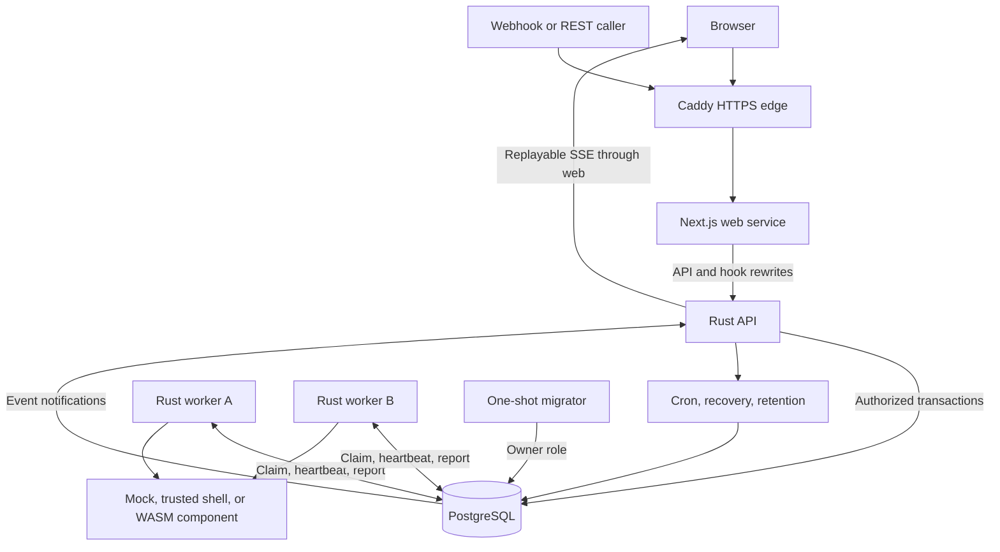
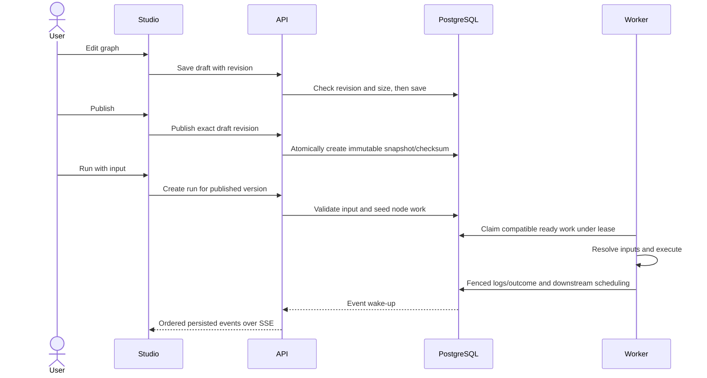

# Architecture

Corqty separates graph authoring from durable execution. PostgreSQL stores
identity, catalog data, workflow snapshots, queued work, attempts, events,
encrypted secrets, plugin binaries, and automation state. There is no separate
message broker or in-memory queue whose loss discards committed runs.

## Service topology

Local Compose exposes loopback ports for web, API, and PostgreSQL. The production
override publishes only Caddy's ports 80/443. Workers have no HTTP service or
published port; they poll the database and execute compatible jobs. See
[Docker layout](../docker/README.md) and [operations](operations.md).

| Process | Main responsibility | Durable state and privileges |
|---|---|---|
| Web | Authentication screens, management views, graph studio, live run UI; same-origin API/hook proxy | Browser state only; no database or master key |
| API | Authentication, authorization, validation, publishing, run submission, SSE, and background loops | Restricted API database role and encryption master key |
| Worker | Compatible work claiming, input resolution, executors, heartbeats, logs, and outcomes | Restricted worker database role, master key, temporary attempt storage |
| Migrator | Apply ordered, checksummed forward SQL migrations | Separate owner role; exits after completion |
| PostgreSQL | Tenant data, transactional scheduler, fencing, events, rate counters, and trigger locks | Named persistent volume in application Compose |
| Caddy | Public HTTPS termination and forwarding | Certificate/configuration volumes in production Compose |

## Repository boundaries

| Area | Responsibility |
|---|---|
| [`crates/domain`](../crates/domain/src) | Account/RBAC rules, graph schemas, diagnostics, catalog/publish validation, runtime limits, secret crypto/redaction |
| [`crates/persistence`](../crates/persistence/src) | SQL access, scoped transactions, stores, worker function calls, and migration entry point |
| [`crates/api`](../crates/api/src) | HTTP transport, cookies/CSRF, request authorization, response models, automation, and event streaming |
| [`crates/worker`](../crates/worker/src) | Worker lifecycle, leases, input/output checks, executor orchestration, cancellation, and log persistence |
| [`crates/plugin-sdk`](../crates/plugin-sdk) | Rust executor contract and versioned WIT component interface |
| [`crates/plugin-host`](../crates/plugin-host/src) | Built-in registry, component validation/compilation, capability host, and runtime budgets |
| [`crates/executor-mock`](../crates/executor-mock/src) | Deterministic example/test executor |
| [`crates/executor-shell`](../crates/executor-shell/src) | Explicitly trusted shell execution and subprocess handling |
| [`crates/migrator`](../crates/migrator/src) | Standalone migration binary |
| [`crates/test-support`](../crates/test-support/src) | Disposable database reset, role-specific pools, and catalog reseeding |
| [`apps/web`](../apps/web) | Next.js application, client contracts, studio, and frontend tests |
| [`migrations`](../migrations) | Schema, grants/RLS, database functions, constraints, and system catalog seeds |
| [`plugins`](../plugins) | Versioned example plugin source, manifest, and precompiled component |
| [`scripts`](../scripts) | Credential initialization, live smoke suites, and dependency audit guard |
| [`docker`](../docker) | Dockerfiles, production/test overrides, PostgreSQL bootstrap, and HTTPS edge |

The domain crate expresses rules without HTTP or SQL. Persistence owns database
interactions; API handlers translate domain/persistence results into the public
contract. Executors use the SDK rather than modifying run tables directly.

## From draft to execution

Manual sessions, scoped REST tokens, cron, and signed webhooks share run creation
and input validation. Triggers pin a published version. Worker retries retain a
stable execution identity so side-effecting executors can implement their own
deduplication. See [workflows](workflows.md), [execution](execution.md), and
[automation](automation.md).

## Consistency and isolation

- Organization requests establish transaction-local user/organization context
  and apply role capabilities. PostgreSQL RLS and constraints are a second layer.
- Published graphs and plugin versions are immutable; execution consumes pinned
  snapshots rather than a mutable studio draft.
- Claims, lease checks, node completion, dependency release, and event recording
  are coordinated in database transactions. A stale worker cannot report a
  successful completion after losing its lease.
- SSE notifications are wake-ups, not the event store. Reconnection replays
  persisted sequence numbers; periodic reads recover missed notifications.
- Cron leadership, occurrence deduplication, rate buckets, and retention locks
  live in PostgreSQL, so multiple API replicas do not depend on local mutexes.

See [data model](data-model.md) for tables and constraints and [security](security.md)
for the boundaries these mechanisms do and do not protect.

## Process lifecycle and capacity

Compose waits for PostgreSQL health, runs migrations, starts API/workers, and
then starts the web service. The API maintains a pool of up to 20 connections
plus its dedicated event listener. A worker pool allows capacity plus one
connection. Account for every replica when sizing database connections.

The API handles shutdown by ending streams and joining background loops.
Workers stop claiming, allow up to 25 seconds to drain, and allow canceled
executors up to five seconds to stop. Unreported attempts recover through lease
expiry; external side effects can occur more than once.

The provided deployment is a single-host Compose baseline. Scaling workers is
supported; it does not supply a managed database, automated failover, billing,
backups, or a customer SLA. Those require an operator's infrastructure and
processes, described in [operations](operations.md).

## Change map

| Change | Review together |
|---|---|
| New workflow field or validation rule | Domain types, API models, persisted graph/version format, web types/forms, fixtures, workflows/API docs |
| New executor capability | SDK/WIT, host permission enforcement, exact approval manifest, worker behavior, plugin/security docs |
| New tenant table | Migration constraints/RLS/grants, scoped persistence calls, tenant-isolation tests, data-model docs |
| New run source | Shared run validation, actor/idempotency model, audit records, automation/API docs |
| New environment setting | Parser, startup validation, Compose forwarding, `.env.example`, configuration/operations docs |
| New user screen | Route/auth role gating, API query keys, accessibility, tests, user guide and visual brief |
