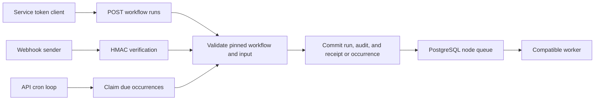
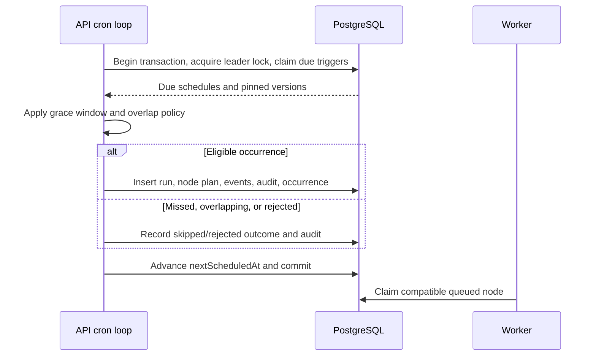
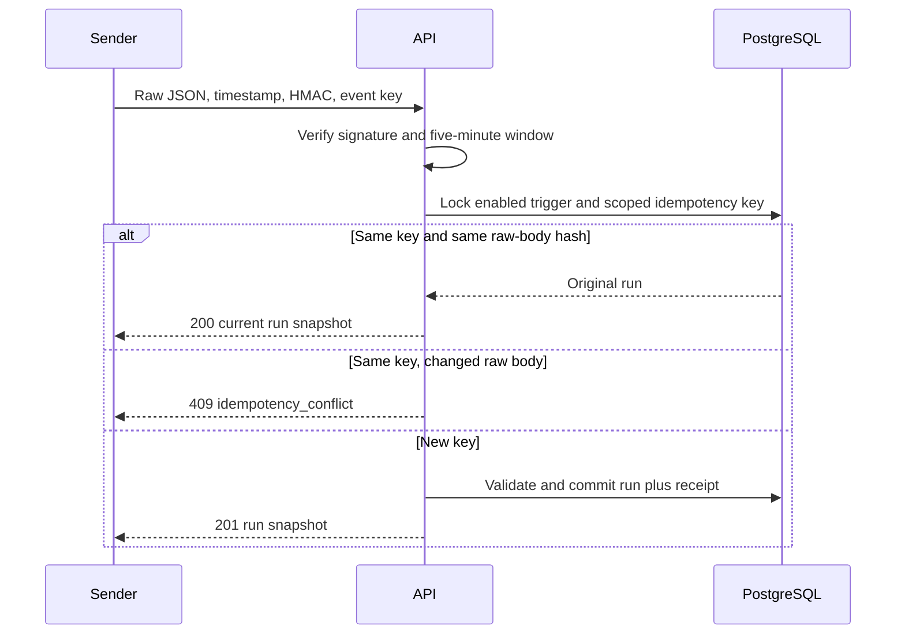

# Automation: service tokens, cron, and signed webhooks

All organization routes use `/api/v1/orgs/{organizationId}`. Browser sessions need
the CSRF cookie/header on mutations. Admins manage service tokens; admins and
editors manage triggers. Members can read trigger metadata. Secret values and
webhook signing secrets never appear in later reads.

See [API conventions and RBAC](api.md), [workflow input schemas](workflows.md),
[configuration](configuration.md), and [operations](operations.md). The durable
receipts, occurrence records, and locks are described in [the data model](data-model.md).



## Service tokens and REST runs

Create a token with `POST /service-tokens {"name":"Deploy client"}`. Copy the
`token` field from the creation response once; only its SHA-256 hash is stored.
Tokens have exactly the `workflow:run` scope. They authorize only
`POST /workflows/{workflowId}/runs`, using `Authorization: Bearer <token>`;
they cannot read resources, change workflows, or administer the organization.
`DELETE /service-tokens/{tokenId}` revokes a token immediately.
The token can start any published workflow in its organization; tokens are not
restricted to a single workflow. They currently have no expiry setting. Token
revocation prevents future authenticated requests; already-created runs continue.

`GET /service-tokens` returns `{"items":[...]}`. Each item contains `id`, `name`,
`scope`, `createdAt`, and nullable `revokedAt`. Creation returns those same fields
and the one-time `token`. Names are trimmed and must contain 1–100 characters.

```sh
curl "$CORQTY_URL/api/v1/orgs/$ORG/workflows/$WORKFLOW/runs" \
  -H "Authorization: Bearer $CORQTY_TOKEN" \
  -H 'Content-Type: application/json' \
  -H 'Idempotency-Key: release-2026-11-04' \
  --data '{"version":1,"input":{"region":"eu-west-1"}}'
```

`version` pins an exact published version; omission selects the current published
version for a new request. An idempotency key is optional for this endpoint and
strongly recommended for retries. The first request returns 201, an identical
retry returns 200 with the original run, and a changed request returns 409
`idempotency_conflict`. Keys are isolated by organization, route, actor, and key
for 24 hours. Keys contain 1–200 printable ASCII characters without spaces.
Browser starts can use the same header. Scope includes the authenticated user
or token identity, so switching credentials does not deduplicate a previous
actor's request. A replay returns the original run's current state, which may
have advanced since creation. It does not rerun validation or choose a newly
published version. REST hashes the parsed/serialized `{input,version}` request;
webhooks instead hash exact body bytes. After expiry, a reused key can create a
new run. Cancellation and rerun endpoints do not support this deduplication.

`triggerSource` in the returned run is `api` for service-token starts and `manual`
for browser starts/reruns. Starting a run does not grant a token read access to
the returned run's later status or event stream; a member session is required.

## Trigger records and updates

`GET /triggers` returns all organization triggers as `{"items":[...]}`, without
pagination. The request fields for both `POST /triggers` and
`PUT /triggers/{triggerId}` are:

| Field | Meaning |
|---|---|
| `name` | Required; trimmed string of 1–100 characters |
| `workflowId` | Required workflow UUID in this organization |
| `version` | Required positive published version number |
| `kind` | Required `cron` or `webhook`; cannot change on update |
| `input` | Object, defaults to `{}`; used for cron execution |
| `enabled` | Boolean, defaults to `true` |
| `cron`, `timezone` | Required strings for cron; omit or use null for webhooks |
| `overlapPolicy` | `skip` (default) or `allow`; enforced for cron dispatch |

Both kinds validate the stored `input` against the pinned version's input schema
when created or updated, even though a webhook's incoming body supplies its actual
execution input. For a webhook workflow with required fields, provide a valid
stored input object as well as valid incoming requests.

The response contains `id`, `name`, `workflowId`, `version`, `kind`, `input`,
`enabled`, nullable `cron`/`timezone`/`nextScheduledAt`, `overlapPolicy`, `createdAt`,
and `updatedAt`. Creation returns `201`; updates return `200`; deletion returns
`204`. Only webhook creation adds `webhookPath` and `webhookSecret`.

Updates replace the settings rather than patching them. Omitted optional fields
take their defaults; send the full intended settings to avoid enabling a trigger
or clearing its input unintentionally. Cron updates calculate the next occurrence
from the update time. Updating a webhook preserves its signing secret. No
individual-trigger GET or webhook-secret rotation endpoint exists. Deleting a
trigger leaves its existing runs intact.

## Cron triggers

```json
{
  "name": "Hourly import",
  "workflowId": "<workflow UUID>",
  "version": 1,
  "kind": "cron",
  "cron": "0 * * * *",
  "timezone": "Asia/Bangkok",
  "input": {},
  "enabled": true,
  "overlapPolicy": "skip"
}
```

Send this to `POST /triggers`. `PUT /triggers/{triggerId}` replaces the settings;
`DELETE` removes the trigger. A trigger always pins its explicit published
version. Publishing a new version never retargets a trigger. The kind cannot
change; create a new trigger when switching cron and webhook.

Cron uses five fields (minute, hour, day of month, month, day of week), an IANA
timezone, numeric or named weekdays, and Sunday 0 or 7. When both day fields
are restricted without a leading wildcard, either field can match. A wildcard
step such as `*/1` retains the other day's restriction, matching traditional
[cron day-field semantics](https://github.com/cronie-crond/cronie/blob/master/src/cron.c).
Nonexistent local times during a DST
spring transition are skipped; both UTC instants of a repeated local time during
fall-back are scheduled.
The dispatcher checks every 15 seconds and
elects one leader in PostgreSQL. Each pass claims at most 100 due triggers and
each scheduled UTC occurrence is unique. Dispatch is best-effort shortly after
the scheduled time, not a hard real-time deadline. Running multiple API replicas
does not intentionally create duplicate scheduled occurrences.



`skip` is the default overlap policy: an unfinished run from that trigger skips
the next occurrence and records an audit event. `allow` permits overlap. A
five-minute grace window catches recent missed occurrences. Older misses are
skipped and summarized in an audit event with the skipped time range. Dispatch
failures such as a disabled executor are audited and do not spin indefinitely.
Their audit actions are `trigger.overlap_skipped`, `trigger.misfire_skipped`, and
`trigger.dispatch_rejected`. Read them through `GET /audit-events`; there is no
public occurrence-history endpoint. The old missed range is summarized rather
than expanded into an unbounded number of rows. A rejected occurrence advances
the schedule; it is not a persistent retry job.

An API outage pauses cron dispatch and worker lease recovery. On restart, the
five-minute window governs catch-up. The overlap check is scoped to this trigger,
not every run of the same workflow. Webhook requests do not apply this overlap
policy; distinct event identifiers can create concurrent runs.

## Signed webhooks

Create a trigger with `kind: "webhook"`, no `cron` or `timezone`, and the desired
workflow/version. Creation returns `webhookPath` and `webhookSecret` once.
Store the secret at the sender. Corqty stores it encrypted with the master key.
To rotate it, create a replacement webhook, switch the sender, and delete the
old trigger. The request's raw JSON object is the workflow input; it is not
merged with the trigger's stored input (that input is used for cron).

For example, this creates a webhook for a workflow whose input accepts `{}`:

```json
{
  "name":"Deployment events",
  "workflowId":"22222222-2222-4222-8222-222222222222",
  "version":1,
  "kind":"webhook",
  "input":{},
  "enabled":true
}
```

The webhook endpoint is `/hooks/v1/{triggerId}` outside the browser session API.
Send:

- `X-Corqty-Timestamp`: current Unix time in whole seconds.
- `X-Corqty-Signature`: hex HMAC-SHA256 over `timestamp + "." + rawBody`, using
  the UTF-8 bytes of the signing secret as the key. An optional `sha256=` prefix
  is accepted. Sign the exact bytes sent, including whitespace.
- `Idempotency-Key`: a unique event identifier, required and retained 24 hours.
- A JSON workflow-input object of at most 1 MiB.

Timestamps more than five minutes in the past or future are rejected. Signature
comparison is constant-time. Invalid signatures return 401, missing/disabled
hooks return 404, changed reuse of an event identifier returns 409. Every source
uses the same workflow-input schema validation. Never put a signing secret in a
URL or query string.



This Python 3 example uses the exact same body bytes for signing and sending.
Set `CORQTY_URL`, `CORQTY_WEBHOOK_PATH`, and `CORQTY_WEBHOOK_SECRET` in the sender's
environment. Set `CORQTY_EVENT_ID` to a stable upstream event ID and preserve it
when retrying that event. Replace the input object to match the pinned schema:

```python
import hashlib
import hmac
import json
import os
import time
import urllib.request

body = json.dumps({"region": "eu-west-1"}, separators=(",", ":")).encode("utf-8")
timestamp = str(int(time.time()))
signature = hmac.new(
    os.environ["CORQTY_WEBHOOK_SECRET"].encode("utf-8"),
    timestamp.encode("ascii") + b"." + body,
    hashlib.sha256,
).hexdigest()
request = urllib.request.Request(
    os.environ["CORQTY_URL"].rstrip("/") + os.environ["CORQTY_WEBHOOK_PATH"],
    data=body,
    method="POST",
    headers={
        "Content-Type": "application/json",
        "X-Corqty-Timestamp": timestamp,
        "X-Corqty-Signature": signature,
        "Idempotency-Key": os.environ["CORQTY_EVENT_ID"],
    },
)
with urllib.request.urlopen(request, timeout=30) as response:
    run = json.load(response)
    print(response.status, run["id"], run["status"])
```

Retries after the signature window need a fresh timestamp/signature while
preserving the event ID and original body bytes. Whitespace changes in the body
produce an idempotency conflict even when the JSON values are equivalent. Missing
keys return `400 idempotency_key_required`; invalid key characters or length
return `400 invalid_idempotency_key`. Input/schema failures do not create a run
or consume the event ID. The application verifies JSON directly from raw bytes;
send `application/json` even though this endpoint does not use the JSON extractor.

Retries protect run creation, not arbitrary external side effects inside nodes.
Worker attempts can retry after a failure or expired lease; downstream systems
should use their own operation keys where duplicate side effects matter.

## Limits, retention, and operations

Run events and logs expire after 30 days, including old events of a live run.
Completed runs and their node inputs,
outputs, and summaries expire after 90 days. Retention runs hourly under a
database advisory lock. It preserves workflow/plugin versions and all audit
events. A live run is never removed by retention. Occurrence records have no
age-based cleanup; their run reference becomes null when a run expires. Retention
periods are fixed in SQL for this release. See [data retention](data-model.md#retention-and-migrations).

API replicas share fixed-window rate counters in PostgreSQL. Defaults are 30
authentication attempts per minute per socket peer, 30 invitation attempts,
300 external requests per peer, and 120 valid token/webhook requests per actor.
Adjust `CORQTY_AUTH_RATE_PER_MINUTE`, `CORQTY_TOKEN_RATE_PER_MINUTE`, and
`CORQTY_WEBHOOK_RATE_PER_MINUTE` within their documented limits. The API does not
trust caller-supplied forwarding headers; reverse proxies should enforce their
own per-client limits as well.

| Variable | Default per minute | Allowed range |
|---|---:|---:|
| `CORQTY_AUTH_RATE_PER_MINUTE` | 30 | 1–1,000 |
| `CORQTY_TOKEN_RATE_PER_MINUTE` | 120 | 1–10,000 |
| `CORQTY_WEBHOOK_RATE_PER_MINUTE` | 120 | 1–10,000 |

These three rate settings use a fallback/clamping parser: malformed values use
the default, and parsed out-of-range values clamp to the bounds. Invitation and
external peer limits are fixed at 30 and 300 respectively. The valid-actor limit
is additional to the external peer limit. With the supplied web proxy, many
clients can share the same API socket peer and therefore the same peer bucket.
Limits are fixed windows measured from a bucket's first request, not a sliding
per-second allowance. Denials return `429 rate_limited` without `Retry-After`.

API and workers validate the following workload limits at startup and reject
malformed, zero, or excessive values. Existing
hard ceilings cannot be raised in this release; lower values are supported:

| Variable | Default and hard ceiling |
|---|---:|
| `CORQTY_MAX_NODES` | 500 |
| `CORQTY_MAX_EDGES` | 1,000 |
| `CORQTY_MAX_RUN_INPUT_BYTES` | 1,048,576 |
| `CORQTY_MAX_NODE_INPUT_BYTES` | 1,048,576 |
| `CORQTY_MAX_NODE_OUTPUT_BYTES` | 1,048,576 |
| `CORQTY_MAX_WEBHOOK_BYTES` | 1,048,576 |
| `CORQTY_MAX_LOG_BYTES` | 10,485,760 |
| `CORQTY_MAX_COMPONENT_BYTES` | 26,214,400 |
| `CORQTY_MAX_WASM_MEMORY_BYTES` | 268,435,456 |
| `CORQTY_MAX_TIMEOUT_SECONDS` | 14,400 |

`CORQTY_DEFAULT_TIMEOUT_SECONDS` defaults to 900, or a lower configured maximum.
Omitted timeout fields use that value. Node log and timeout ceilings are captured
when a run is created. Input/output limits are enforced by workers. Keep API and
worker settings aligned. The database truncates logs at a UTF-8 boundary and
emits exactly one truncation event.

Run `./scripts/smoke-automation.ps1` against a disposable local stack to exercise
token creation/revocation, REST deduplication, signed webhook deduplication,
secret metadata, and real cron dispatch (up to 75 seconds).
Its `-ApiBase` default is `http://localhost:8080/api/v1`, and `-WebBase` defaults to
`http://localhost:3000`; signed requests go through the web proxy to exercise
preservation of raw bytes and signature headers.

Implementation references: [automation handlers and dispatcher](../crates/api/src/automation.rs),
[cron parsing and DST handling](../crates/api/src/schedule.rs),
[run creation](../crates/api/src/runs.rs),
[background loops](../crates/api/src/loops.rs),
[automation persistence](../crates/persistence/src/automation.rs),
[schema](../migrations/202611040003_automation.sql), and
[end-to-end smoke](../scripts/smoke-automation.ps1).
