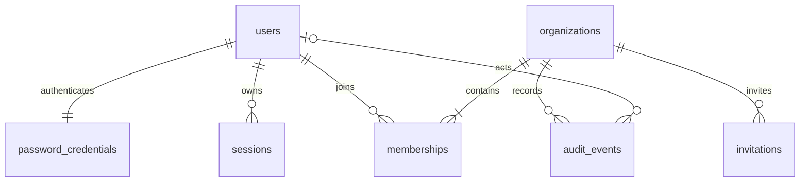
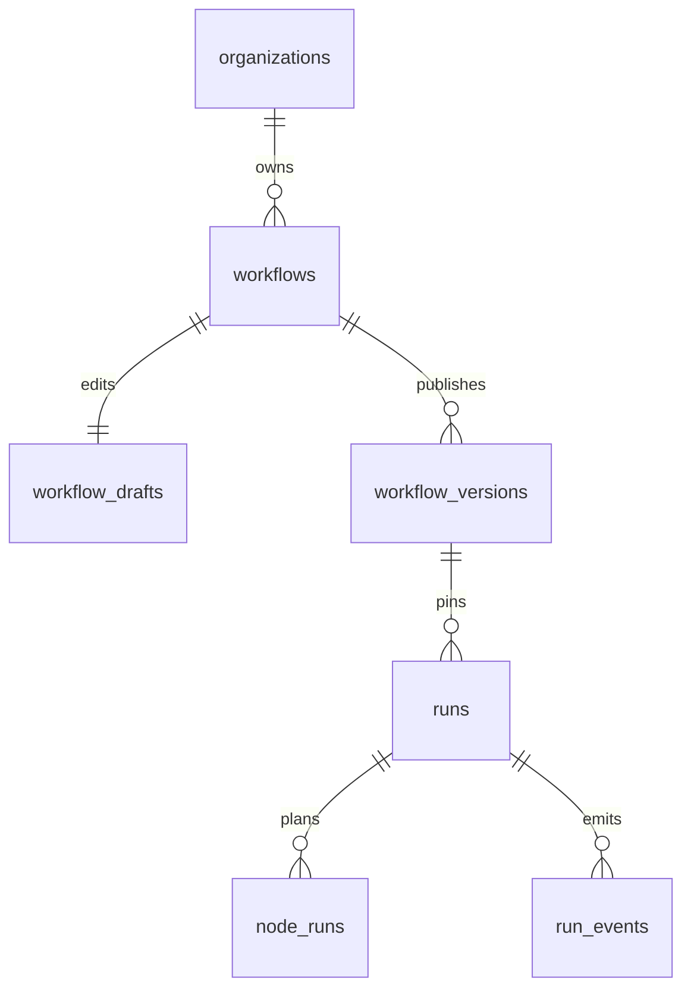
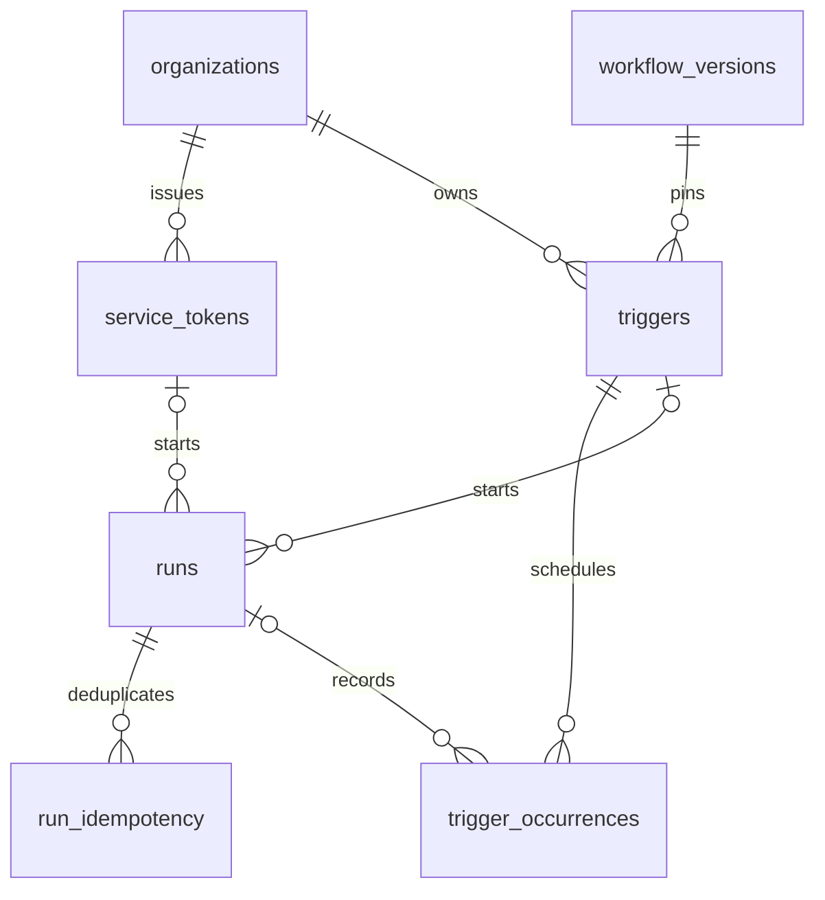

# Data model and persistence invariants

PostgreSQL is the durable source for identity, tenant resources, workflow versions,
the execution queue, event replay, automation receipts, and audit history. There
is no separate queue broker. The SQL migrations in [migrations](../migrations/)
define the schema; Rust persistence functions in
[crates/persistence](../crates/persistence/src/) execute tenant transactions.
The current schema uses PostgreSQL 18 features, including database-generated
UUIDv7 identifiers for many resource tables.

## Identity and organization membership

The diagram shows intended application relationships. The final-admin invariant
is enforced by a deferred database constraint trigger, not merely the diagram's
cardinality.

| Table | Identity / important columns | Purpose and constraints |
|---|---|---|
| `users` | UUID `id`; normalized, unique `email`; `created_at` | Global user identity; email is lowercased and trimmed |
| `password_credentials` | `user_id` primary/foreign key; `password_hash`, `updated_at` | One password credential per registered user; salted Argon2 hash |
| `sessions` | UUID `id`; `user_id`, unique `token_hash`, `csrf_hash`, expiry and last-seen timestamps | Stores hashes, never plaintext session/CSRF tokens; user deletion cascades |
| `organizations` | UUID `id`; name, unique slug, creator, timestamps; `shell_enabled` | Tenant identity; shell gate defaults off |
| `memberships` | Primary key `(organization_id,user_id)`; `role` | Role constrained to admin/editor/runner/viewer |
| `invitations` | UUID `id`; org/email/role, unique token hash, inviter, expiry, acceptance time | One-time, email-bound invitation; plaintext token returned only at creation |
| `audit_events` | Identity bigint `id`; org, nullable actor, action/resource/metadata/time | Tenant audit history; indexed by `(organization_id,id DESC)` |

Registration inserts the user, credential, first organization, admin membership,
session, and audit records transactionally. New organization creation similarly
creates an admin membership in the same transaction. A deferred membership
constraint locks the organization and rejects a commit that would leave an
existing organization without an admin. This also protects concurrent demotions
or removals. Invitation acceptance locks the invitation, verifies its expiry,
unused state, and the current user's email, then upserts membership, marks the
invitation accepted, and audits the change together.

Account-scoped operations use a transaction-local user identity; a narrow
`organizations_for_current_user()` function lists memberships across tenants.
User security events can be copied to the user's organization audit histories by
`audit_current_user_memberships()`. Auth tables are global and do not use tenant
RLS. The API role needs direct access to them to implement login and session
management. A user's identity must therefore always come from authenticated
application logic, never an arbitrary client-provided SQL setting.

Sources: [base tables](../migrations/202607280001_base.sql),
[invitations/admin guard](../migrations/202607280004_invitations.sql),
[auth persistence](../crates/persistence/src/auth.rs).

## Catalog, drafts, and immutable versions

| Table | Identity / important columns | Purpose and constraints |
|---|---|---|
| `node_definitions` | UUID `id`; scope, nullable org, key, integer version, metadata, JSONB `spec`, `deprecated_at` | Unique `(organization_id,key,version)` including null orgs; only system keys begin `corqty.` |
| `blueprints` | UUID `id`; scope, nullable org, key/version, metadata, JSONB `graph` | Versioned reusable graph; same scope/key uniqueness rules |
| `workflows` | UUID `id`; org, name/slug, nullable `published_version`, creator/timestamps | Unique org/slug and org/id; current publication references `(workflow_id,version)` |
| `workflow_drafts` | `workflow_id` primary key; org, JSONB graph, bigint revision, updater/time | One replaceable draft per workflow; revision starts at 1 |
| `workflow_versions` | UUID `id`; org/workflow, integer version, graph, checksum, draft revision, publisher/time | Unique `(workflow_id,version)` and `(workflow_id,draft_revision)` |

Scope constraints require `organization_id IS NULL` exactly for system catalog
records. Tenant catalog entries use `scope='organization'` and cannot use the
reserved system prefix. Definitions include JSON Schema ports/configuration,
form metadata, defaults, and an executor identity. Graphs store definition
references, node configuration and input bindings, typed edges, retries,
timeouts, and viewport state. These references are JSON rather than relational
foreign keys; graph validation checks them before publication and run creation.

The API role has insert/select privileges for definitions, blueprints, and
published versions, plus only `deprecated_at` updates for definitions. It has
no delete privilege on these tables. There is no general immutability trigger
protecting them from a privileged owner; operators must preserve published data
when writing migrations or repair scripts.

Draft saves compare the supplied revision and increment it atomically. Publishing
locks workflow/draft rows, checks the revision and validation diagnostics,
inserts the next immutable version, updates the publication pointer, and writes
the audit record in one transaction. The canonical SHA-256 checksum includes
viewport data. A run pins a published-version row; later draft edits or publishes
do not change its graph. Definition and plugin version records remain available
for that pinned graph.

Source: [catalog/workflow migration](../migrations/202610250001_workflow_catalog.sql),
[workflow persistence](../crates/persistence/src/workflows.rs),
[workflow format](workflows.md).

## Durable execution and events

| Table | Identity / important columns | Purpose and constraints |
|---|---|---|
| `runs` | UUID `id`; org/workflow/version, input, status, source/actor IDs, cancellation, timestamps, `last_event_seq`, `rerun_of` | One execution of a pinned version; rerun reference becomes null if source is retained away |
| `node_runs` | UUID `id`; unique `(run_id,node_id)`; executor, state, attempts, timeout, parent count/children, availability, lease, input/output/error, log counters/limit | Queue row and durable result for each graph node |
| `run_events` | Primary key `(run_id,seq)`; org, JSONB payload, creation time | Ordered replay stream, including logs; cascades with run deletion |
| `worker_instances` | Worker UUID; executor identities, host contracts, capacity, heartbeat | Global worker compatibility/capacity metadata; workers serve multiple organizations |

Composite `(organization_id, resource_id)` foreign keys prevent a run from
referencing another tenant's workflow/version and prevent nodes/events from
referencing another tenant's run. The run source is constrained to `manual`,
`api`, `cron`, or `webhook`. Run states are queued/running/succeeded/failed/canceled;
node states also include blocked/retry_wait/skipped. Attempt ceilings are 1–5 and
stored timeouts 1–14,400 seconds, with deployment settings allowed to lower them.

Run creation inserts the run, the entire node plan, initial events, and audit in
one transaction. Root nodes start queued; dependent nodes start blocked with the
number of distinct parents and a list of children. An empty graph settles
immediately. Successful parents decrement dependency counters and release ready
children. Terminal failures skip blocked descendants while independent branches
can finish. Run aggregation gives failure precedence over cancellation, then
success.

Workers call narrowly granted SQL functions to register, claim, start, heartbeat,
append logs, and complete work. Claiming uses row locks with `SKIP LOCKED` and
increments a lease token. Completion and log writes require the current worker,
node, and fence token; stale attempts cannot overwrite a reassigned job. Run
rows are locked before node rows to coordinate cancellation and completion.
The API recovery loop runs every five seconds and elects a leader with a database
advisory lock to recover expired leases. See [execution](execution.md) for retry,
lease, cancellation, and delivery semantics.

Each event append increments `runs.last_event_seq` while holding the run row lock,
then inserts that sequence in both the event key and JSON payload. Within normal
retained history, concurrent writers cannot reorder or duplicate sequences.
Event inserts notify `corqty_run_events` with only the run UUID. Notification
delivery is a wakeup mechanism, not durable event storage; SSE readers query the
table after their cursor and periodically recheck it. Retention can remove older
sequences without resetting `last_event_seq`.

Log text lives in `run_events`, not a separate log table. `node_runs` stores byte
counters, a truncation flag, and the limit captured at creation. The append
function truncates at a valid UTF-8 boundary and emits one truncation event.

Sources: [run tables](../migrations/202610260001_runs.sql),
[worker functions](../migrations/202610260002_worker_functions.sql),
[lease recovery](../migrations/202610260004_lease_recovery.sql),
[live result events](../migrations/202610270001_live_event_details.sql),
[stored log limits](../migrations/202611040004_limits.sql).

## Secrets and runtime plugins

| Table | Identity / important columns | Purpose and constraints |
|---|---|---|
| `secrets` | UUID `id`; org/name, ciphertext, 12-byte nonce, positive key version, timestamps | Unique `(organization_id,name)`; API can select metadata columns only |
| `plugin_versions` | UUID `id`; org/key/string version, host contract, manifest, SHA-256 checksum, component bytes, enabled flag, installer/time | Unique `(organization_id,key,version)`; component hard limit 25 MiB |
| `plugin_approvals` | `plugin_id` primary key; org/checksum/manifest/capabilities, approver/time | Composite foreign key binds approval to the exact org/plugin/checksum |

Secret values use authenticated encryption with per-organization key derivation;
organization and secret ID are bound to the ciphertext. The master key is supplied
to API/workers outside PostgreSQL. Updating a secret preserves its ID and generates
a new nonce. Stored key-version metadata does not provide an automatic key-rotation
workflow. A restore requires the matching master key as well as the database.
See [secrets](secrets.md) and [operations](operations.md).

Draft/version writes, reference validation, and secret deletion use the same
organization advisory lock. A delete guard rejects a secret referenced anywhere
in a saved workflow draft or published version. It does not scan standalone
blueprints or node-definition defaults; those resources still undergo reference
validation when used for publication/execution. Published references are retained,
so they can continue to block deletion after all corresponding runs expire.

The worker-only `bound_secrets()` function requires a valid lease and returns
encrypted values referenced by that node, with a `secret.used` audit record.
The API database role has no `SELECT` grant on secret ciphertext/nonce/key-version
columns. It may write encrypted values and select metadata. Higher-level API
permissions further restrict metadata listing to editors/admins.

Plugin installation stores the supplied component and verified manifest. API
privileges make component identity/content immutable; only `enabled` can change.
Approval records bind the exact checksum, manifest, and capability list. Plugins
with no elevated capabilities need no explicit elevated approval. Publication and
new run validation share an organization catalog lock with enable/disable changes.
Disabled versions remain executable for already-created runs. Workers load the
version for the current node through a fenced helper; compatible host contracts,
not a process-local list of installed plugins, determine claimability.

Sources: [secrets migration](../migrations/202611040001_secrets.sql),
[plugin migration](../migrations/202611040002_plugins.sql),
[secret persistence](../crates/persistence/src/secrets.rs), [plugins](plugins.md).

## Automation and idempotency

| Table | Identity / important columns | Purpose and constraints |
|---|---|---|
| `service_tokens` | UUID `id`; org/name, unique 32-byte token hash, scope, creator/time, revocation | Scope constrained to `workflow:run`; revoke is a soft update |
| `triggers` | UUID `id`; org/workflow/version, kind/input/enabled, schedule/zone/overlap/next time or encrypted webhook secret | Kind constrained to cron/webhook with mutually exclusive schedule/signing fields |
| `trigger_occurrences` | Primary key `(trigger_id,scheduled_for)`; org, nullable run, outcome | Unique scheduled UTC occurrence; started/overlap_skipped/misfire_skipped/rejected |
| `run_idempotency` | Primary key `(organization_id,route,actor,key)`; request hash, run, expiry | Durable REST/webhook receipt, default 24-hour lifetime |
| `rate_limits` | Hashed bucket key primary key; window start/attempt count | Shared fixed-window rate counters; accessed through a constrained definer helper |

REST and webhook request keys acquire a transaction-scoped advisory lock even
before a receipt exists. The transaction checks the request hash and atomically
creates the run, audit, and receipt. An identical retry returns the current
snapshot of the original run; it does not save and replay a frozen HTTP response.
A changed request with the same unexpired key conflicts. REST hashes the parsed,
serialized start-run request; webhooks hash the raw body bytes. The identity tuple
isolates different organizations, routes, users, tokens, and triggers.

Cron dispatch uses a transaction advisory leader lock and claims at most 100 due
trigger rows per pass. The run, occurrence outcome, next timestamp, and audit
commit together. A crash rolls the pass back for another API instance to retry.
A savepoint isolates a rejected run creation so it can record the rejection and
advance. Old missed ranges receive a summary audit and one representative
`misfire_skipped` occurrence rather than an unbounded row for every historic tick.
Webhook dispatch locks the trigger and rechecks its current enabled settings
before creating a run. Trigger deletion cascades occurrences and sets historic
`runs.trigger_id` to null; the run source and audit history remain.

Source: [automation schema/functions](../migrations/202611040003_automation.sql),
[receipt persistence](../crates/persistence/src/automation.rs),
[automation behavior](automation.md).

## Database roles and row-level security

| Role | Privileges and responsibility |
|---|---|
| Bootstrap PostgreSQL role | Creates database roles on first volume initialization; not used by application processes |
| `corqty_owner` | Database/migration owner; `NOSUPERUSER`, `BYPASSRLS`, no create-role/database rights; owns definer functions |
| `corqty_api` | `NOSUPERUSER`, `NOINHERIT`, `NOBYPASSRLS`; explicit table/column and function grants; tenant RLS applies |
| `corqty_worker` | Same unprivileged role flags; no application-table privileges; executes only granted worker functions |

Tenant resources enable and force RLS. Ordinary reads require the matching
transaction-local organization plus membership. Writes additionally require the
appropriate admin/editor/runner predicate. System catalog rows are a deliberate
read-policy exception; HTTP catalog routes still require organization membership.
Worker metadata and rate-counter tables are not directly readable through API
policies. Function grants provide the narrow compatibility/rate operations.

`begin_tenant()` begins a transaction and uses local settings `corqty.user_id` and
`corqty.organization_id`; commit or rollback clears them before a pooled
connection is reused. All work for that request must stay on the same transaction.
Automation clears user identity and sets either `corqty.service_token_id` or
`corqty.trigger_id`. RLS checks that this actor belongs to the tenant and remains
active. Automation actors receive internal read/run rights, while admin/editor
checks still require a real member. HTTP middleware restricts a bearer actor to
the single start-run route, independently of those internal database reads.

Security-definer helpers run with the owner role and a fixed `public, pg_temp`
search path. Their public execution grants are revoked and necessary roles are
granted functions individually. The owner bypass is intentional because helpers
read forced-RLS tables. These controls defend tenant boundaries in application
queries; they do not make compromised owner/API credentials safe. Keep each role
credential private and never expose database access to tenants.

Sources: [role initialization](../docker/postgres/init/001-roles.sh),
[initial RLS](../migrations/202607280002_rls.sql),
[tenant context](../crates/persistence/src/tenant.rs),
[catalog security tests](../crates/persistence/tests/catalog_guards.rs).

## Retention and migrations

Retention runs immediately when each API starts, then hourly. A database advisory
lock permits one cleaner at a time. These periods are fixed in the current SQL
function rather than configurable environment values:

| Data | Retention behavior |
|---|---|
| Run events and log text | Delete events older than 30 days, including old events of a still-live run |
| Completed runs | Delete succeeded/failed/canceled runs whose `finished_at` is older than 90 days |
| Node results | Cascade with their run; live runs are preserved |
| Idempotency receipts | Delete after 24 hours; lookup also removes an expired matching receipt |
| Rate counters | Delete windows older than one day |
| Trigger occurrences | No age-based cleanup; run reference becomes null when a run expires; deleting trigger cascades |
| Audit, workflow/catalog/plugin versions, worker metadata, revoked tokens | No automatic age-based cleanup |
| Expired sessions and invitations | Expiry blocks use; current retention does not purge these rows |

Runs deleted by retention are no longer retrievable through the API. Retention
does not securely erase backups or automatically shrink filesystem storage, and
it is not an organization/account deletion facility. Long-lived installations
should monitor audit, occurrence, catalog, and worker-row growth. See
[operations](operations.md) for backup/restore and maintenance.

SQLx tracks applied versions/checksums in `_sqlx_migrations`. The repository has
these ordered migration groups:

| Migration prefix | Changes |
|---|---|
| `202607280001`–`202607280005` | Identity, organization RLS, cross-org membership lookup, final-admin/invitation helpers, user audit |
| `202610250001` | Versioned catalog, drafts, published workflows, system seed function |
| `202610260001`–`202610260004` | Runs/queue/events, worker functions, shell gate/catalog, lease recovery |
| `202610270001` | Input/output/error details in completed node events |
| `202611040001` | Encrypted secrets, reference/deletion locks, fenced worker reads |
| `202611040002` | Runtime components, capability approvals, host-contract compatibility |
| `202611040003` | Service tokens, cron/webhooks, receipts, rate limits, retention |
| `202611040004` | Captured per-node log ceiling and bounded log append |

Migrations run with the owner connection through the migration command/Compose
one-shot service, not the API or worker credentials. Existing migration files
must not be edited after deployment: add a new forward migration, keep canonical
line endings/checksums, back up first, and test an upgrade against a restored
copy. Do not reset the schema or delete a PostgreSQL volume to resolve an upgrade
error. See [migration runner](../crates/persistence/src/migrate.rs),
[development](development.md), and [operations](operations.md).
