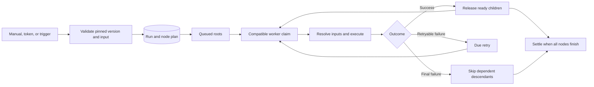
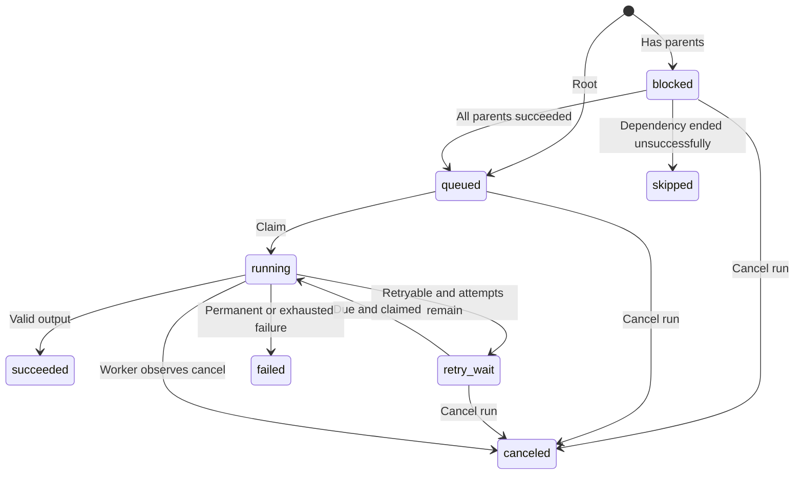
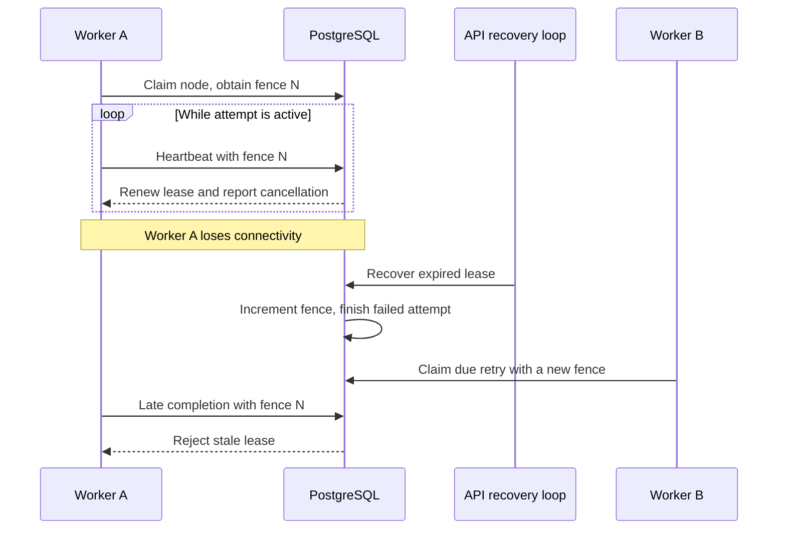

# Execution and recovery

Corqty executes a published workflow as a directed acyclic graph of node runs. PostgreSQL owns the queue, leases, state transitions, and ordered event history. Workers execute attempts; API replicas recover abandoned leases and dispatch scheduled triggers. There is no separate message broker.

For creating workflows, see [workflows](workflows.md). For HTTP request shapes and trigger delivery, see [API](api.md) and [automation](automation.md). Deployment settings belong in [configuration](configuration.md).

## From a published graph to a run

A manual or service-token request selects an explicit published version, or the workflow's latest published version when `version` is omitted. A trigger selects its pinned version. Run creation validates the workflow input, checks the exact runtime executors and their enabled/approved status, and checks whether shell execution is allowed. A draft is never executed directly.

One transaction creates the run, its node-run plan, and the initial `run.state` event. The run records the immutable workflow-version ID, input, and origin. Root nodes start `queued`; nodes with dependencies start `blocked`. An empty graph immediately settles successfully. Each node records its exact `key@version` executor, timeout, maximum attempts, distinct children, and count of unfinished parents.



Dependencies count distinct parent nodes, not edges. Two ports connected from the same parent do not require two completions. A child becomes eligible only after every parent succeeds. A final failure skips its blocked descendants; independent branches can continue. Graph validation rejects cycles before publication.

Sources: [run planning](../crates/domain/src/run.rs), [run API](../crates/api/src/runs.rs), [run persistence](../crates/persistence/src/runs.rs), [worker transition functions](../migrations/202610260002_worker_functions.sql).

## States

| Node state | Meaning |
| --- | --- |
| `blocked` | Waiting for successful parents. |
| `queued` | Eligible for a compatible worker. |
| `running` | Claimed under a worker lease; includes preparation and execution. |
| `retry_wait` | A failed attempt may run again after `available_at`. |
| `succeeded` | Accepted output is persisted. Terminal. |
| `failed` | No further attempt will run. Terminal. |
| `canceled` | Stopped by a run cancellation. Terminal. |
| `skipped` | A dependency could not succeed. Terminal. |



The domain also permits `retry_wait → queued`; the database claim path can claim a due retry directly as `running`.

Run statuses are `queued`, `running`, `succeeded`, `failed`, and `canceled`. A run remains nonterminal while any node can still change. Once all nodes are terminal, a failed node makes the run `failed`; otherwise a cancel request or canceled node makes it `canceled`; otherwise it is `succeeded`. An already failed node therefore keeps the aggregate result failed after a cancel request. Skipped nodes do not independently determine the result.

## Queue compatibility and leases

Every worker process registers a new worker ID, its compiled executor identities, supported runtime host contracts, and capacity. Compiled executors require an exact key and version match. Runtime components require a worker that supports their host contract. A worker claims only due jobs it can execute, using database row locking with `SKIP LOCKED` so concurrent claimers do not duplicate the same claim.

A claim increments both the attempt and the lease token and assigns the worker and expiry. The token is a monotonically increasing fence, not an authentication credential. Worker operations require the worker ID, node-run ID, and current token. The database rechecks the lease under locks before accepting work. A stale worker cannot commit logs or a result after its job has been recovered or reassigned.



The default worker runs four attempts concurrently, polls every 500 ms, leases work for 30 seconds, and renews every 10 seconds. The API recovery loop runs every five seconds. Database advisory locking elects one recovery pass across API replicas. Recovery records a retryable `lease_expired` failure without counting the already-claimed attempt twice, then applies the normal retry and settlement rules.

The run snapshot can report `waiting_for_compatible_worker` for a waiting node when no recently seen worker advertises its executor or host contract. This is a derived explanation, not another node state. A queued node is not automatically failed merely because the required worker is absent. Compatibility considers worker heartbeats within 60 seconds.

Sources: [worker configuration and supervision](../crates/worker/src/lib.rs), [queue interface](../crates/persistence/src/worker_queue.rs), [recovery SQL](../migrations/202610260004_lease_recovery.sql), [runtime claim support](../migrations/202611040002_plugins.sql).

## One attempt

The worker fetches the pinned graph, definition, and successful upstream outputs through the fenced job interface. It selects the exact compiled executor or retrieves and compiles the runtime component. Runtime preparation renews the lease and observes cancellation and the node deadline; compilation time is included in that attempt's timeout.

Input values come from an incoming edge, a literal binding, a JSON Pointer into workflow input, or a bound secret. Optional absent inputs are omitted; `null` is a value. Input schemas validate the resolved values without coercion. Secret input values are strings and must match the port schema. Runtime guests receive opaque secret references and obtain plaintext only through an approved host call. See [secrets](secrets.md).

Each attempt receives a private temporary scratch directory, a cancellation token, a bounded log channel, and an `ExecuteRequest`. `executionId` is the node-run UUID and remains stable across retries; `attempt` starts at one. Plugins should use `executionId` as an idempotency key when calling external systems. An explicit rerun creates new identities.

Successful output must be a JSON object using declared output-port names, obey the configured size limit, contain no U+0000, and match each supplied output's schema. The current output validator allows declared outputs to be absent; a downstream required input then fails if its value is missing. Output containing an exact bound secret fails before storage. The worker persists the outcome only while the lease still belongs to it, and removes the attempt directory after reporting.

Sources: [input and output validation](../crates/domain/src/runtime.rs), [executor contract](../crates/plugin-sdk/src/lib.rs), [attempt implementation](../crates/worker/src/lib.rs).

## Retries and external side effects

A node's `retry.maxAttempts` is between one and five, including its first attempt. A failed attempt retries only when the executor marks it retryable, the error is not in the permanent list, and attempts remain. Retry delay is approximately `2 × 2^(attempt − 1)` seconds with positive jitter of up to 20%, capped at 300 seconds.

These codes are always nonretryable, even if an executor says otherwise:

```text
input_missing       input_invalid          input_too_large
output_invalid      output_too_large       secret_unavailable
secret_output_detected                     executor_missing
permission_denied   capability_denied
```

A worker-enforced timeout uses the compiled executor's `timeout_retryable` classification. The shell executor allows timeout retries; mock and runtime-component timeouts do not. A runtime guest can return a typed retryable application error as described in [plugins](plugins.md).

Fencing makes database completion authoritative. It does not roll back an HTTP request, command, or other external effect performed before a crash. A recovered attempt can repeat that effect. Executors that write to external services must implement idempotency or tolerate duplicate calls. There is no distributed transaction or exactly-once external delivery guarantee.

## Cancel, shutdown, and rerun

`POST /api/v1/orgs/{org}/runs/{run}/cancel` requires run permission and no request body. It immediately cancels blocked, queued, and retry-wait nodes. Running workers observe the request on heartbeat, cancel their execution token, and give the executor up to five seconds to return before dropping its future. The run settles when active nodes finish. Canceling an already terminal run returns `409 run_finished`.

On process shutdown, a worker stops claiming and allows 25 seconds for active attempts to finish. After that drain period it stops remaining execution without reporting a terminal outcome. Expired-lease recovery handles those attempts. Unix shell and approved host-command execution use process groups for descendant cleanup; processes deliberately escaping the group are outside that guarantee. Command execution remains a trusted feature, as explained in [security](security.md).

`POST /api/v1/orgs/{org}/runs/{run}/rerun` creates a new run, reusing the source run's workflow input and published version unless another version is explicitly supplied. The selected version and input are validated again, and the new run records `rerunOf`. It reruns the whole graph; it does not resume only failed nodes or copy previous outputs. Current plugin enablement and secret values apply to the new work.

## Logs and live events

Workers collect `stdout`, `stderr`, and `system` chunks through a bounded channel. They flush at least every 500 ms or when the batch reaches 8 KiB. The database enforces the configured byte budget per node run across its attempts and emits one `node.log_truncated` marker when the cap is reached. The default cap is 10 MiB. Exact bound secrets are redacted before persistence, including values split across chunks in the same stream.

Every run event has a monotonically increasing per-run sequence. Event types include `run.state`, `node.state`, `node.log`, and `node.log_truncated`. State events carry the information needed to update the run view, including attempt and terminal input/output/error details where applicable.

`GET /api/v1/orgs/{org}/runs/{run}/events` is an authenticated Server-Sent Events stream:

| Behavior | Contract |
| --- | --- |
| Cursor | `Last-Event-ID` header, else `?after=`, else zero. |
| Frame | Unnamed event; `id` is sequence, `data` is the JSON event payload. |
| Replay | Reads events after the cursor in pages of 500. |
| Wake-up | One PostgreSQL notification listener per API process; each stream rereads its run. |
| Lost notification | Safety read every 30 seconds; listener reconnect also requests a resync. |
| Keepalive | Every 15 seconds; suggested reconnect delay is two seconds. |
| Lifetime | Ends after ten minutes, API shutdown, or the terminal run event. |
| Already complete | Returns HTTP 204 if a terminal run's cursor is caught up. |
| Capacity | 256 open streams per API process and eight per user; excess requests receive 429. |

Open streams hold no database connection between reads. Each read uses a short tenant transaction, so membership is still enforced by row-level security. Session validity is checked when the stream opens; an already-open stream may outlive logout until its ten-minute limit. The browser merges snapshots with sequenced events and ignores already applied events. Proxies must preserve streaming: the API sends `Cache-Control: no-cache, no-transform` and `X-Accel-Buffering: no`.

The hourly retention pass removes events after 30 days and terminal run records after 90 days. Event replay is therefore bounded history, not a permanent event archive. See [operations](operations.md) for retention and recovery procedures.

Sources: [SSE implementation](../crates/api/src/events.rs), [event payload migration](../migrations/202610270001_live_event_details.sql), [log-limit enforcement](../migrations/202611040004_limits.sql), [background loops](../crates/api/src/loops.rs).

## Verification

[Domain run tests](../crates/domain/tests/run_rules.rs), [queue integration tests](../crates/persistence/tests/worker_queue.rs), [worker execution tests](../crates/worker/tests/execution.rs), and [run HTTP tests](../crates/api/tests/runs_http.rs) exercise state aggregation, dependency release, retry/fencing behavior, cancellation, input/output validation, and persisted results. See [testing](testing.md) for the supported database setup and suite commands.
