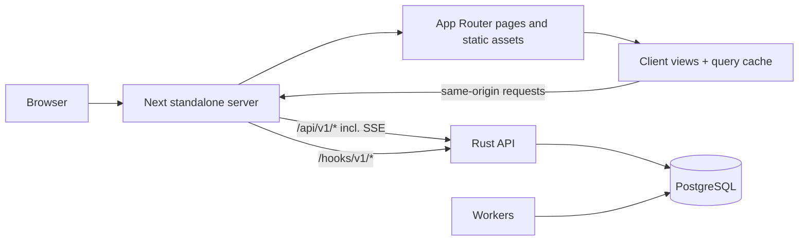
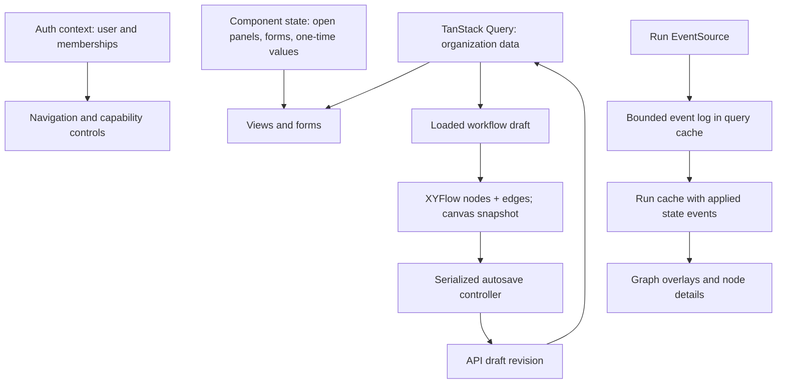
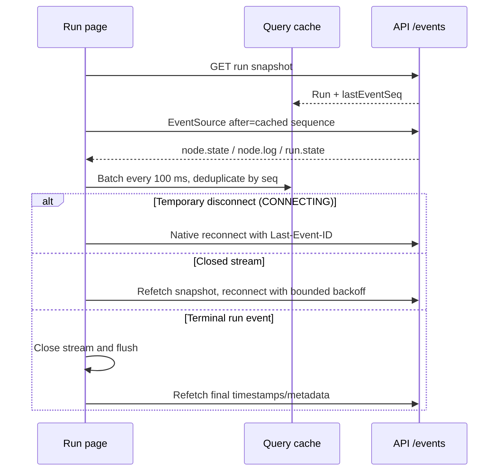
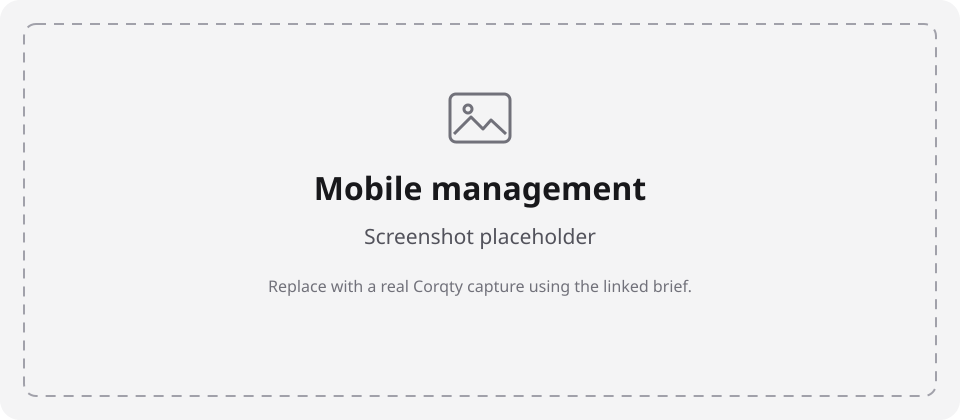

# Frontend architecture

The web application in [`apps/web`](../apps/web/) is a Next.js App Router client
for the Rust API. It does not implement a second authorization or execution
backend. Next serves the application and proxies API/SSE/webhook paths to the
API origin. The [user guide](user-guide.md) covers operation;
[workflows](workflows.md) specifies graph contracts; [development](development.md)
and [testing](testing.md) cover the complete repository workflow.

The current package uses Next 16, React 19, TanStack Query 5, XYFlow 12,
Tailwind CSS 4, Base UI primitives, and checked-in UI components. Exact versions
and ranges live in [package.json](../apps/web/package.json); resolved dependency
versions are pinned by [pnpm-lock.yaml](../pnpm-lock.yaml). TypeScript, Oxlint,
Vitest, Testing Library, jsdom, and MSW support development and verification.

## Request and rendering boundary



Route files resolve route/search parameters and render view components. Data
fetching and interactions happen in client components. The root layout installs
providers, metadata, styles, and a small pre-hydration system-theme script.
XYFlow canvases are dynamically imported with `ssr: false` because they measure
the DOM. Loading and failure states are explicit rather than rendering an
incomplete editable graph.

### Routes

All organization paths begin `/orgs/{organizationId}`. Route groups such as
`(app)` are source organization only and are not present in URLs.

| URL | View/purpose |
| --- | --- |
| `/login` | Email/password sign-in |
| `/register` | Account + first organization registration |
| `/invitations/accept#token=...` | Authenticated invitation acceptance |
| `/` | Redirect to first organization, or no-membership message |
| `/orgs/{org}` | Workspace overview |
| `.../workflows` | Workflow list and creation dialog |
| `.../workflows/{workflowId}` | Studio with draft editor, publish/run controls, recent runs |
| `.../runs/{runId}` | Pinned graph, live state/output/log monitoring |
| `.../catalog` | Definitions/blueprints and definition creation |
| `.../secrets` | Metadata list and admin write controls |
| `.../plugins` | Runtime installation, approval, enable/disable |
| `.../service-tokens` | One-time token creation and revocation |
| `.../triggers` | Pinned cron/webhook management |
| `.../members` | Invitations and membership roles |
| `.../audit` | Latest 50 audit events |
| `.../settings` | Organization shell-executor setting |

The catalog route accepts `executor` and `executorVersion` query parameters
from the plugin screen to prefill a definition. They carry an executor identity,
never a credential. New management views are keyed by organization ID, so
switching organizations remounts transient form/credential state.

## Source map

| Path under `apps/web/src` | Responsibility |
| --- | --- |
| [`app/`](../apps/web/src/app/) | Routes, layouts, root providers, global CSS |
| [`auth/`](../apps/web/src/auth/) | Session context, auth gate, capabilities, safe return path |
| [`layout/app-shell.tsx`](../apps/web/src/layout/app-shell.tsx) | Organization navigation, role badge, switcher, logout |
| [`api/client.ts`](../apps/web/src/api/client.ts) | Same-origin JSON client and structured API errors |
| [`api/types.ts`](../apps/web/src/api/types.ts) | Browser-facing DTOs and graph/run shapes |
| [`api/queries.ts`](../apps/web/src/api/queries.ts) | Organization-scoped query keys, workflow/run/member hooks |
| [`api/management.ts`](../apps/web/src/api/management.ts) | Secret/plugin/token/trigger hooks and ephemeral mutations |
| [`views/`](../apps/web/src/views/) | Page-level forms, lists, management interactions |
| [`studio/graph-model.ts`](../apps/web/src/studio/graph-model.ts) | Graph/XYFlow conversion, connections, blueprint insertion |
| [`studio/studio.tsx`](../apps/web/src/studio/studio.tsx) | Loaded workflow lifecycle, permissions, validate/publish |
| [`studio/studio-canvas.tsx`](../apps/web/src/studio/studio-canvas.tsx) | XYFlow state, drag/keyboard insertion, selection, inspector |
| [`studio/widgets.tsx`](../apps/web/src/studio/widgets.tsx) | Schema-based value editors and widget selection |
| [`studio/use-draft-autosave.ts`](../apps/web/src/studio/use-draft-autosave.ts) | Revision-aware serialized saving |
| [`runs/`](../apps/web/src/runs/) | Run form, graph, log drawer, SSE/cache integration |
| [`components/ui/`](../apps/web/src/components/ui/) | Checked-in reusable UI primitives |
| [`test/`](../apps/web/src/test/) | MSW fixtures, render helpers, environment/SSE shims |

## Session, capabilities, and CSRF

`AuthProvider` calls `GET /auth/me` using the shared API client and keeps `me`,
loading, and session-check failure state in React context. A 401 clears `me`;
other failures keep the session uncertain instead of asserting a logout.
`AuthGate` redirects only a known signed-out visitor. It shows a retry control
when a session check fails.

The gate remembers the current pathname/search/fragment in sessionStorage under
`corqty.returnTo`. On successful sign-in/registration, the path is consumed and
removed. Only a path beginning `/` and not `//` is accepted. This includes an
invitation fragment when returning through login; it is best-effort navigation
state, not persisted authentication. There is no localStorage token store.

`AppShell` finds the requested organization in `/auth/me` memberships and refuses
to render a non-member organization's content. `useCan` reads the capabilities
returned by that endpoint. Navigation and action controls use those capabilities;
admin-only management pages also disable their list fetches when unauthorized.
The Rust API rechecks authorization for every protected request. A cached role
or hidden button must never be treated as a security boundary.

[`api()`](../apps/web/src/api/client.ts) prefixes `/api/v1`, sends
`credentials: "include"` and `cache: "no-store"`, adds JSON Content-Type for
string bodies, and copies the readable `corqty_csrf` cookie into `x-csrf-token`
for explicitly specified non-GET methods. It parses non-2xx responses into
`ApiProblem(status, code, diagnostics)`. A 204 resolves as `undefined`. Preserve
this shared behavior when adding requests. See [security](security.md) for
server-side cookie, origin, and CSRF enforcement.

## State ownership and caching



The root creates one `QueryClient` for the mounted app. There is no query-cache
persistence or custom global query-default configuration. Resource keys begin
`["orgs", organizationId, ...]`; workflow, published-version, run, and run-event
keys include their exact IDs/version. Fetch functions accept query cancellation
signals. Successful organization mutations invalidate that organization's key
prefix, refreshing related lists and audit data.

Query state is not interchangeable with editor state. The studio waits for a
workflow fetch after mount before initializing its editor, avoiding blind edits
to a previously cached draft. Once mounted, the canvas owns its graph state;
background refetches do not replace local edits. Conflict Reload fetches the
server draft and increments an editor generation key to rebuild the canvas and
autosave controller.

Management writes use `gcTime: 0`. Callers copy one-time token/webhook responses
to short-lived component state and immediately reset the mutation. List query
data contains metadata, not credential values. Secret plaintext fields clear
after submission, even on error. Do not add sensitive values to query keys,
URLs, persistent storage, or telemetry. This ephemeral handling applies to the
new token/webhook/secret flows; the invitation flow has its own temporary dialog
and return-path behavior described above.

## Studio and autosave lifecycle

The studio derives editability from `edit_workflows` plus a 1024 px media query.
The shell definition is offered only when both deployment and organization
settings allow it. The palette selects the highest non-deprecated definition
version per key. `StudioCanvas` combines a palette, ReactFlow canvas, and
inspector inside a `ReactFlowProvider`.

Canvas nodes retain the domain graph node in `data.node`; handle IDs are
`in:{port}` and `out:{port}`. `toFlow`/`fromFlow` preserve the saved graph schema
while mapping XYFlow position/edge data. Selection of exactly one node opens
its inspector; otherwise workflow inputs are shown. Both dragging and native
Add buttons call the same definition/blueprint insertion logic. Additions and
refused connections are announced through a status region.

Autosave rules are covered in [workflows](workflows.md#browser-autosave-behavior).
The frontend invariants are:

- The initial canvas report establishes its normalized baseline without an
  unsolicited save; later unchanged graph reports are ignored.
- One 800 ms debounce timer and one promise queue serialize writes.
- Each successful save updates the local revision and the cached workflow draft.
- 409 stops the controller; other errors retry only on another edit/flush.
- Validate and Publish flush first and use the saved graph/revision returned.
- Unmount initiates a best-effort flush; pending work registers an unload warning.

Validation diagnostics are mapped against the graph sent for that validation,
not whichever array order happens to exist on the latest canvas. Node input
pointers map to input handles; edge problems map to the named end or target.
This mapping is executor-neutral: runtime plugin identities are not rejected
by a frontend built-in-only allowlist.

## SSE and run monitoring

The production UI uses the browser's native `EventSource`, not the test shim.
`useRun` first loads a complete run snapshot. `useRunEvents` then streams
`/api/v1/orgs/{org}/runs/{run}/events?after={lastSeq}` into the same query cache.
It can replay from zero when no event log is cached.



The event log keeps the newest **2,000 events** and a monotonically advancing
sequence cursor. Duplicate or older sequence numbers are ignored. Events update
run/node state, attempts, input/output/error where carried; a successful node
clears its old error. Fresh REST snapshots have newer cached events replayed
onto them so a slow refetch does not move state backward.

Events are batched at 100 ms to avoid rendering per log line. Terminal
`run.state` events close the EventSource, immediately flush pending events, and
invalidate the run snapshot for finish times and fields absent from events.
A terminal run is done only when its reported event sequence is consumed.

For native `CONNECTING`, the browser handles reconnection. For `CLOSED`, HTTP
status is hidden from EventSource, so the hook refetches the run and uses
exponential delays from 1 second to 30 seconds. A run read with 401, 403, or 404
stops streaming. Other read errors retain cached state and allow reconnection.
Unmount closes the source, clears the retry timer, and flushes buffered events.

The studio Logs tab streams the newest run only while that drawer is open on
the Logs tab. The run detail page follows its selected run. Log display filters
by selected node, auto-scrolls only while the reader remains near the bottom,
and uses `content-visibility` for off-screen rows. It is a bounded rendered
list, not an unlimited log archive or full virtualization system. Its live
region is deliberately off to avoid flooding assistive technology; state
changes have separate status announcements.

## Accessibility, responsive layout, and styles

The app provides a skip link, headings/landmarks, labeled native controls,
visible focus styles, disabled fieldsets for read-only forms, status/alert
regions, and dialog/tab primitives. The palette's native buttons support
keyboard insertion; Delete/Backspace removes selected editable graph items.
Read-only canvas operations are disabled while selection remains available.
There is no claim of complete keyboard graph connection authoring or audited
WCAG conformance; see the [user-guide boundaries](user-guide.md#current-product-boundaries).

Desktop navigation is a 220 px side rail; narrow navigation scrolls horizontally.
Management forms collapse to fit narrow screens. The studio's editing threshold
is 1024 px; the inspector uses a side column at its wider breakpoint and a lower
section below it. Run monitoring uses responsive graph/detail sections without
the studio's editing restriction.



*A real mobile service-token metadata capture is pending. The
[capture brief](visual-tour.md#mobile-management) specifies the viewport and
requires dismissing all one-time credentials first.*

[`globals.css`](../apps/web/src/app/globals.css) contains semantic monochrome
color tokens, Tailwind mappings, radii, light/dark styles, and base rules.
The root script applies and follows `prefers-color-scheme` before hydration;
there is no persistent theme-selector setting. XYFlow separately follows the
system color mode. Use existing `bg-background`, `text-muted-foreground`,
`border`, and related semantic utilities instead of independent color palettes.

Checked-in UI components use Base UI, class variance utilities, Lucide icons,
and local state variants in
[`variants.css`](../apps/web/src/components/ui/variants.css), retaining the
[shadcn MIT notice](../apps/web/src/components/ui/LICENSE.shadcn). The shadcn
generator is not a runtime/build dependency. Review any newly generated
component code, dependencies, and required variants before adopting it.

## Production build and proxy

Run repository scripts from the root:

```sh
pnpm install --frozen-lockfile
pnpm web:lint
pnpm web:test
pnpm web:build
```

For local web development, `pnpm --filter @corqty/web dev` binds port 3000.
See [development](development.md) for the API/database processes and environment.

[`next.config.ts`](../apps/web/next.config.ts) enables standalone output,
sets the tracing/Turbopack root to the monorepo, disables the powered-by header,
and rewrites both `/api/v1/*` and `/hooks/v1/*`. `CORQTY_API_ORIGIN` defaults
to `http://127.0.0.1:8080` outside Docker. Rewrites are determined at build time;
changing a production API destination requires rebuilding the web image.

[`docker/web/Dockerfile`](../docker/web/Dockerfile) installs the locked workspace,
builds the app, and copies standalone output plus static assets into a Node 24
runtime image. It runs `node apps/web/server.js` as the unprivileged `node` user.
The Docker build argument defaults to `http://api:8080`. The production service
does not run a development server. See [configuration](configuration.md) and
[operations](operations.md) for Compose, HTTPS, and deployment routing.

Next adds MIME-sniffing, frame, referrer, and feature-policy headers. Its CSP is
currently `frame-ancestors 'none'; base-uri 'self'; object-src 'none'`; it is not
a strict script-source policy. The root marks the authenticated app noindex/
nofollow. API fetches request no-store, while the in-memory query cache remains
intentional application state. Do not mistake those choices for an HTML page
cache or a substitute for authenticated API responses.

## Tests and extension workflow

[`vitest.config.ts`](../apps/web/vitest.config.ts) uses jsdom, the React plugin,
the `@/` alias, and two workers to bound concurrent browser/interceptor cost.
[`setup.ts`](../apps/web/src/test/setup.ts) supplies missing layout APIs for
XYFlow, mocks Next navigation, and starts MSW. The
[test EventSource adapter](../apps/web/src/test/event-source.ts) exercises
stream behavior through fetch in tests; it is not bundled as production SSE.

MSW 3 intercepts Node fetch at the socket layer. Each test gets an isolated
Undici dispatcher; teardown unmounts React, destroys that dispatcher, then
resets handlers. This prevents an aborted Node 24 SSE connection pool from
bypassing the next test's handlers. Do not replace it with longer assertion
timeouts or remove teardown ordering without reproducing the affected tests.

The current suite has 136 tests across 18 files: graph conversion/compatibility,
schema widgets, inspector bindings, revision conflicts, stream replay/lifecycle,
run/log interactions, authentication, capability-gated navigation, management
forms, one-time credentials, and catalog creation. See [testing](testing.md)
for commands and integrated acceptance coverage. jsdom tests do not prove
actual browser layout, proxy streaming, or worker execution; the
[visual tour](visual-tour.md) and [release checklist](release-checklist.md)
record separate evidence.

When extending the app:

1. Establish the Rust/API contract and capability first; update browser DTOs
   only for fields actually consumed.
2. Add organization-scoped query keys and shared-client hooks. Use cancellation
   signals for reads and invalidate the appropriate scope after writes.
3. Keep route files thin and interaction state in a view/component. Gate direct
   page reads and controls as well as navigation.
4. For widgets, update both backend contracts and frontend rendering/value
   behavior. A widget registration alone cannot authorize a new backend value.
5. For sensitive one-time responses, retain only short-lived display state and
   reset mutation data; never persist them or include them in fixtures/screenshots.
6. Add behavioral tests for the changed contract; run lint, the relevant tests,
   and build. Verify changes to canvas/layout/SSE against the running stack.

Capture maintenance and safe placeholder replacement are documented in
[`assets/README.md`](assets/README.md).
