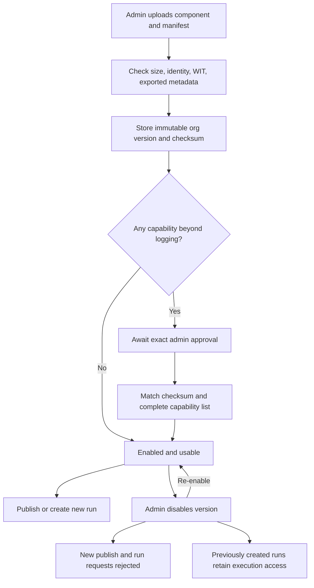
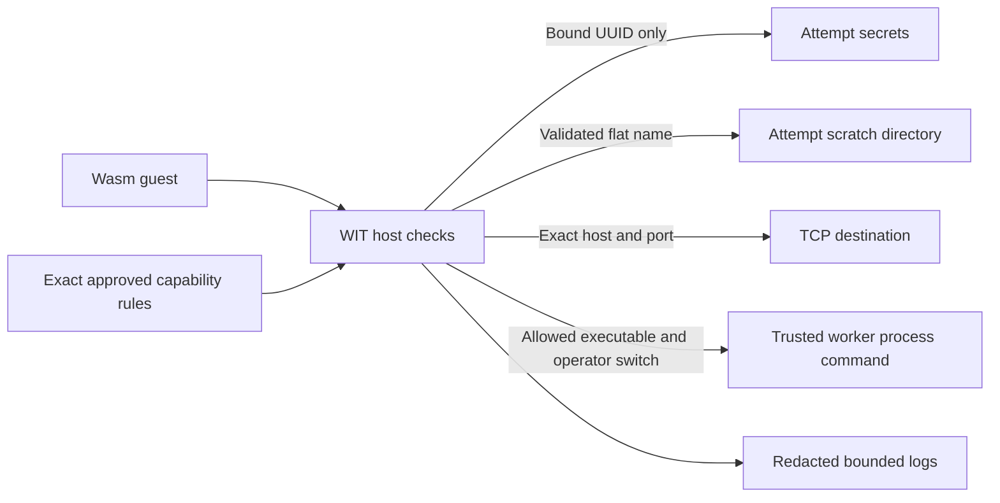

# Executors and runtime plugins

A node definition names an executor by exact key and version. Corqty supports trusted Rust executors compiled into a worker and organization-scoped WebAssembly Components installed at runtime. They share the same logical metadata, validation, and execution contract. Installing a runtime component does not require rebuilding or restarting a worker.

The authoritative contracts are the [Rust SDK](../crates/plugin-sdk/src/lib.rs), [executor WIT](../crates/plugin-sdk/wit/executor.wit), and [runtime host](../crates/plugin-host/src/runtime.rs). Workflow authoring is covered in [workflows](workflows.md); lease, retry, and cancellation semantics are in [execution](execution.md).

## Choose an extension boundary

| Kind | Distribution | Trust and compatibility |
| --- | --- | --- |
| Compiled executor | Rust code built into the worker and registered at startup. | Trusted process code; exact `key@version` must be advertised by a worker. |
| Runtime plugin | Precompiled WebAssembly Component plus JSON manifest, stored per organization. | Wasmtime guest with explicit host imports; a worker must support the declared host contract. |

`mock@1.0.0` is always compiled into the worker. `shell@1.0.0` is registered only when the operator sets `CORQTY_SHELL_EXECUTOR=enabled`; organization settings impose an additional shell permission. The compiled registry rejects invalid identities, duplicate identities, and unsupported host contracts.

Uploading source code, a standalone core Wasm module, a native shared library, or a serialized native Wasmtime artifact is unsupported. The upload must be a Component Model binary implementing the WIT world. The server compiles bytecode itself and does not deserialize user-supplied machine code.

The compiled SDK exposes `metadata()`, `validate(config)`, and asynchronous `execute(request, context)`. Metadata includes capabilities and `timeout_retryable`; the context supplies cancellation, an attempt directory, log sender, and bound-secret map. These Rust values are trusted host code. The WIT contract below is the separate serialization/import boundary for uploaded guests.

The built-in mock supports fixed output or echoing inputs as `{"result": inputs}`, optional delay, a permanent `failureMessage`, and retryable failures through `failAttempts` when the node definition's schema permits it. It is useful for deterministic workflows and tests. The Unix shell runs `/bin/sh -c` with the configured command, writes inputs to `input.json`, and passes paths through `CORQTY_INPUT` and `CORQTY_OUTPUT`. The command must write its output JSON object to that output file; stdout/stderr are logs. Its environment is cleared, then supplied with a fixed `PATH`, locale, attempt-local home/temp directories, and allowed configuration variables. Variable names must match `[A-Z_][A-Z0-9_]*` and must not begin `CORQTY_`. Nonzero shell exits are nonretryable; a worker-enforced shell timeout can retry. See the [mock](../crates/executor-mock/src/lib.rs) and [shell](../crates/executor-shell/src/lib.rs) implementations for their exact configuration and error contracts.

## Manifest and identity

A minimal manifest is:

```json
{
  "key": "hello",
  "version": "1.0.0",
  "hostContract": "1",
  "capabilities": [{ "type": "log" }]
}
```

The key matches `[a-z][a-z0-9-]{0,62}`. Runtime plugins cannot use the reserved `mock` or `shell` keys. Versions contain exactly three numeric `MAJOR.MINOR.PATCH` segments, without leading zeroes except the number `0`; prerelease labels, build metadata, ranges, and automatic version selection are unsupported. A runtime version is at most 40 bytes. The supported host contract is the string `"1"`.

The manifest rejects unknown fields. Its capability list has at most 32 rules with no duplicate rules. Component `metadata()` must return JSON that deserializes to exactly the upload manifest. JSON whitespace and object-key order do not matter, but capability-array order is part of equality.

An organization's `(key, version)` is immutable. Reuploading that identity returns `409 plugin_version_exists`, including when the bytes are identical. A changed binary requires a new version and its own approval. There is no plugin delete or in-place binary replacement endpoint.

## Installation, approval, and disabling

All plugin management routes require an organization admin. The API stores the binary's SHA-256 checksum, manifest, installer, and version. Listing returns metadata, checksum, enabled/approved flags, and creation time; it does not return the component bytes.



| Request | Body and result |
| --- | --- |
| `GET /api/v1/orgs/{org}/plugins` | `{items: [...]}` metadata list. |
| `POST /api/v1/orgs/{org}/plugins` | `{manifest, componentBase64}`; standard base64 binary; returns 201 metadata. |
| `PUT /api/v1/orgs/{org}/plugins/{id}/approval` | `{checksum, capabilities}` matching the stored version exactly. |
| `PUT /api/v1/orgs/{org}/plugins/{id}/enabled` | `{enabled: true}` or `{enabled: false}`. |

A component requesting no capability other than logging is usable without a separate approval record. Other components require approval of the full declared list, not a subset. A checksum or capability mismatch returns `409 plugin_approval_mismatch`. Approval binds the organization, plugin version, checksum, manifest, capability list, approver, and time. Approving `command-exec` also requires the API deployment's trusted-shell switch; otherwise the API returns `409 command_exec_unavailable`.

Publication and run creation check availability under a transaction-scoped catalog lock, so disabling cannot race those checks. Disabling prevents new work from being created with the version; it does not cancel runs already created, including their unstarted nodes. Cancel existing runs separately if necessary. There is no separate approval-revocation endpoint; disable the version to prevent new use.

Sources: [plugin API](../crates/api/src/plugins.rs), [catalog persistence](../crates/persistence/src/plugins.rs), [plugin tables and fenced worker access](../migrations/202611040002_plugins.sql).

## Guest contract

The WIT package is `corqty:executor@1.0.0`, with world `executor`. It imports only the `host` interface and exports:

```wit
export metadata: func() -> string;
export validate: func(config-json: string) -> string;
export execute: func(request-json: string) -> result<string, string>;
```

`metadata` returns manifest JSON. `validate` receives node configuration JSON and returns an array of `{code, pointer, message}` diagnostics. Pointers locate fields within configuration; the API prefixes them with the node/config path. Validation also runs for node-definition defaults. A validation result is limited to 200 diagnostics, a 1 MiB JSON string, and per-diagnostic lengths of 100 bytes for code, 1,024 for pointer, and 2,000 for message. Both metadata inspection and validation run in a restricted store with no secrets, scratch directory, commands, or network permissions.

`execute` receives this JSON structure:

```json
{
  "executionId": "node-run UUID",
  "attempt": 1,
  "workflowId": "workflow UUID",
  "runId": "run UUID",
  "nodeId": "graph-node-id",
  "inputs": {},
  "config": {},
  "deadline": "2026-11-04T12:00:00Z"
}
```

The illustrative UUID labels above must be real UUID strings in an actual request. `executionId` stays stable across retries; `attempt` increases. `deadline` is an RFC 3339 timestamp. Inputs have already been resolved and schema-validated by the worker. Secret bindings are replaced with opaque reference objects before guest invocation; config references also remain opaque. Call `host.secret-read(id)` for a bound value after approval. See [secrets](secrets.md) for the binding format and persistence rules.

The success string must parse as a JSON object, with one entry per supplied output port. The worker applies the node definition's output schemas, size limit, and secret-output rejection before persisting it. Return the WIT error variant for failures. A structured error preserves application retry intent:

```json
{"code":"upstream_busy","message":"Try again later.","retryable":true}
```

The structured error accepts exactly `code`, `message`, and `retryable`. Code must be 1–100 ASCII lowercase letters, digits, or underscores. The entire error string is capped at 65,536 UTF-8 bytes. Plain text, malformed JSON, or an invalid structured code becomes nonretryable `plugin_error`; overlong text is truncated at a UTF-8 boundary. The worker's permanent-error list still overrides a guest's `retryable: true`. Traps and resource exhaustion return a bounded generic `plugin_trap` message rather than engine internals.

## Host calls and boundaries

No ambient WASI imports, inherited environment, unrestricted filesystem, sockets, or process APIs are linked. A guest reaches these resources only through the WIT host. Logging and cancellation checks are available without an extra privileged approval; all resource-bearing calls check their capability before host I/O.



| Host call | Manifest rule | Behavior and limits |
| --- | --- | --- |
| `log(message)` | `{"type":"log"}` convention; no privileged approval required. | Sends a `system` log chunk through the bounded worker channel. Messages over 1 MiB are ignored. The node's persisted log cap and secret redaction still apply. |
| `secret-read(id)` | `{"type":"secret-read"}` | Reads only an explicitly bound UUID in this attempt. Unknown/unbound IDs return `secret_not_bound`. |
| `scratch-read(name)` / `scratch-write(name, bytes)` | `{"type":"scratch-fs"}` | Accesses only flat filenames in the attempt directory. Read limit is 1 MiB; cumulative writes are limited to 10 MiB, including overwritten bytes. |
| `network(host, port, request)` | `{"type":"network","host":"example.com","port":80}` | Exact host-string/port match; one TCP exchange, write-half closed after request, then read until EOF. Request and response each at most 1 MiB; bounded by the attempt deadline. This is raw TCP, not an HTTP or TLS client. |
| `command-exec(executable, arguments)` | `{"type":"command-exec","executables":["tool"]}` | Exact executable name, plus the operator switch. At most 100 arguments and 65,536 total argument bytes; successful UTF-8 stdout at most 1 MiB. Nonzero exit returns `command_failed`. |
| `cancelled()` | None. | Reports cancellation or elapsed deadline. |

Scratch names are 1–100 ASCII letters, digits, `.`, `_`, or `-`, excluding `.` and `..`. Directories, symlinks, separators, and traversal paths are rejected. The worker deletes its temporary directory after the attempt; scratch files are not workflow artifacts.

Network hosts are 1–253 ASCII letters, digits, dots, hyphens, or colons; ports must be nonzero. Approval is destination permission, not an internal-network blocklist or certificate policy. An approved hostname may resolve to an internal address. The host does not provide TLS/HTTPS, persistent connections, or an interactive read/write socket API. Protocols needing multiple bidirectional exchanges on the same connection are outside this call's contract.

Command rules contain 1–16 executable names, each 1–100 ASCII letters, digits, `.`, `_`, or `-`. Paths are not accepted. The host clears the environment, sets `PATH=/usr/local/bin:/usr/bin:/bin`, uses the attempt directory, closes stdin, discards stderr, and bounds execution by the deadline. Unix process groups are killed on cleanup; other platforms use direct-child cleanup. Commands still run as the worker's OS user. They are trusted native execution, with the same security boundary as the built-in shell, even when launched by Wasm. See [security](security.md).

## Resource budgets

| Resource | Current limit |
| --- | --- |
| Component upload | 25 MiB decoded binary maximum; deployment may lower it. |
| Guest linear memory | 256 MiB maximum; deployment may lower it. |
| Store objects | One memory, eight tables, 100,000 elements per table, 32 instances. |
| Fuel | 100,000,000 units for a guest call; asynchronous yield every 10,000. Fuel units are engine work, not elapsed milliseconds. |
| Active interruption | A process-wide 10 ms epoch clock checks cancellation/deadline. |
| Metadata/validation deadline | Five seconds in a restricted store. |
| Execute deadline | The node's remaining attempt timeout. Compilation/preparation consumes that timeout too. |
| Execute result | 1 MiB returned JSON string, then the configured node-output limit. |
| Compile pressure | At most two concurrent compilations per process; compiled-component cache holds up to 16 checksums. |

`CORQTY_MAX_COMPONENT_BYTES`, `CORQTY_MAX_WASM_MEMORY_BYTES`, and node/input/output/log limits are bounded downward from their hard ceilings. Use consistent API and worker configuration. These are per-call/per-store limits, not organization billing quotas or a guarantee that every allowed workload fits the deployment's total memory. See [configuration](configuration.md) and [operations](operations.md).

## Build and run the example

The repository includes a small auditable [example component](../plugins/example-wasm/README.md): [hello.wat](../plugins/example-wasm/hello.wat), [hello.wasm](../plugins/example-wasm/hello.wasm), and [manifest.json](../plugins/example-wasm/manifest.json). It returns `{"result":"hello from wasm"}` and requests only logging.

From the repository root:

```sh
cargo run -p corqty-plugin-host --example build-sample
cargo test -p corqty-plugin-host
```

The helper compiles the checked-in WAT locally; the server does not accept WAT source. For a production plugin, choose a Component Model toolchain that can implement the checked-in WIT, and produce a component with exactly those imports/exports. The Rust SDK is the worker-side logical contract, not a preconfigured guest-language project generator.

1. As an organization admin, open **Plugins** and install `hello.wasm` with its manifest.
2. In **Catalog**, create a node definition targeting executor `hello`, version `1.0.0`, with no inputs, configuration schema `{"type":"object"}`, and an output named `result` using `core.string` and schema `{"type":"string"}`.
3. Add the definition to a workflow, publish it, and run. Inspect the result in the run view.
4. For a component with privileged capabilities, review and approve its displayed checksum and exact rules before publishing or running it.

## Tests and extension work

[Runtime tests](../crates/plugin-host/tests/runtime.rs) verify the checked-in component matches its WAT, reject invalid interfaces/metadata, execute requests, and exercise limits. [Host unit tests](../crates/plugin-host/src/runtime.rs) exercise denied I/O, scratch traversal, typed errors, active epoch interruption, the command operator gate, and Unix descendant cleanup. [Plugin API tests](../crates/api/tests/plugins_http.rs) cover tenant/admin boundaries, immutable versions, exact approval, disable behavior, and graph validation. The Compose smoke flow installs and executes the example through HTTP.

For a new compiled executor, implement the SDK `Executor` trait, return metadata and config diagnostics, observe `ExecutionContext.cancel`, send bounded log chunks, and return an output object or `ExecutorError`. Register it in the worker and update the API's supported built-in catalog/validation alongside it. Merely adding a Rust crate does not make its identity publishable or advertise it from workers. Use contract and integration tests described in [testing](testing.md).
