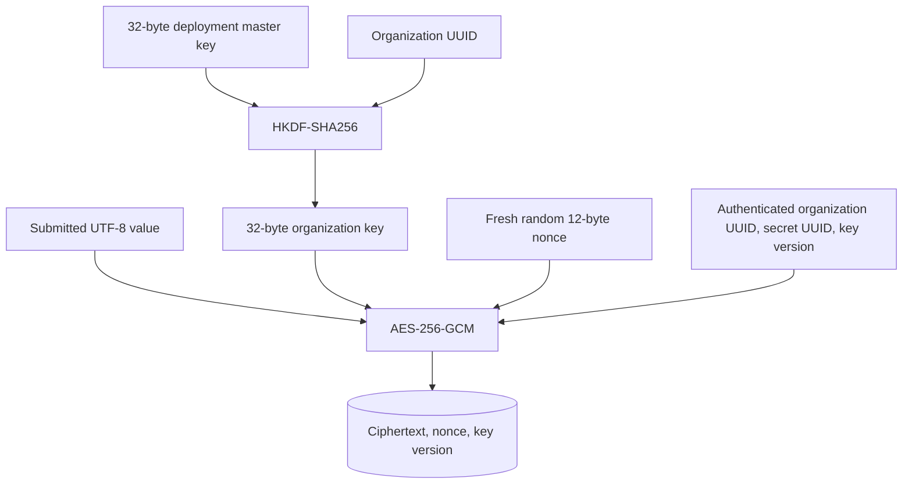
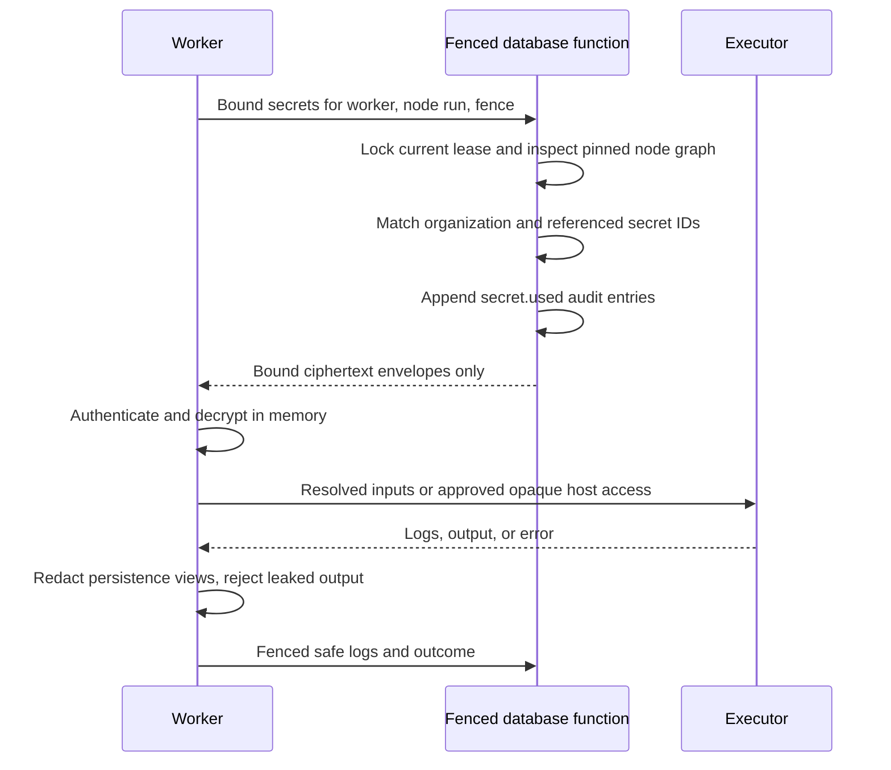

# Secrets

Organization secrets store credentials separately from workflow graphs. The API accepts a value on create or replacement, returns metadata only, and stores authenticated ciphertext. A worker decrypts only the secrets bound to the node attempt it currently leases. Persisted node inputs, logs, and errors are redacted; an output containing a bound secret is rejected.

This protection applies to explicit secret bindings. Ordinary run input and literal workflow configuration are persisted as ordinary data. Keep credentials in secrets, and review the [security boundaries](security.md) before approving a plugin that can read them or send network traffic.

## Manage metadata and values

Admins create, replace, and delete secrets. Admins and editors can list metadata so they can select bindings while authoring workflows. Runners and viewers cannot list the secret catalog. No role has an API that reads a stored plaintext value.

| Request | Body | Response |
| --- | --- | --- |
| `GET /api/v1/orgs/{org}/secrets` | None. | `{items: [{id, name, createdAt, updatedAt}]}`. |
| `POST /api/v1/orgs/{org}/secrets` | `{name, value}`. | 201 with metadata. |
| `PUT /api/v1/orgs/{org}/secrets/{id}` | `{name, value}`. | Updated metadata. Both fields are required. |
| `DELETE /api/v1/orgs/{org}/secrets/{id}` | None. | 204 if unreferenced. |

Names are trimmed, contain 1–100 Unicode characters, exclude U+0000, and are unique within an organization. Values are nonempty UTF-8 strings of at most 65,536 bytes and exclude U+0000. Duplicate names return `409 secret_name_conflict`; deletion of a protected reference returns `409 secret_in_use`. Missing or inaccessible IDs return 404.

Replacing a value preserves the secret UUID and encrypts the new value with a fresh nonce. Graphs bind that UUID, not the name or value. Values are resolved per attempt rather than snapshotted at publication or run creation. A later attempt can therefore use a replacement value, including a retry in an existing run. A rename does not break bindings.

Sources: [secret API](../crates/api/src/secrets.rs), [metadata persistence](../crates/persistence/src/secrets.rs), [secret administration UI](../apps/web/src/views/secrets-view.tsx).

## Encryption at rest

API and worker startup require the same `CORQTY_MASTER_KEY`: a standard-base64 encoding of exactly 32 random bytes. The master key is deployment configuration, not a database row. The encryption format currently supports key version `1` only.



HKDF uses salt `corqty.secret.encryption.v1` and the organization UUID bytes as its information input. AES-256-GCM authenticates the organization UUID, object UUID, and big-endian key-version number as associated data. Copying a ciphertext to a different organization or secret ID, modifying it, or changing its nonce causes authentication failure. Each write generates a new 96-bit nonce with the operating system's random source.

The same envelope implementation protects webhook signing secrets, using the trigger UUID as the object ID. These are separate from the user-managed secret catalog; see [automation](automation.md).

Master-key and derived-key buffers use zeroizing wrappers, and their debug formatting does not expose key bytes. Worker execution contexts, host secret maps, and redactor-held values zeroize their owned strings on drop. This reduces retained copies; it is not a guarantee that no plaintext ever exists elsewhere in process memory, guest memory, allocations, or an operating-system dump.

There is no online key rotation command, keyring, KMS integration, or multi-version decryption implementation. The stored version field is not an implemented rotation system. Replacing the master key without re-encrypting existing data makes secrets and webhook signing keys unreadable. Follow [operations](operations.md) for key custody, backup, and recovery, and [configuration](configuration.md) for required settings.

Source: [encryption implementation](../crates/domain/src/secrets.rs).

## Bind a secret to a node

A secret input binding is:

```json
{
  "kind": "secret",
  "secretId": "00000000-0000-0000-0000-000000000001"
}
```

The example UUID is a placeholder; select an existing secret from the same organization. The binding is placed at `node.inputs.<port>`. Configuration fields using the secret widget also store an opaque `kind: "secret"` reference. The graph contains the ID only, so draft saving, publication, and version history do not copy the plaintext.

Publication and catalog validation check reference availability in the tenant's locked secret catalog. Missing or cross-organization IDs produce validation diagnostics. At execution, the worker loads the references from the current node, decrypts the values, and validates resolved input strings against their port schemas. A missing value, unavailable master key, failed authentication, or unsupported envelope version fails the node with nonretryable `secret_unavailable`.

Compiled executors receive resolved plaintext inputs and the attempt's bound-secret map. Runtime components receive opaque `{kind, secretId}` objects in secret-bound input positions instead. Their config remains opaque too. A component must declare and obtain approval for `secret-read`, then call the host with an ID bound to that node. Approval does not grant enumeration of all organization secrets. See [plugin host calls](plugins.md#host-calls-and-boundaries).

Sources: [graph bindings](../crates/domain/src/graph.rs), [input resolution](../crates/domain/src/runtime.rs), [worker attempt setup](../crates/worker/src/lib.rs).

## Fenced worker retrieval

The API database role can select secret metadata columns, but has no direct select grant for ciphertext, nonce, or key version. The worker database role has no direct secret-table access. Its `corqty.bound_secrets(worker, nodeRun, fence)` function requires the exact active, unexpired lease.



The function derives allowed IDs from the node inside the run's immutable published graph. It does not trust a worker-supplied arbitrary list. A different worker, stale token, expired lease, another node's reference, or another tenant cannot broaden that result. Retrieval records `secret.used` with the secret ID, node-run ID, and attempt, never the plaintext. Administrative actions record `secret.created`, `secret.updated`, and `secret.deleted` in the same transaction as their change.

The database enforces a narrow worker interface, but the worker process and its master key are trusted deployment components. A host or worker-process compromise is outside the protection of this interface; it is not a hardware-backed secret service.

Source: [secret tables, grants, reference guards, and retrieval function](../migrations/202611040001_secrets.sql).

## Redaction and output rejection

The worker builds an exact-value redactor from all values bound to the attempt. It replaces occurrences with `[REDACTED]` in persisted resolved-input views, log text, and executor error code/message. JSON traversal checks nested values, object keys, arrays, and scalar representations. When values overlap, the matching logic preserves the longest match at the same position.

For logs, a separate pending suffix is held for each of `stdout`, `stderr`, and `system`. A suffix that could begin a secret is retained until more text arrives or the final flush occurs. This prevents an exact value split across two chunks or periodic database flushes from escaping redaction within one stream. It may delay the visible tail of a log until the next chunk.

Outputs are handled more strictly: if any key, string, nested value, or scalar representation contains an exact bound value, the entire result becomes nonretryable `secret_output_detected`. The output is not persisted or sent to downstream nodes. Ordinary output schema and size validation still applies when no secret is found.

This mechanism does not recognize encoded, encrypted, hashed, transformed, generated, or partial secret values. It does not combine characters distributed across different streams or unrelated JSON fields. It is not a general data-loss-prevention system, and it does not prevent an approved network call or trusted command from sending a secret elsewhere. Short secrets can also match ordinary output text or numbers and cause redaction or output rejection. Use meaningful credential values and keep the distinction between storage hygiene and capability approval clear.

Sources: [redactor](../crates/domain/src/secrets.rs), [worker logs and completion](../crates/worker/src/lib.rs).

## Deletion and immutable history

The database rejects deletion if any current workflow draft or any immutable published version in the organization contains a matching secret reference. An old published version remains a blocker even after a newer version removes the reference. Enabled triggers pin published versions, so their references are protected by the same rule. Definition defaults alone are not the deletion guard's source of truth.

An organization advisory lock serializes graph reference writes, availability checks, and deletion. A draft saved after a secret was deleted can remain invalid, but it cannot successfully publish with the missing reference. The guard prevents deletion from silently breaking an already stored referenced version.

A reference can keep a secret's identity in use for the lifetime of published history. Replace its value when rotating credentials; there is no supported API to rewrite immutable versions simply to force deletion. If credentials are compromised, revoke them at their source and review affected runs, plugins, and triggers as well as replacing the stored value.

## Verification

[Crypto/redaction tests](../crates/domain/tests/secrets.rs) cover authenticated tenant/object binding, fresh encryption, exact JSON redaction, and stream boundaries. [Secret HTTP tests](../crates/api/tests/secrets_http.rs) cover metadata-only responses, authorization, cross-tenant behavior, and reference deletion. [Worker execution tests](../crates/worker/tests/execution.rs) exercise decryption, split log redaction across flushes, and output rejection. [Queue integration tests](../crates/persistence/tests/worker_queue.rs) verify retrieval is limited to the exact live lease and bound node. See [testing](testing.md) for running these suites.
