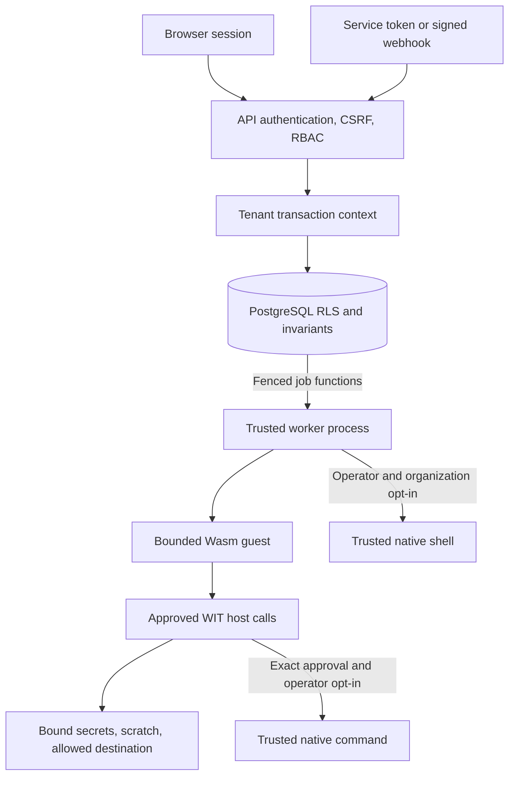

# Security model and policy

Corqty's security-sensitive areas include tenant isolation, authentication, worker lease fencing, secret storage/redaction, runtime capabilities, and trigger authentication. Security fixes target the current maintained branch. No support window, response-time guarantee, or independent security certification is implied.

This document describes the implemented boundaries and the repository's reporting policy. It is not a claim that an arbitrary deployment is safe for hostile tenants. For deployment and recovery procedures, use [operations](operations.md); for settings and limits, use [configuration](configuration.md).

## Reporting a vulnerability

Use this repository's **Security → Report a vulnerability** option when private reporting is available. Include affected revisions, deployment conditions, minimal reproduction steps, impact, and a proposed mitigation if known. Use synthetic accounts and secrets; exclude production credentials and tenant data.

If private reporting is unavailable, open a minimal issue asking a maintainer for a private reporting channel, without exploit details or sensitive material. Do not publish a working exploit or other users' information while arranging coordinated disclosure. Maintainers will discuss remediation and disclosure timing with the reporter when they can respond.

For an active incident, restrict access, preserve relevant audit evidence, revoke affected tokens, disable affected triggers/plugins, and follow your incident response process. Avoid placing incident secrets in public issue discussions. Disabling a plugin blocks new use but does not stop already created runs; cancel those separately when required.

## Threat model and trusted components

The application defends against unauthenticated requests, authenticated members exceeding their role, cross-organization identifiers, stale or duplicated worker results, malformed graphs/schemas, and runtime guests attempting unapproved host operations. Its controls combine API authorization, PostgreSQL row-level security, transactional invariants, bounded execution, and capability checks.

The operating system, database administrator/migration owner, API process, worker process, and deployment secret store remain trusted. The API supplies authenticated identity to database transactions. Workers hold the decryption master key and a narrowly granted database credential. Compromise of these trusted components is outside tenant-level request isolation. Encrypting database values does not protect them from an attacker who also controls the master key or a process allowed to use it.

This boundary does not provide organization-specific OS users or containers, hardware key isolation, distributed exactly-once side effects, or a hostile-native-code sandbox. Runtime network permission explicitly grants reachability to its approved destination. Review permissions in that context.

## Accounts, sessions, and CSRF

Passwords must contain 12–128 Unicode characters. The API hashes them with Argon2 and an operating-system-random per-password salt; encoded hashes retain their verification parameters. Password work is moved off the async request executor. Login checks a dummy password hash when an account is absent so a missing user does not skip that work. Email addresses are trimmed and normalized to lowercase.

Sessions are opaque random tokens rather than browser-supplied identity claims. Session, invitation, and service-token secrets contain 32 random bytes encoded as URL-safe base64 without padding; the database stores SHA-256 hashes for authentication, not recoverable plaintext tokens. A browser session expires after 30 days. Logout deletes the current session, and users can list/revoke their own sessions. Changing a password verifies the current password and revokes other sessions while preserving the current one.

| Cookie | Properties and purpose |
| --- | --- |
| `corqty_session` | `HttpOnly`, `SameSite=Lax`, path `/`, 30-day maximum age; authenticates the user. |
| `corqty_csrf` | JavaScript-readable, `SameSite=Lax`, path `/`, same expiry; supplies the CSRF header value. |

Both cookies are `Secure` by default. Disabling secure cookies is an explicit local-HTTP development setting; public HTTPS deployments must keep them enabled. Cookie-authenticated `POST`, `PUT`, `PATCH`, and `DELETE` requests require `x-csrf-token` to equal the CSRF cookie and hash to the value stored in the authenticated session. Client-side button visibility is not an authorization boundary.

Bearer authentication is accepted only for the exact workflow-run creation route and only for `POST`. It bypasses cookie CSRF because the caller supplies an explicit bearer credential, but it does not gain access to user administration, workflow editing, run inspection, or other protected routes. A token is bound to its organization. Webhooks use their separate HMAC authentication path; timestamp, signature, body-size, replay, and idempotency rules are documented in [automation](automation.md).

An invitation expires after seven days, is accepted by an authenticated account, and is checked against the invited email. The generated link places the secret in a URL fragment, which is not sent as part of an HTTP request path or query. The client submits it in the authenticated acceptance request. Invitation links and service-token values are shown when created; handle them as credentials. There is no SMTP delivery or email-based recovery service, and account registration does not constitute external email-ownership verification.

Open SSE streams authenticate the session at connection time and have a maximum ten-minute lifetime. Logout or session revocation does not retroactively reauthenticate an already-open stream on every event. Each database read still enforces current organization membership. See [execution](execution.md#logs-and-live-events).

Sources: [token/password implementation](../crates/api/src/auth/crypto.rs), [cookies](../crates/api/src/auth/cookies.rs), [authentication and CSRF](../crates/api/src/auth/middleware.rs), [account service](../crates/api/src/auth/service.rs), [invitations](../crates/api/src/organizations/members.rs).

## Organization roles

Roles are fixed capabilities, not user-defined permission documents:

| Capability | Admin | Editor | Runner | Viewer |
| --- | :---: | :---: | :---: | :---: |
| View organization, workflows, runs, members, and audit | Yes | Yes | Yes | Yes |
| Edit workflows, definitions, and blueprints | Yes | Yes | — | — |
| Publish workflows | Yes | Yes | — | — |
| Start, cancel, and rerun workflows | Yes | Yes | Yes | — |
| Create/update/delete triggers | Yes | Yes | — | — |
| List secret metadata for authoring | Yes | Yes | — | — |
| Manage secret values | Yes | — | — | — |
| Manage plugins and exact capability approvals | Yes | — | — | — |
| Manage members and invitations | Yes | — | — | — |
| Manage service tokens | Yes | — | — | — |
| Enable organization shell execution | Yes | — | — | — |

The API checks the member's role inside the tenant transaction. A nonmember receives 404 for an organization resource; a member without the required capability receives 403. A deferred database constraint prevents removing or demoting the final organization admin, including concurrent mutations.

Editors can select secrets and author workflows that use them, so workflow-edit permission is sensitive even though it does not expose a plaintext read endpoint. Admin capability approval determines which runtime plugins can read a bound secret or reach a destination. Run permission can invoke already published effects. Give each role based on those effective powers.

Sources: [role matrix](../crates/domain/src/rbac.rs), [authorization helper](../crates/api/src/authz.rs), [authorization tests](../crates/api/tests/authorization_matrix.rs).

## Database isolation and worker authority

Use distinct migration-owner, API, and worker database credentials. The API and worker roles must not own tenant tables or have superuser/BYPASSRLS privileges. These are deployment requirements; running a service as the migration owner defeats the intended boundary.

Tenant requests begin a transaction and set `corqty.user_id` and `corqty.organization_id` with transaction-local settings. Policies constrain rows by organization and membership; commit or rollback clears the context before the pooled connection is reused. Shared system catalog entries have explicit visibility rules rather than acquiring a tenant's ownership. Service-token and trigger run creation use separately validated actor context and do not become an admin user.

Workers have no general table access. Their security-definer functions expose registration, claiming, starting, heartbeat/cancellation, appending logs, completion, bound-secret retrieval, and runtime-component retrieval. Functions use a fixed search path, revoke default public execution, and check their intended lease/identity conditions. Lease fencing prevents a worker that lost ownership from persisting a late result. The worker database credential itself is privileged and must still be protected; the worker ID and lease token are protocol coordinates, not a substitute for that credential.

State changes, dependency release, event sequence allocation, and run settlement are transactional. Immutable workflow versions and plugin binaries prevent an execution identity from silently changing. Secret graph-reference locks and plugin catalog locks close validation-versus-delete/disable races. These controls protect database consistency; external effects still need idempotency as described in [execution](execution.md#retries-and-external-side-effects).

Sources: [transaction context](../crates/persistence/src/tenant.rs), [base RLS policies](../migrations/202607280002_rls.sql), [worker functions](../migrations/202610260002_worker_functions.sql), [tenant isolation tests](../crates/persistence/tests/tenant_isolation.rs), [data model](data-model.md).

## Secrets and extension capabilities

Secret values are encrypted using AES-256-GCM with per-organization HKDF-derived keys and authenticated object identity. The API can read secret metadata, not ciphertext columns; a worker retrieves only the references belonging to its live fenced attempt. See [secrets](secrets.md) for the exact format, deletion rules, redaction implementation, and its limits.

Secret redaction detects exact bound values. Encoded, transformed, generated, or partial values are outside that guarantee. Do not put credentials in plain workflow configuration or ordinary run inputs. Redaction also cannot stop an approved plugin from deliberately using its network capability to transmit a credential. An output containing an exact bound value is rejected rather than stored.

Runtime components have bounded memory, fuel, and deadlines and explicit host capabilities. Installation verifies the WIT interface and exported manifest in a restricted store. Approvals bind the exact immutable binary checksum and declared rules. No ambient WASI environment, filesystem, sockets, or processes are exposed. Approving network access grants reachability to the named destination, including internal services; review it accordingly. See [plugins](plugins.md) for each host call and its resource budget.

Shell and runtime host commands execute as the shared worker user. Enable `CORQTY_SHELL_EXECUTOR` only when all command authors are trusted; it is not a hostile-tenant sandbox. The built-in shell additionally requires organization enablement. Runtime commands require exact plugin approval and the operator switch, which is checked at execution as well as approval time. Allowing a general-purpose interpreter can provide much broader authority than its executable name suggests.

Clearing command environment variables and killing Unix process groups are useful containment measures, but they do not remove the OS user's filesystem/network privileges or guarantee cleanup of a deliberately detached process. A command can access resources available to the worker user, including deployment material; this is why the production override in [docker/compose.production.yml](../docker/compose.production.yml) disables shell and runtime commands in both API and worker.

## Resource abuse and public deployment

Graph, schema, input/output, log, webhook, component, and guest-memory limits bound individual operations. JSON Schema validation uses Draft 2020-12, accepts at most 16 KiB per schema, rejects reference keywords including local references, runs offline, and uses a linear-time regex engine. Schemas cannot fetch remote documents. Published graphs are acyclic. Runtime validation output and API diagnostics are bounded.

Database-backed request limits protect authentication and automation entry points, including service-token and webhook traffic. They complement bounded worker concurrency, finite queue attempts, SSE stream caps, and runtime budgets. These are not per-organization billing or storage quotas, and registration is public by default. Use upstream access control for a private beta and suitable edge rate limiting for a public service.

The API intentionally uses the connection's peer address for address-based limits and does not trust arbitrary forwarding headers. Behind a proxy, clients can share that peer-address bucket. Configure the edge with that behavior in mind rather than assuming untrusted `X-Forwarded-For` identifies a client.

Serve public deployments over HTTPS with secure cookies, private database/API networking, current dependencies, and an upstream rate limiter where needed. The production Compose override publishes only the HTTPS edge. The web server sends `nosniff`, `X-Frame-Options: DENY`, a same-origin referrer policy, disabled camera/microphone/geolocation permissions, and CSP directives for frame ancestors, base URI, and objects. That CSP is intentionally narrow; it does not claim to restrict every script or eliminate XSS.

Protect `CORQTY_MASTER_KEY` and database credentials with host/secret-store access controls. Back up the key separately and securely. Changing it without re-encrypting data breaks stored secrets and webhook authentication. Recovery recipes and production networking details remain in [operations](operations.md).

Sources: [bounded settings](../crates/domain/src/limits.rs), [schema validation](../crates/domain/src/schema.rs), [API rate limits](../crates/api/src/limits.rs), [automation limits](../crates/api/src/automation.rs), [web headers](../apps/web/next.config.ts).

## Audit and retained evidence

Sensitive application changes append organization audit events in their transaction. Events identify actors, resources, and safe action metadata. Secret use records IDs and attempt information, not plaintext; plugin installation/approval records checksums and capability decisions. The audit API is read-only and organization-scoped. Application roles are not a replacement for database administrator access controls or an external tamper-evident audit sink.

Run event and summary retention are separate from audit history. The retention loop deletes old execution data, not the audit ledger or immutable published/plugin versions. Inspect [data model](data-model.md), [automation](automation.md), and [operations](operations.md) for the retained records and operational consequences. Avoid placing credentials in application fields, diagnostics, or incident reports that are intentionally retained.

## Dependency audit scope

CI runs the JavaScript audit and [scripts/audit-rust.ps1](../scripts/audit-rust.ps1), using `cargo-audit` 0.22.2. The Rust script first checks the complete workspace dependency tree for all targets, then audits with warnings denied. It allows one explicit advisory, `RUSTSEC-2023-0071`, only while the affected `rsa` crate remains absent from the compiled dependency tree. SQLx retains that optional MySQL dependency in the lockfile even though Corqty enables PostgreSQL only. The script fails if `rsa` becomes a compiled dependency; the exception must then be removed and the exposure remediated. This is an unused-dependency exception, not a claim that the affected RSA implementation is safe or fixed.

The checked lockfile includes updated Rustls, WebPKI, root certificates, and Tokio dependencies addressing the advisories found during release preparation. Audit results are snapshots of known advisories; keep dependencies and the advisory database current after deployment. See [testing](testing.md) and the [release checklist](release-checklist.md) for the verification workflow.

## Security regression coverage

The repository tests session/cookie/CSRF behavior, role decisions, final-admin protection, tenant context cleanup, cross-tenant access, stale lease rejection, bound-secret retrieval, exact-value redaction, runtime capabilities, command gates, active cancellation, and automation authentication/replay. Relevant suites include [auth HTTP](../crates/api/tests/auth_http.rs), [authorization matrix](../crates/api/tests/authorization_matrix.rs), [tenant isolation](../crates/persistence/tests/tenant_isolation.rs), [queue fencing](../crates/persistence/tests/worker_queue.rs), [secret HTTP](../crates/api/tests/secrets_http.rs), and [plugin HTTP](../crates/api/tests/plugins_http.rs).

These tests establish specific regression checks; they are not a penetration test or independent certification. Report confirmed vulnerabilities through the private process above.
