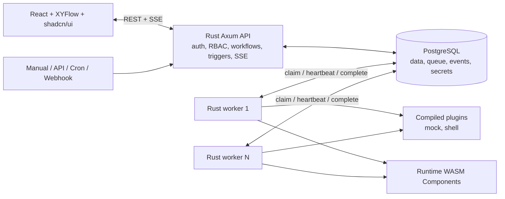

# Corqty Workflow Orchestrator Design

**Date:** 2026-07-28

**Status:** Approved; implementation planned by milestone

## 1. Product summary

Corqty is a generic, multi-tenant visual workflow orchestrator. Users build directed acyclic graphs (DAGs) by placing versioned node presets on an XYFlow canvas, configuring them with schema-driven widgets, and connecting typed executor outputs to downstream inputs. Publishing creates an immutable workflow version; horizontally scalable Rust workers then execute its dependency-ready nodes in parallel.

Infrastructure automation is an important use case, but the orchestration model is executor-neutral. Terraform, Helm, Pulumi, and kubectl are future executor plugins rather than hard-coded workflow concepts.

## 2. First-release goals

The first release must provide:

1. A React workflow studio using XYFlow, shadcn/ui, and a monochrome Vercel-style visual system.
2. Email/password authentication, organizations, fixed RBAC roles, member invitations, and audit events.
3. Mutable workflow drafts, atomic publishing, immutable versions, versioned node definitions, and reusable blueprints.
4. JSON Schema-defined configuration, workflow inputs, node inputs, and executor outputs.
5. Typed drag-to-connect edges with cycle prevention and server-authoritative graph validation.
6. Built-in `mock` and trusted `shell` executor plugins.
7. One logical executor contract implemented by both compiled Rust plugins and runtime-installed WebAssembly Components.
8. Manual, REST API, cron, and authenticated webhook run triggers.
9. PostgreSQL-backed durable scheduling, parallel worker execution, retries, cancellation, lease recovery, logs, and run monitoring over server-sent events (SSE).
10. Organization-scoped encrypted secrets.
11. Infrastructure-shaped and generic data-processing starter blueprints.
12. A local Docker Compose environment whose workers can be horizontally scaled.

## 3. Explicit non-goals

The first release does not include:

- Real Terraform, Helm, Pulumi, or kubectl execution. The infrastructure starter blueprint uses the `mock` executor and is visibly labeled as simulated.
- Terraform state or other executor state transfer through graph edges. A future IaC executor owns its working directory and remote state configuration.
- File artifacts, object storage, or files passed between nodes.
- Conditional branches, loops, dynamic fan-out, subworkflows, manual approval nodes, compensation, or automatic rollback.
- Arbitrary uploaded React widget code.
- Native runtime `.dll`/`.so` plugins or uploaded Rust source code.
- OIDC, user-defined roles, billing, public plugin marketplace, or real-time multi-user draft collaboration.
- A security boundary suitable for hostile shell-command authors. The shell executor is for trusted/self-hosted organizations.

## 4. Architecture

Corqty is a modular monorepo with separately runnable web, API, migration, and worker processes.



PostgreSQL is the only durable data store and queue in this release. Redis, NATS, S3, and a separate workflow engine are not required.

The API process also runs three leader-elected background loops:

- Cron dispatch, guarded by transactional row claims and unique scheduled-occurrence keys.
- Expired worker-lease recovery.
- Run-event retention cleanup.

Multiple API replicas may run these loops because database locks and uniqueness constraints prevent duplicate work. These loops live behind internal interfaces so they can move to a separate service later without changing the domain model.

## 5. Repository boundaries

The implementation will use these responsibility boundaries:

- `apps/web`: React application, routes, XYFlow editor, schema widgets, API client, and tests.
- `crates/api`: Axum HTTP/SSE server and API background loops.
- `crates/worker`: job claiming, leases, cancellation, plugin invocation, and result persistence.
- `crates/domain`: graph, RBAC, run-state, validation, and plugin-domain types with no HTTP or SQL dependencies.
- `crates/persistence`: PostgreSQL repositories, transactions, row-level-security context, and migrations.
- `crates/plugin-sdk`: stable logical executor types plus the versioned WIT contract for runtime plugins.
- `crates/plugin-host`: compiled-plugin registry, Wasmtime host, capabilities, limits, and plugin cache.
- `crates/executor-mock`: safe deterministic mock executor.
- `crates/executor-shell`: trusted subprocess executor.

Each executable depends on shared crates; API handlers do not contain scheduling or graph-validation logic.

## 6. Tenancy, accounts, and RBAC

### 6.1 Bootstrap and invitations

- A new user registers with email/password and creates an organization; that user becomes an `admin`.
- An admin generates a time-limited invitation link for an email and role. SMTP delivery is outside the first release; the UI makes the link copyable.
- Invitation plaintext appears only in the SPA URL fragment and is submitted in an authenticated `POST` body; it is never placed in an HTTP path or query string.
- Users may belong to multiple organizations and select the active organization in the application shell.
- There is no `owner` role.
- An organization must always retain at least one admin. Removing or demoting the final admin is rejected transactionally.

### 6.2 Fixed permission matrix

| Capability | admin | editor | runner | viewer |
|---|:---:|:---:|:---:|:---:|
| View workflows, versions, runs, outputs, logs, blueprints, node definitions, triggers, and audit events | Yes | Yes | Yes | Yes |
| Create/edit drafts, custom node definitions, and organization blueprints | Yes | Yes | No | No |
| Validate and publish workflows | Yes | Yes | No | No |
| Create/edit cron and webhook triggers | Yes | Yes | No | No |
| Start, retry, and cancel runs | Yes | Yes | Yes | No |
| Manage members and roles | Yes | No | No | No |
| Create/revoke service tokens | Yes | No | No | No |
| Create/update/delete secrets | Yes | No | No | No |
| Install/approve/disable runtime plugins | Yes | No | No | No |
| Enable the trusted shell executor for the organization | Yes | No | No | No |

Editors can reference secret identifiers and see secret names, but no role can retrieve secret plaintext after creation.

## 7. Core domain model

### 7.1 Accounts and organization data

- `users`
- `password_credentials`
- `sessions`
- `organizations`
- `memberships`
- `invitations`
- `service_tokens`

Sessions and service tokens store only token hashes. Invitation and service-token secrets are displayed once.

### 7.2 Workflow catalog

- `workflows`: identity, organization, name, slug, current draft, and current published version.
- `workflow_drafts`: graph JSONB, monotonically increasing revision, and last editor.
- `workflow_versions`: immutable canonical graph snapshot, version number, SHA-256 checksum, publisher, and timestamp.
- `node_definitions`: immutable versioned input/output/config schemas, UI schema, defaults, executor binding, and scope.
- `blueprints`: immutable versioned graph templates with `system` or `organization` scope.

System node definitions and blueprints are seeded by migrations. Organization definitions and blueprints belong to exactly one organization. Applying a blueprint creates a new draft with fresh node and edge identifiers.

An immutable definition/version cannot be edited or deleted while referenced. It may be deprecated. Disabling a plugin version prevents new publishes and new runs that require it, but does not remove data or interrupt a run that was already created; queued descendants in that run may still execute.

### 7.3 Plugins

- `plugin_versions`: organization, key, semantic version, host-contract version, manifest, SHA-256 checksum, component bytes as `bytea`, enabled state, and installer.
- `plugin_approvals`: exact organization, plugin version, checksum, approved capability set, approver, and timestamp.
- `worker_instances`: worker identity, heartbeat, compiled plugin keys/versions, supported host-contract versions, and capacity.

Compiled plugins are system-scoped and become available only after rebuilding/redeploying the worker. Runtime installation accepts a precompiled WebAssembly Component; Corqty never compiles uploaded Rust source and never loads a native shared library.

### 7.4 Execution and events

- `runs`: organization, immutable workflow-version reference, trigger source, workflow input JSON, status, idempotency data, and timestamps.
- `node_runs`: run/node identity, exact executor version, state, attempt policy, available time, lease fencing token, worker, redacted inputs, JSON output, and timestamps.
- `run_events`: append-only execution status and redacted log events with a per-run sequence.
- `audit_events`: separate append-only administrative/security events.
- `triggers`: manual/API metadata, cron definitions, or webhook definitions pinned to a published workflow version.
- `secrets`: organization, stable identifier, name, ciphertext, nonce, key version, and timestamps.

Run events and audit events are never mixed. Executor stdout/stderr belongs only in redacted run events.

## 8. Graph, schemas, ports, and widgets

### 8.1 Graph snapshot

A draft/version contains:

- `schemaVersion`
- `workflowInputSchema`
- node instances with stable IDs, exact node-definition versions, positions, display names, configuration, input bindings, retry policy, and timeout
- edges with source node/port and target node/port
- viewport metadata

Input bindings have exactly one of four forms:

1. JSON literal
2. workflow-input JSON Pointer
3. organization secret reference
4. upstream node-output reference, represented visually by an edge

A scalar input accepts at most one upstream edge. Fan-in requires separate named input ports; implicit arrays and merge behavior are not provided.

### 8.2 JSON Schema rules

- Schemas use JSON Schema Draft 2020-12.
- Every port has a schema and a stable `dataType` string.
- Built-in data types include `core.string`, `core.number`, `core.integer`, `core.boolean`, `core.object`, `core.array`, and `core.any`.
- Presets may use semantic types such as `aws.vpc-id`.
- Connections require identical `dataType` values, except `core.integer` may connect to `core.number`, and any source may connect to `core.any`.
- There is no other implicit coercion.
- Optionality and `null` come from the target schema. A missing optional input is omitted; `null` is valid only when explicitly allowed.
- Runtime values are validated against the full target JSON Schema before executor invocation and against output schemas after executor completion.

The backend is authoritative. The UI uses the same shared rules for immediate feedback but cannot bypass publish-time validation.

### 8.3 Widget registry

`uiSchema` selects only trusted registry widgets:

- text, textarea, number, boolean, select, multi-select
- secret reference
- code editor
- key/value editor
- small file-as-text import

The file-as-text widget imports at most 256 KiB into a JSON string; it does not create an artifact or a file-valued edge. Unknown widgets make the definition invalid. Arbitrary uploaded React code is not supported.

### 8.4 Draft saving and publishing

The web app debounces draft saves and sends the current revision as an optimistic concurrency precondition. A stale update returns `409 Conflict`; Corqty does not silently merge concurrent edits.

Publishing is one transaction tied to an exact draft revision. It rejects:

- malformed or unsupported schemas/UI schemas
- duplicate IDs or missing node definitions
- cycles
- incompatible or multiply bound ports
- missing required inputs
- invalid node configuration
- missing, disabled, or incompatible exact executor versions
- cross-organization secret references
- invalid retry/timeout values

Successful publishing writes one canonical immutable snapshot and checksum, increments the workflow version, and updates the workflow's current published version atomically.

Trigger creation or version updates are separate atomic operations. They validate the exact published version, the trigger's configured workflow-input payload, authentication settings, and schedule policy before saving.

## 9. Workflow studio UX

The approved layout uses:

- A global organization/navigation sidebar.
- A compact top bar with workflow breadcrumb, draft/version state, Validate, Publish, and Run actions.
- A searchable preset palette on the left of the editor.
- An XYFlow canvas as the dominant surface.
- A schema-generated selected-node inspector on the right.
- A collapsible bottom drawer for recent runs and live logs.

Core interactions:

- Drag a node definition or blueprint onto the canvas.
- Drag an output handle to a compatible input handle.
- Refuse self-edges, duplicate bindings, incompatible types, and connections that create a cycle.
- Configure literals, workflow-input mappings, and secret references in the inspector.
- Show backend validation errors both in a summary and on affected nodes/ports.
- Overlay node-run states on the published graph during execution.
- Resume SSE streams with `Last-Event-ID` after reconnecting.
- Support light/dark system preference with monochrome semantic tokens; raw status colors are restricted to status components.

The editor is desktop-first and usable at 1024 px or wider. Smaller screens support navigation and run monitoring, not full graph editing.

## 10. Executor plugin contract

### 10.1 Logical interface

Compiled Rust plugins and WebAssembly Components expose the same versioned operations:

- `metadata()`: plugin key/version, host-contract range, and declared capabilities.
- `validate(config_json)`: structured diagnostics with JSON Pointer paths.
- `execute(request)`: success with a JSON object, or a typed executor error.

The request contains:

- stable `execution_id` equal to the node-run ID across retries
- attempt number
- workflow/run/node identity
- validated JSON inputs and configuration with secret references still opaque
- deadline

Host operations are:

- emit a structured or text log
- read only a secret explicitly bound to this node
- access an ephemeral scratch directory
- make an approved network connection
- run an approved host command
- query cancellation

### 10.2 Capability enforcement

The capability vocabulary is:

- `log`
- `secret-read`
- `scratch-fs`
- `network` with approved host/port rules
- `command-exec` with approved executable names

Runtime plugins receive only `log` by default. Network name lookup and sockets remain disabled unless approved. Scratch directories are unique per attempt and deleted afterward. Capabilities are approved by an admin for one organization, plugin version, checksum, and manifest. A changed checksum or version requires a new approval.

Wasmtime enforces:

- a 25 MiB maximum uploaded component
- 256 MiB maximum linear memory
- 100 million fuel units per guest call
- epoch/deadline interruption
- the node timeout, default 15 minutes and configurable up to four hours

Host command duration is still bounded by the node deadline because host calls do not consume WebAssembly fuel.

Workers claim only jobs whose exact compiled-plugin version or runtime host-contract version they advertise. Mixed worker deployments therefore leave a job in `queued`; the API derives and surfaces `waiting_for_compatible_worker` as its queue reason rather than inventing another persisted node state or silently failing it.

### 10.3 Built-in mock executor

The mock executor supports:

- configurable delay
- fixed JSON output or input echo
- deterministic configured failure
- cancellation

It powers both starter blueprints and deterministic scheduler tests.

### 10.4 Built-in shell executor

The shell executor is disabled until an organization admin opts in. It runs as the unprivileged worker-container user in a fresh temporary working directory.

- The configured program/arguments or script may use tools installed in the worker image.
- Custom tools require building a custom worker image.
- Validated inputs are written to the path in `CORQTY_INPUT`.
- The command writes one JSON object to the path in `CORQTY_OUTPUT`.
- Stdout/stderr become bounded, redacted log events and are not interpreted as outputs.
- Only a small Corqty-owned environment allowlist plus explicitly mapped variables is inherited.
- Timeout/cancellation terminates the entire subprocess tree.
- The standard worker image has no Docker socket, privileged mode, or host filesystem mounts.

The trusted-user warning is visible when enabling and configuring this executor.

## 11. Durable execution semantics

### 11.1 Node states

```text
blocked -> queued -> running -> succeeded
                    |       \
                    |        -> failed
                    -> retry_wait -> queued

blocked/queued/running -> canceled
blocked                -> skipped
```

Run states are `queued`, `running`, `succeeded`, `failed`, and `canceled`.

### 11.2 Run creation and parallelism

Creating a run:

1. Authorizes the actor and validates workflow inputs.
2. Pins one immutable workflow version.
3. Creates every node-run row in one transaction.
4. Queues every zero-dependency node; other nodes start `blocked`.

Workers atomically claim `queued` rows using `FOR UPDATE SKIP LOCKED`, filtered by executor compatibility and ordered by availability and age. One worker process may execute multiple jobs up to its configured capacity, and multiple worker containers may claim independently.

### 11.3 Completion and downstream release

Worker completion uses a lease fencing token. One database transaction:

1. Verifies the current lease/fence.
2. Persists the validated output and terminal node status.
3. Appends run events.
4. Queues children whose parents all succeeded.
5. Marks a child skipped if any parent failed, was skipped, or was canceled.
6. Aggregates the run if every node is terminal.

A stale or duplicate worker cannot complete a job after losing its fence.

For a fan-in node, every parent must succeed. A failed branch skips only its descendants; unrelated branches continue. A run is `failed` if any node fails or is skipped because of failure. A user-requested cancellation produces `canceled` unless failure was already terminal.

### 11.4 At-least-once execution, leases, and retries

Execution is at least once, not exactly once. Every executor receives the stable node-run ID as its idempotency key, but Corqty cannot make arbitrary external side effects exactly once.

- Workers heartbeat active leases.
- An expired lease consumes the current attempt, then requeues the same node run when attempts remain and fails it otherwise.
- Default maximum attempts: 1.
- Configurable maximum attempts: 5.
- Retry backoff: exponential from 2 seconds, capped at 5 minutes, with jitter.
- Validation, permission, capability, and output-schema errors are non-retryable.
- Timeouts and executor errors are retryable only when the plugin classifies them so.

Cancellation marks blocked/queued work canceled, signals running plugins, allows a short grace period, then interrupts WebAssembly or terminates the shell process tree.

## 12. Triggers and idempotency

Every trigger pins an exact published workflow version. Publishing a newer workflow version does not silently move existing triggers; an editor must explicitly update them. Manual runs default to the current published version, and reruns default to the original version.

### Manual and REST API

- Browser requests use the user session.
- Automation uses a hashed organization service token scoped to `workflow:run`.
- REST idempotency keys are scoped to organization, route, actor/token, and key for 24 hours.
- Reusing a key with a different request hash returns `409 Conflict`.

### Cron

- Cron expressions use a documented five-field syntax plus an IANA timezone.
- Each cron trigger stores a JSON workflow-input payload validated against its pinned version.
- A unique `(trigger_id, scheduled_for)` key prevents duplicate dispatch.
- Default overlap policy is `skip` while an earlier run is active; `allow` may be selected.
- A missed occurrence is dispatched only within a five-minute grace window; older misfires are skipped and audited.

### Webhooks

- A webhook secret is generated once and stored encrypted.
- Requests require `X-Corqty-Timestamp`, `X-Corqty-Signature` using HMAC-SHA256 over timestamp and raw body, and `Idempotency-Key`.
- Timestamps outside a five-minute window are rejected.
- Event keys are deduplicated for 24 hours.
- The validated JSON body becomes the workflow-level input object.

Manual, API, cron, and webhook payloads all pass through the same workflow-input schema validation.

## 13. Secrets and security

### Authentication

- Passwords use Argon2id with parameters selected for the deployment.
- Sessions use high-entropy opaque tokens; only hashes are stored.
- Cookies are `HttpOnly`, `Secure` outside local HTTP, and `SameSite=Lax`.
- Mutating browser requests require a CSRF token.
- Login, invitation acceptance, API tokens, and webhooks are rate-limited.

### Tenant isolation

- Every organization-scoped API transaction executes as a non-owner PostgreSQL role and uses `SET LOCAL` to establish its organization context.
- Row-level-security policies enforce organization equality.
- Pooled connections never retain tenant context beyond the transaction.
- Cross-tenant identifiers return not found rather than revealing existence.
- Migrations use a separate owner role.
- Workers use a distinct service role with no blanket row-level-security bypass. It may execute a fixed set of `SECURITY DEFINER` functions for claim, heartbeat, scoped job-payload retrieval, completion, and cancellation.
- Worker functions return organization data only for a job currently claimed by that worker and lease fence. They expose only the ciphertext for secret IDs bound to that job; decryption remains in worker memory.
- Worker requests are always keyed by the claimed job's organization and covered by cross-tenant integration tests.

### Secret storage and lifecycle

- `CORQTY_MASTER_KEY` is required outside tests and is never stored in PostgreSQL.
- Per-organization encryption keys are derived from the master key and organization ID.
- AES-256-GCM uses a fresh nonce for every stored version.
- Ciphertext records carry a key version for future rotation.
- Plaintext exists only during create/update and in worker memory during one execution.
- Secret references are stable IDs. Updating a secret changes the value resolved by future executions; published graphs do not snapshot plaintext.
- Deletion is blocked while an active draft, published workflow, or enabled trigger references the secret.
- Persisted input views, logs, and events redact exact configured secret values.
- If executor output contains an exact bound secret value, completion fails with a non-retryable `secret_output_detected` error instead of storing or passing a redacted value downstream.
- Encoded, transformed, generated, or very short secret fragments cannot be guaranteed detectable; the UI documents this limitation.

### Audit events

Audit events cover authentication, invitations, membership/role changes, workflow and node-definition mutations, publish, trigger changes, run start/cancel/retry, service tokens, plugin installation/approval/disable, shell enablement, and secret create/update/delete/use. They contain identifiers and safe metadata, never secret plaintext, password material, executor stdout/stderr, or full node configuration.

## 14. HTTP and live-event API

The JSON API is under `/api/v1`.

Route groups:

- `/auth`: registration, login, logout, current user, password change, and session revocation
- `/organizations` and `/orgs/{org_id}/members`
- `/orgs/{org_id}/workflows`, drafts, validation, versions, publish, and runs
- `/orgs/{org_id}/node-definitions` and `/blueprints`
- `/orgs/{org_id}/plugins`
- `/orgs/{org_id}/triggers`
- `/orgs/{org_id}/secrets`
- `/orgs/{org_id}/service-tokens`
- `/orgs/{org_id}/audit-events`
- `/orgs/{org_id}/runs/{run_id}/events` for SSE
- `/hooks/v1/{trigger_id}` for signed incoming webhooks

Errors use Problem Details JSON with stable machine-readable codes and field/graph JSON Pointer diagnostics. Permission errors never disclose another organization's resource.

SSE events have a monotonically increasing per-run sequence used as the event ID. A reconnect with `Last-Event-ID` replays retained events before switching to live delivery.

## 15. Limits and retention

Defaults are deployment-configurable but bounded:

- 500 nodes and 1,000 edges per workflow version
- 1 MiB workflow-run input
- 1 MiB resolved node input
- 1 MiB node JSON output
- 1 MiB webhook body
- 10 MiB persisted log text per node run, followed by one truncation event
- 25 MiB runtime WebAssembly Component
- 256 MiB WebAssembly linear memory
- 15-minute node timeout by default; four-hour deployment maximum

Run logs/events are retained for 30 days. Node outputs and run summaries are retained for 90 days. Audit events are retained indefinitely in the first release. Cleanup never deletes workflow versions, plugin versions that remain referenced, or audit events.

## 16. Starter content

### Infrastructure simulation

An explicitly simulated blueprint demonstrates:

```text
Workflow region input -> Create VPC (mock) -> Create RDS (mock)
                                      \----> Deploy service (mock)
```

It passes semantic JSON outputs such as `aws.vpc-id` into downstream inputs and demonstrates parallel branches.

### Generic data processing

A generic mock blueprint demonstrates:

```text
Workflow payload -> Normalize payload (mock) -> Produce summary (mock)
```

Both are copy-on-apply, editable drafts. The node library also exposes a configurable shell-command preset when the organization enables it.

## 17. Docker Compose and local development

`docker compose up --build` starts:

- `postgres`: PostgreSQL with health check and persistent named volume
- `migrate`: one-shot SQL migrations and system seed data
- `api`: Axum API plus cron, lease-recovery, and retention loops
- `worker`: Rust worker with built-in plugins
- `web`: Vite development server with API/SSE proxying

The API and worker wait for successful migrations. Migrations and system seeds are idempotent. Local registration creates the first admin and organization.

Parallel local execution is demonstrated with:

```text
docker compose up --build --scale worker=3
```

No Docker socket is mounted. An `.env.example` documents database credentials, public URLs, master-key generation, limits, and development-only cookie behavior.

## 18. Testing strategy

All behavior is developed test-first.

### Rust unit tests

- DAG cycle detection and topological readiness
- port compatibility, null/optional handling, and schema validation
- publish validation and optimistic revisions
- role permission matrix and final-admin invariant
- node/run state transitions, retry classification, cancellation, and aggregation
- plugin manifest/version/capability checks

### PostgreSQL integration tests

- tenant isolation and cross-organization identifier rejection
- atomic publish
- concurrent `SKIP LOCKED` claims
- lease fencing and expired-lease recovery
- unique downstream enqueue under concurrent completion
- fan-in, independent-branch continuation, and descendant skipping
- trigger occurrence/idempotency uniqueness
- secret reference isolation and deletion protection

### Plugin contract tests

- built-in mock success, failure, output validation, and cancellation
- shell input/output files, bounded logs, timeout, and process-tree termination
- sample precompiled runtime WebAssembly Component installation and execution
- denied network/filesystem/command capabilities
- fuel, memory, and deadline interruption
- mixed worker capability filtering

### Frontend tests

- node palette and inspector widgets
- compatible/incompatible connections and cycle prevention
- draft revision conflicts
- publish diagnostics
- RBAC-gated actions
- run overlays, logs, and SSE reconnection

### End-to-end and Compose smoke tests

- Empty-database startup, migration, registration, and system seeds
- Organization invitation and fixed roles
- Draft, publish, manual run, and live status
- API, cron, and signed-webhook triggers
- Three scaled workers execute independent branches concurrently
- A failed node skips only descendants
- Cross-tenant API access is denied
- Runtime WebAssembly sample installs and executes
- Trusted shell preset returns JSON through `CORQTY_OUTPUT`

## 19. Delivery decomposition

The product is one integrated first release, but implementation is split into independently testable milestones rather than one oversized plan:

1. **Foundation:** Rust/React workspace, PostgreSQL migrations, Docker Compose, accounts, organizations, fixed RBAC, RLS, and administrative audit events.
2. **Catalog and studio:** versioned node definitions/blueprints, draft persistence, publish validation, schema widgets, and the XYFlow editor.
3. **Execution core:** manual runs, PostgreSQL scheduling, scalable workers, built-in mock/shell plugins, retries/leases/cancellation, SSE, and run UI.
4. **Runtime plugins and secrets:** encryption, secret bindings, WIT contract, Wasmtime host, capability approval, and a sample runtime component.
5. **Automation and hardening:** service tokens, REST/cron/webhook triggers, idempotency, retention, limits, complete end-to-end tests, and operating documentation.

Each milestone receives its own implementation plan and must leave the repository runnable. Later milestone plans may refine file-level details without changing the approved behavior in this specification.

## 20. Acceptance criteria

The release is complete when:

1. A fresh clone starts with one documented Docker Compose command.
2. A user can register, create an organization, invite members, and enforce every role in the matrix.
3. A user can apply either blueprint, edit its graph, connect typed ports, and receive immediate cycle/type feedback.
4. Publishing creates an immutable, checksummed version and rejects an invalid graph atomically.
5. Manual, API, cron, and signed-webhook triggers create runs against pinned versions with deduplication.
6. Three workers can claim and execute dependency-ready mock nodes in parallel without duplicate downstream scheduling.
7. Retries, lease expiry, worker crashes, cancellation, fan-in, and failure propagation match this specification.
8. Outputs and logs update in the UI through replayable SSE.
9. An admin can upload and approve a compatible precompiled WebAssembly Component, and a worker can execute it within declared limits.
10. An admin can opt into the trusted shell executor, whose command consumes JSON input and produces JSON output.
11. Secrets remain encrypted at rest, absent from API reads/events/logs, and inaccessible across organizations.
12. The complete automated test and Compose smoke suites pass.

## 21. Documentation references checked during design

- XYFlow custom nodes, handles, and connection validation: `@xyflow/react`
- shadcn/ui current theming and component-composition guidance
- Axum middleware, modular routing, and SSE support
- Wasmtime Component hosting, fuel limits, deadlines, and capability-controlled WASI access
