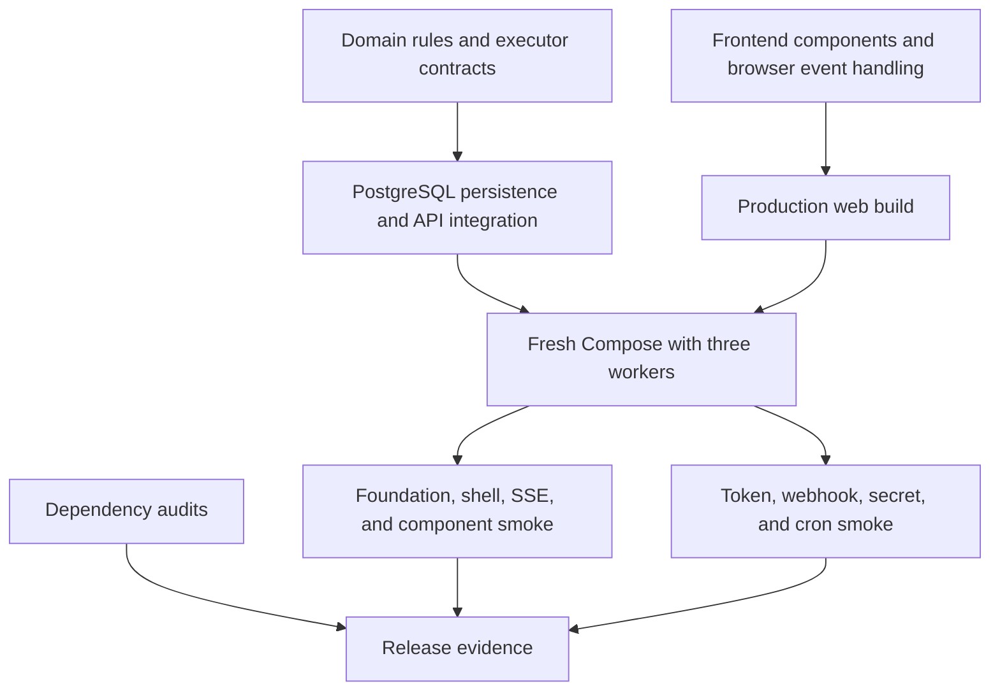

# Testing and verification

Verification follows the changed behavior. Pure documentation edits need link,
example, and consistency checks; scheduler, tenancy, or runtime changes need the
relevant behavioral tests and live smoke coverage. Historical release evidence
is recorded separately in the [release checklist](release-checklist.md).

## Test layers



| Area | Location | Important contracts |
|---|---|---|
| Domain | [domain tests](../crates/domain/tests) | RBAC, schemas, graph/publish rules, runtime limits, secrets |
| Persistence | [persistence tests](../crates/persistence/tests) | Migration grants, RLS, transactions, immutable catalog, queue concurrency |
| API | [API tests](../crates/api/tests) | Public routes, roles, CSRF, problems, publish, events, plugins, automation |
| Worker | [worker tests](../crates/worker/tests) | Leases, retries, input/output, shutdown, health, shell switch |
| Built-in executors | [mock](../crates/executor-mock/tests), [shell](../crates/executor-shell/tests) | Execution results, cancellation, timeout, process cleanup |
| Components | [plugin-host tests](../crates/plugin-host/tests) | Exact metadata, bytecode, capabilities, fuel/memory/deadlines |
| Web | [web source tests](../apps/web/src) | Auth, management views, studio, autosave, input forms, SSE and logs |
| Live system | [foundation smoke](../scripts/smoke-foundation.ps1), [automation smoke](../scripts/smoke-automation.ps1) | Real HTTP/proxy/database/worker integration |

## Disposable PostgreSQL

```sh
docker compose -f docker/compose.test.yml up -d --wait
```

The test service uses database `corqty_test`, fixed development credentials, and
host port 55432. Its initialization mount creates owner/API/worker roles.
The file keeps the project name `corqty`, preserving the historical test service
identity after moving it under `docker/`. Tests use fixed URLs in
[test-support](../crates/test-support/src/lib.rs), not application `.env` URLs.

**Integration tests truncate application tables.** Do not point them at real
data, and do not run independent Cargo integration-test processes against the
same test database concurrently. A single `cargo test --workspace` invocation
is the supported full run. The test Compose port is exposed on host interfaces;
use it only in an isolated development/CI environment.

## Rust checks

```sh
cargo fmt --check
cargo clippy --workspace --all-targets --jobs 2 -- -D warnings
cargo test --workspace --jobs 2
```

Examples of focused verification, chosen to match a change:

```sh
cargo test -p corqty-domain --jobs 2
cargo test -p corqty-api --test plugins_http --jobs 2
cargo test -p corqty-persistence --test tenant_isolation --jobs 2
cargo test -p corqty-worker --test execution --jobs 2
cargo test -p corqty-plugin-host --jobs 2
```

Use Linux for shell and process-group contracts. Windows can run portable
domain/API/worker/component checks, but platform-gated tests are not evidence
for Linux subprocess behavior. CI runs on Linux. Dependency debug information
is reduced in the workspace profile to contain Wasmtime build/link memory use.

## Frontend checks

```sh
pnpm install --frozen-lockfile
pnpm web:lint
pnpm web:test
pnpm web:build
```

The lint script generates route types, runs TypeScript checking, then oxlint.
Tests use Vitest, Testing Library, MSW, and the repository's event-source helpers.
The production build catches route/build/proxy integration issues beyond unit
tests. Use Node 24 to match CI; the recorded release also tested Node 26.

SSE tests deliberately manage their fetch connection pool so an aborted stream
cannot reuse a stale intercepted connection across tests. Preserve stream
cleanup and server-handler reset ordering when modifying these tests. See
[frontend](frontend.md) for the event and query lifecycle.

## Full application smoke suites

Initialize `.env` first and use a disposable application stack. The foundation
suite exercises trusted shell, so the explicit deployment switch and an
organization setting must both allow it; the script sets the latter.

```powershell
./scripts/init-local.ps1
$env:CORQTY_SHELL_EXECUTOR = "enabled"
$env:CORQTY_WORKER_CAPACITY = "1"
docker compose --project-name corqty-check up --build --wait --scale worker=3
./scripts/smoke-foundation.ps1 -ProjectName corqty-check -ExpectedWorkers 3
./scripts/smoke-automation.ps1
```

Use the POSIX initializer when appropriate, then run the `.ps1` scripts through
PowerShell. Their `ApiBase` and `WebBase` parameters support non-default host
ports. Foundation also accepts `ProjectName` and `ExpectedWorkers`; automation
uses HTTP endpoints and has no project-name parameter.

The scripts create synthetic organizations and execution data. Foundation
covers blueprint/draft/publish, three-worker execution, retries/cancel, trusted
shell, SSE through the web proxy, and component upload/approval/execution.
Automation covers service-token replay/revocation, signed webhooks through the
proxy, metadata-only secret reads, and real cron dispatch, which can wait up to
75 seconds. Successful automation cleanup removes its test triggers.

Stop the stack with `docker compose --project-name corqty-check down`. Persistent
data remains. Remove volumes only when deliberately discarding that disposable
environment, not when debugging an upgrade or preserving user data.

## Audits and CI

```sh
pnpm audit --audit-level=low
cargo install cargo-audit --locked --version 0.22.2
```

Then run `./scripts/audit-rust.ps1` from PowerShell. It verifies that the optional
RSA dependency is not compiled on any target before applying the narrow,
documented lockfile advisory exception. Read [security](security.md#dependency-audit-scope)
instead of suppressing additional warnings to obtain a green result.

The [CI workflow](../.github/workflows/ci.yml) runs formatting, all-target clippy,
workspace tests, frozen frontend install/lint/tests/build, both audits, a fresh
three-worker Compose stack, and both smoke suites. Build concurrency is two;
the job has a 45-minute limit. Its final cleanup removes only its disposable
CI stack/volumes. A successful local run is not a claim that a later revision's
CI or public deployment has passed.

## Documentation checks

For documentation changes, check relative links and heading anchors, parse JSON
examples, inspect image assets, and review Mermaid diagrams against source.
Check that commands use current Compose/sample paths and that placeholders are
clearly labeled. Run `git diff --check` for whitespace errors. When a doc change
also moves a file used by code, run the affected build/test or configuration
check; documentation-only changes do not require rerunning unrelated suites.
