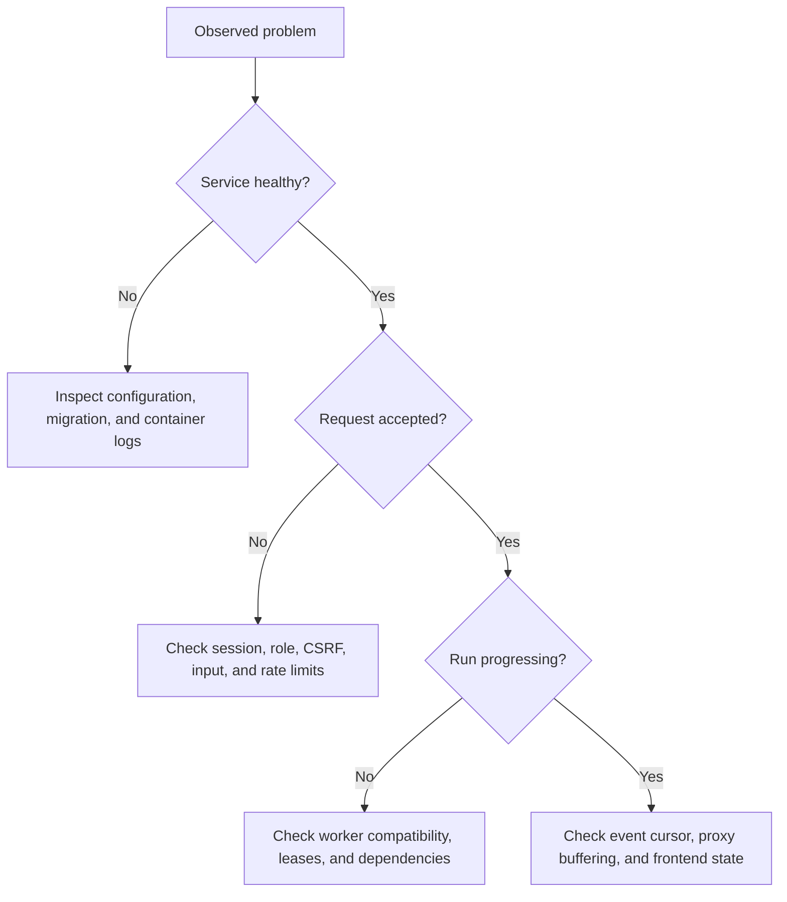

# Troubleshooting

Start from the actual error, the affected organization/run/version, and the
deployed revision. Use synthetic reproduction data where possible. Do not paste
master keys, tokens, database URLs with passwords, secret values, or tenant
payloads into public issues.

## First checks

```sh
docker compose ps
docker compose logs --tail=100 migrate api worker web
docker compose config --quiet
```

Use the same project name and Compose file arguments used to start the stack.
For production, include `-f docker-compose.yml -f docker/compose.production.yml`.
Inspect only the services relevant to the symptom; logs may contain sensitive
application details. Read [operations](operations.md) before changing persistent
data or credentials.



## Startup and builds

| Symptom | Likely cause and next action |
|---|---|
| Docker is unreachable | Start Docker Desktop/daemon and check `docker info`; retry after it is ready. |
| Required master-key error | Initializer was not run, or it preserved an existing `.env` missing the key. Recover/use the original matching key for existing data; do not generate a replacement blindly. |
| Invalid limit at startup | Compare `.env` with [configuration](configuration.md). Workload limits must be positive and at/below ceilings; explicit default timeout must fit the maximum. |
| Database authentication failure after editing `.env` | Initialization does not rotate existing role passwords. Reconcile role credentials and all role-specific URLs without deleting the data volume. |
| Host port already in use | Inspect other Compose projects/processes. Change local published ports and update the public URL/web proxy and smoke endpoint parameters accordingly. |
| Migration checksum mismatch | An applied migration differs from its recorded bytes, or a stale binary embeds old migrations. Restore the original migration and rebuild; add a forward migration for real changes. Do not manually rewrite production migration history. |
| PostgreSQL bootstrap mount missing | Use `docker/compose.test.yml` for tests; its standalone mount is relative to `docker/`. Production override must follow the root Compose file. |
| Rust build runs out of memory/paging space | Stop competing builds, use `--jobs 2`, and ensure sufficient memory/disk. A cold Wasmtime build is substantial; do not weaken tests to hide resource failures. |
| New API address is ignored by web image | `CORQTY_API_ORIGIN` is resolved at build time. Rebuild web; a runtime-only environment change does not rewrite the bundle. |

## Accounts and request failures

| Symptom | Check |
|---|---|
| Login succeeds but session disappears on local HTTP | Ensure standalone API has `CORQTY_SECURE_COOKIES=false` for local HTTP. Production must use HTTPS and secure cookies. Keep browser requests on the web origin. |
| Mutation returns 403 | Confirm the user's current role and the session's CSRF cookie/header. Service tokens only bypass session CSRF on their exact supported run route. |
| Resource returns 404 | Verify organization, resource UUID, and membership. Tenant isolation intentionally hides resources belonging to another organization. |
| Token works for starting a run but not reading it | Tokens have only `workflow:run` scope on the run-creation route. Use an authorized session for reads. |
| Save/publish returns a revision conflict | Reload the latest draft, reconcile edits, and save against its current revision. Do not repeatedly overwrite using a stale revision. |
| Last admin cannot be removed/demoted | Add or promote another administrator first; the final-admin invariant is deliberate. |
| Invitation has no delivered email | Invitations are copyable links. SMTP delivery is outside this release. |
| Many callers receive 429 behind a proxy | Peer-based buckets see the proxy address. Check aggregate traffic, SSE connection limits, and actor-specific limits; configure trusted edge limits. |

Error bodies and codes are documented in the [API guide](api.md). Do not treat
403/404 as reasons to grant the application database-owner privileges.

## Workflow and execution

| Symptom | Check and recovery |
|---|---|
| Publish fails validation | Follow diagnostic paths for nodes, ports, bindings, cycles, required input, schemas, secrets, and executor identity. Fix the draft before publishing. |
| A new edit does not affect a run | Runs use immutable published versions. Publish the draft and select that version; update pinned triggers explicitly. |
| `waiting_for_compatible_worker` | Start healthy workers advertising the exact executor version or component host contract. Check deployment shell switch, plugin installation/enabled state, and worker registration. |
| A node is blocked | Inspect predecessor outcomes and required bindings. Failed/skipped dependencies may prevent the node from becoming runnable; this is not necessarily a dead worker. |
| An attempt runs again after a crash | Leases provide at-least-once execution. Reconcile external side effects and use the stable execution ID for executor deduplication. |
| Cancel appears delayed | Workers observe cancellation through their heartbeat and executor cancellation handling. Check database reachability and worker health; trusted subprocesses that escape process groups require container containment. |
| Logs stop growing | Check the per-node log ceiling and truncation event. Logs/events also have retention, so old history may be gone. |
| Node fails when returning a credential | Secret output-leak detection rejects exact bound values. Return a non-secret result; do not disable redaction to make the run pass. |
| Shell is unavailable | Both deployment opt-in and organization opt-in are required. The production override disables trusted commands deliberately. |

The [execution guide](execution.md) describes exact transitions and retry rules.
Avoid manually editing node states or fencing fields to unstick a queue.

## Plugins, secrets, and automation

| Symptom | Check |
|---|---|
| Component rejected on upload | It must be a supported WebAssembly **Component**, not a core module, native serialization, or WAT source. Exported metadata must exactly match its manifest. |
| Host call denied | Review approvals for that organization, exact version/checksum/manifest, and the specific requested secret/host/port/command. Ambient WASI is not supplied. |
| Plugin disabled but existing work continues | Disabling blocks new publishes/runs. Existing runs and descendants may finish; cancel runs or stop workers for incident containment. |
| Secret cannot be deleted | Check references in workflow drafts and published versions. Published snapshots are immutable; inspect the retention/reference implications before changing authoring data. |
| Secret decryption/webhooks broke after key change | Restore the matching original key and follow the documented migration/rotation procedure; metadata alone cannot recover plaintext. |
| Signed webhook returns 401 | Sign the exact raw bytes and timestamp string sent. Check the five-minute clock window, UTF-8 secret bytes, HMAC algorithm, and headers. |
| Webhook replay returns 409 | The same event key was reused for a different request payload; send a new event ID or retry the original identical request. |
| Cron appears late or skipped | Verify IANA timezone, five-field expression, enabled state, pinned version, overlap policy, API dispatcher health, and misfire audit entries. |

Use [plugins](plugins.md), [secrets](secrets.md), and [automation](automation.md)
for contracts and examples. Never expose a signing key while troubleshooting.

## Live run display and tests

If a run progresses in persisted state but the UI stalls, check the SSE request,
authentication, cursor, and proxy. Preserve `no-cache, no-transform`, avoid
buffering/compression, and reconnect from the last event ID. A finished run with
no newer events can return 204; it is an intentional end, not a missing response.

Integration-test connection errors usually mean the disposable database is not
ready on port 55432 or its roles were not bootstrapped. Cross-test missing rows
can mean multiple test processes reset the same database concurrently. Use one
workspace run and consult [testing](testing.md).

When escalating, include the revision, relevant sanitized error code, affected
service, reproduction steps, expected/actual behavior, and checks already run.
For vulnerabilities, use the [private reporting policy](security.md#reporting-a-vulnerability).
