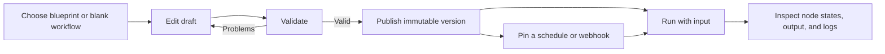
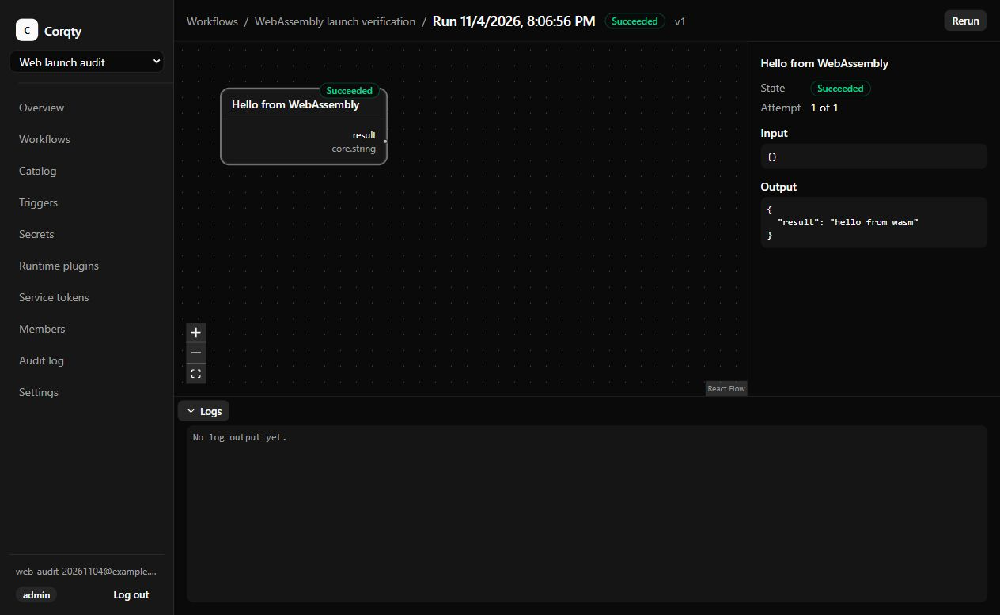

# User guide

Corqty lets an organization compose typed workflow graphs, publish immutable
versions, and run them on workers. The browser includes workflow editing, live
run monitoring, secrets, runtime plugins, and automation management. Start with
the [visual tour](visual-tour.md) for real application screenshots, or use
[development](development.md) and [operations](operations.md) to start a deployment.

## Create or join a workspace

Open your deployment's web URL. For a local Compose installation this is
`http://localhost:3000`.

1. Choose **Create an account** on the sign-in page.
2. Enter an organization name, email, and a password of 12–128 characters.
3. **Create account** creates your account, your first organization, an admin
   membership, and a signed-in session.
4. The **Organization** selector switches between your memberships. The overview
   links to Workflows, Catalog, and Triggers.

*This labeled placeholder will be replaced with a real overview capture using
the [visual-tour brief](visual-tour.md#workspace-overview).*

An admin invites people from **Members → Invite member**. Enter the recipient's
email and role, create the invitation, and copy the link while it is visible.
Invitations expire after seven days. Corqty returns the link to the admin; it
does not send an invitation email. Share it through your normal communication
channel. The recipient signs in with the invited email, then the invitation
acceptance page adds the membership. The token is in the URL fragment. A
signed-out visitor is returned to the invitation after signing in.

Registration currently always creates an initial organization. A new invitee
without an account goes through that registration flow before accepting their
invitation. There is no separate invitation-only registration screen, email
verification flow, password-reset UI, or account settings UI. An authenticated
password-change endpoint exists; see the [API](api.md).

**Log out** ends the current session. If the app cannot check your session,
it shows **Retry** rather than treating a temporary outage as a logout.

Source: [registration](../apps/web/src/views/register-view.tsx),
[invitations](../apps/web/src/views/accept-invitation-view.tsx),
[membership API](../crates/api/src/organizations/members.rs).

## Roles and access

Roles are fixed per organization. The API enforces access; hidden browser
controls are a convenience, not the authorization boundary.

| Action | Admin | Editor | Runner | Viewer |
| --- | --- | --- | --- | --- |
| View workflows, catalog, runs, members, audit, settings, trigger metadata | Yes | Yes | Yes | Yes |
| Create/edit workflows and node definitions; validate/publish | Yes | Yes | No | No |
| Start, cancel, or rerun workflows | Yes | Yes | Yes | No |
| Create/edit/enable/disable/delete triggers | Yes | Yes | No | No |
| List secret names and bind references | Yes | Yes | No | No |
| Create, replace, or delete secrets | Yes | No | No | No |
| Manage runtime plugins and capability approvals | Yes | No | No | No |
| Create/revoke service tokens | Yes | No | No | No |
| Invite/remove members, change roles, enable organization shell execution | Yes | No | No | No |

Admins can change another member's role or remove them on **Members**. Every
organization must retain an admin. The browser omits your own Remove action;
the API also protects the final admin. See [security](security.md) and the
[role definitions](../crates/domain/src/rbac.rs).

## Build your first workflow

The **Data processing** blueprint is a small demonstration that requires no
external credentials or cloud account.

1. Open **Workflows → New workflow**.
2. Give it a name and choose **Data processing** under **Start from**.
3. Create the workflow. Its two steps appear in the studio.
4. Choose **Validate**. Correct any listed problems before publishing.
5. Choose **Publish**. The toolbar reports the published version, for example
   `v1 published`.
6. Choose **Run**. Set the `payload` input to a JSON object, such as
   `{"records":[1,2,3]}`, then choose **Start run**.
7. The run page shows the graph and its states. Select a node to inspect its
   input, output, attempt, error, and filtered logs.

The starter blueprints use the deterministic mock executor. **Data processing**
returns configured example results; it is not an arbitrary data transformation
engine. **Simulated infrastructure** demonstrates a VPC step followed by a
database and service in parallel. It does not provision AWS resources.

## Work with the studio

Full editing requires a viewport at least **1024 pixels wide** and an admin or
editor role. Smaller screens and read-only roles can inspect the graph. Run
monitoring works at any screen width.

- Filter the palette by node name or key. **Add to canvas** works with a click,
  Enter, or Space; dragging also places a node or blueprint at a chosen point.
- The palette offers the latest non-deprecated version of each definition.
  Existing nodes keep their exact selected definition versions.
- Select one node to edit its name, configuration, input bindings, maximum
  attempts, and timeout. With no single selected node, the inspector edits the
  workflow input schema as JSON.
- Connect an output port to an input port. The studio rejects self-connections,
  cycles, incompatible types, and inputs already connected or bound. Select a
  node or edge and use Delete or Backspace to remove it from an editable graph.
- An input can receive an edge, a literal, a workflow input, or a secret
  reference. Choose **Not bound** before connecting an input that already has
  a literal or reference. A connected input shows its source in the inspector.
- Invalid text in a JSON editor leaves the last valid JSON value in the graph.
  Resolve the inline error; text that has not parsed is not saved as a graph edit.

Drafts autosave **800 ms after the last edit**. Wait for **Saved** before
closing the page. Validate and Publish first flush pending saves. A revision
conflict means someone else saved that draft: **Reload** fetches their saved
version and discards your local changes. There is no automatic merge or
collaborative cursor editing. Save failures can retry on the next edit or
Validate/Publish action. See [workflow contracts](workflows.md) for details.

Publishing does not replace earlier versions, and editing a draft does not
change any published version. **Run** in the studio starts the latest published
version, even if the draft has newer edits. API callers and triggers can select
a particular published version.

## Catalog and blueprints

**Catalog** lists the system catalog plus the current organization's definitions
and blueprints. Editors and admins can use **New node definition** to supply:

- A unique key, display name, category, and optional description.
- An exact executor key and version: a built-in executor or an installed,
  approved, enabled runtime plugin.
- Typed input/output ports, configuration schema, UI widgets, and defaults as
  JSON.

Creating another definition with the same organization key creates its next
immutable definition version. The form retains your input if validation fails
and shows diagnostic pointers. The **Create a node definition for this plugin**
link on an enabled, approved plugin fills in its executor identity.

A blueprint copies graph structure; adding it does not create a live link to
the original template. Inserting one into an existing graph assigns new node
and edge IDs and merges workflow inputs, with existing properties taking
precedence. The UI can list/use blueprints and create definitions. Blueprint
creation and definition deprecation are API capabilities without dedicated
browser controls. See [workflows](workflows.md), [plugins](plugins.md), and
the [sample component](../plugins/example-wasm/README.md).

## Follow executions

Open **Runs** at the bottom of the studio to see recent executions or the newest
run's logs. The list refreshes on focus and after mutations; it is not a live
stream of every run. Opening a particular run provides live updates through
Server-Sent Events.

Run states are `queued`, `running`, `succeeded`, `failed`, and `canceled`.
Node states also include `blocked`, `retry_wait`, and `skipped`. A queued node
may report that it is waiting for a compatible worker. Select it to see the
required executor. **Cancel** requests cancellation; **Cancel requested** remains
visible until processing settles. **Rerun** creates a new run from the source
run's published version and input.

*The repository's sample component completed and returned `hello from wasm`.
This is a real local production-stack run in a synthetic audit organization.*

The log drawer filters to the selected node; clear selection to see all nodes.
It follows new lines only while you remain at the bottom. The browser keeps
the newest **2,000 events**, including state events, rather than an unlimited
log history. A server-side log limit also applies per node run, by default
10 MiB. Retention can remove old run data. See [execution](execution.md),
[configuration](configuration.md), and [operations](operations.md).

## Keep credentials in Secrets

Admins create named secrets and replace their values on **Secrets**. Editors
see metadata and can select names in input bindings or `secretReference`
configuration widgets. No browser/API operation retrieves plaintext values.
Replacing a value affects future execution-time resolution of that reference.

The form clears plaintext after submission, including failures. Deleting a
referenced secret is refused with `secret_in_use`; remove the protected
references before attempting deletion. Published versions can retain such
references. See [secrets](secrets.md) for the exact protection rules and key
management requirements.

Exact bound secret values are redacted from persisted inputs and logs; outputs
containing them are rejected. Encoded/transformed values, generated values,
and fragments are not guaranteed detectable. Never paste credentials into
literal inputs, ordinary configuration, workflow names, or log messages.

## Install runtime plugins

On **Runtime plugins**, an admin uploads a precompiled WebAssembly **Component**
file and its manifest. A core WebAssembly module is not a compatible component.
The browser's upload ceiling is 25 MiB; the operator can lower server limits.

Review the key, exact version, SHA-256 checksum, and capabilities. Log-only
components are automatically approved; additional capabilities require the
explicit approval acknowledgement. Approval is for the displayed checksum
and capability set, not every future component with that name. Network grants
identify a host and port; command grants list executables.

`command-exec` grants worker-user command execution and is for trusted
deployments. The operator must first enable the deployment's trusted-execution
setting; otherwise approval fails with `command_exec_unavailable`. Installing
a plugin does not by itself create a node definition: use its catalog link
and define the component's ports/configuration. Disabling prevents new
publishes and runs using that component; existing runs keep their pinned
component. See [plugins](plugins.md) for capability behavior and authoring.

## Start automation with service tokens

Admins create **Service tokens** with a descriptive name. Copy the token before
choosing **I saved it** or leaving the page. It is shown once and only its hash
is stored. Tokens grant the `workflow:run` scope for that organization, not
general administration. **Revoke → Confirm revoke** disables a token and keeps
its revoked metadata visible. The token page includes a REST request example.

Automation callers should send `Authorization: Bearer …` and a unique
`Idempotency-Key`. Retrying the same request with the same key returns the
original run for 24 hours; changing its request produces a conflict. Browser
manual runs use the signed-in session. See [automation](automation.md) for
exact scope, headers, replay rules, and runnable integration examples.

## Schedule or receive webhooks

Admins/editors manage **Triggers**; other members can inspect metadata.

1. Publish the workflow first.
2. Name the trigger, select a published workflow, and enter the exact version.
3. Choose **Cron schedule** or **Signed webhook**.
4. For cron, provide five fields and an IANA timezone such as `UTC` or
   `Asia/Bangkok`. The UI shows the next scheduled occurrence.
5. Supply workflow input as a JSON object, choose whether to skip an occurrence
   while a previous run is active or allow overlapping runs, and set Enabled.
6. Create the trigger. Later publishes do not move its pinned version.

Webhook creation reveals a signing secret once and a `/hooks/v1/{id}` path.
Save the secret before dismissing it. Send the timestamp, raw-body HMAC, and
idempotency key described under **Webhook authentication and delivery**.
Webhook runs use the delivered JSON object as their input; it is not merged with
the stored trigger input. The stored input must still satisfy the pinned
workflow schema when creating/editing a trigger. Consult
[automation](automation.md) for all cron/DST/misfire and delivery rules.
The UI does not retrieve or rotate an existing webhook secret; create a
replacement webhook when necessary.

**Edit**, **Enable/Disable**, and **Delete** operate on a selected trigger.
Deletion requires confirmation. Disabling a schedule is useful while changing
the workflow or validating an integration. The trigger kind cannot be changed
in the edit form.

## Settings and audit history

**Settings** exposes organization shell execution. The control appears only
when the operator has enabled shell for the deployment, and only admins can
change it. Shell commands execute on workers with their operating-system
permissions; this is not isolation for hostile tenants. Existing runs are not
changed by toggling this setting. See [security](security.md) and
[execution](execution.md).

**Audit log** shows the latest 50 administrative events with time, action,
resource, actor, and metadata. A missing actor is displayed as `system`. This
screen has no pagination/filter/export controls; use the [API](api.md) for
available queries. Audit history is separate from per-node execution logs.

## Current product boundaries

- The graph is a directed acyclic graph: no loops, dynamic graph expansion,
  interactive approval nodes, or visual branching language.
- Node definitions describe ports/forms; executors implement behavior. Adding
  a definition does not generate an integration or executable plugin.
- The studio workflow-input picker offers top-level properties. Nested
  RFC 6901 property pointers can be supplied through the API and preserved
  in existing bindings.
- Editing needs a desktop-sized viewport. Keyboard palette insertion and form
  controls are supported; the product does not claim complete keyboard graph
  authoring or an accessibility certification.
- There is no workflow rename/delete/version-comparison UI, blueprint authoring
  UI, or definition deprecation UI. Consult the API before assuming a missing
  browser action is available programmatically.
- Roles are organization-wide. There is no per-workflow ACL, SSO, MFA UI,
  billing, subscription management, or hosted control plane in this repository.
- Browser state is not an offline workspace. Wait for saves and resolve errors
  before leaving. Published versions are immutable; draft conflicts need a
  conscious reload/reapplication of edits.

For operational failures, see [troubleshooting](troubleshooting.md).
