# Visual tour and screenshot briefs

Corqty moves from a reusable catalog to an editable workflow, then an immutable
published version and an observable run. The [user guide](user-guide.md)
explains the interactions; [workflow contracts](workflows.md) and
[frontend architecture](frontend.md) explain the implementation.

This page contains **two real application screenshots** captured on
**2026-11-04** from a local production Compose deployment, using a synthetic
`Web launch audit` organization. They were visually reviewed and copied
unchanged into the repository. No secret or service-token values appear.
All other images are explicitly labeled **Screenshot placeholder** cards, not
application captures or mockups. Their briefs are ready for a later real capture
and replacement, including by Claude. See the [asset inventory](assets/README.md)
for paths and replacement steps.

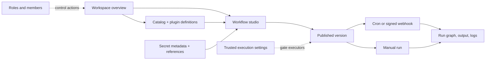

## Successful runtime execution — actual capture

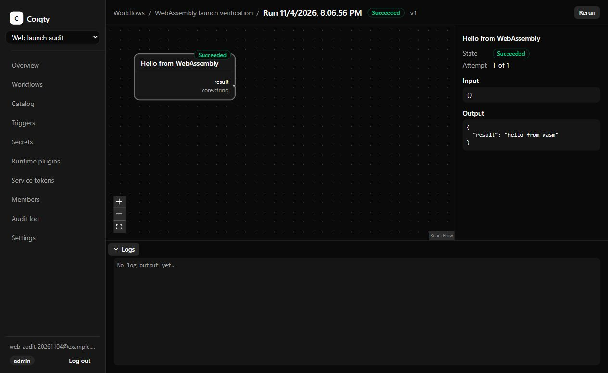

The sample `hello@1.0.0` Component was installed, exposed through an
`audit.hello` node definition, inserted through the studio's keyboard Add action,
and published as workflow version 1. The run reached **Succeeded** through live
SSE updates. Selecting its node shows `{"result":"hello from wasm"}`.
The empty log panel means this component emitted no log text; it is not evidence
that logging is unsupported. The visible `.test` email is synthetic.

Source behavior: [run view](../apps/web/src/runs/run-view.tsx),
[event lifecycle](../apps/web/src/runs/use-run-events.ts),
[sample component](../plugins/example-wasm/README.md).

## Pinned triggers — actual capture

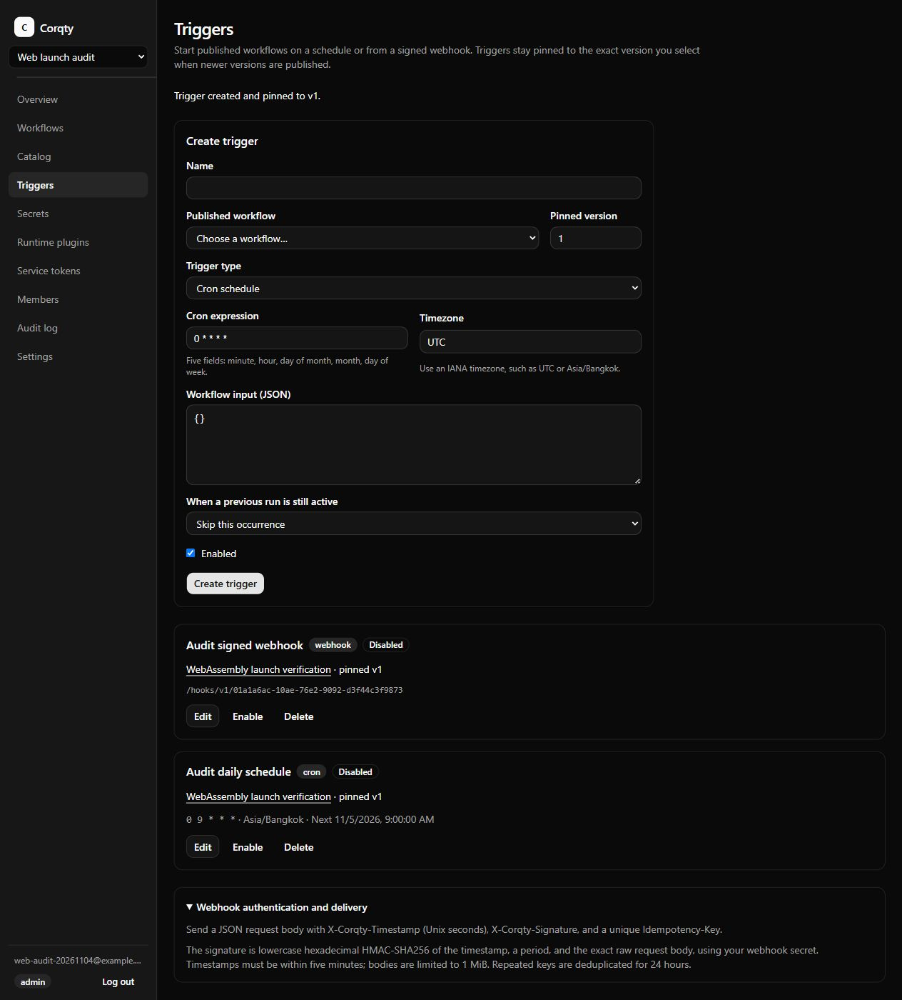

The form demonstrates exact workflow version, cron/timezone, JSON input, and
overlap controls. The saved entries are a signed webhook and a daily schedule
in `Asia/Bangkok`, both pinned to version 1. Both were left disabled after the
acceptance exercise. The form's **Enabled** checkbox belongs to a new unsaved
trigger; it does not contradict the Disabled badges on existing entries.
The webhook secret had been dismissed before capture. The displayed webhook
path is an identifier for the synthetic disabled trigger, not its credential.

Source behavior: [triggers view](../apps/web/src/views/triggers-view.tsx) and
[automation contracts](automation.md).

## Workspace overview

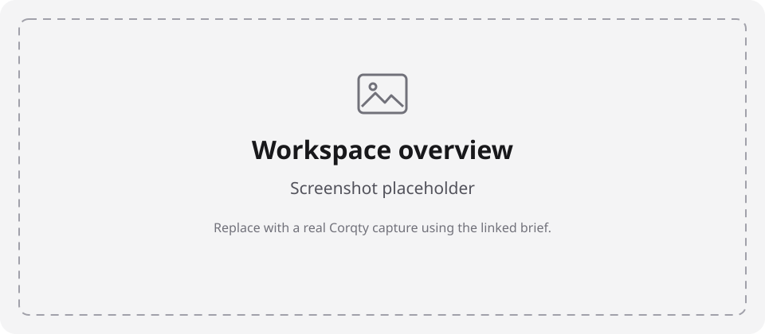

**Capture brief:** open `/orgs/{org}` in a synthetic admin workspace. Show the
current **Your workspace** heading and Workflows, Catalog, and Triggers entry
cards, with the organization switcher and navigation visible. Use desktop
1440 × 900 CSS pixels at 100% zoom and the system dark theme for consistency
with the existing captures. Capture the viewport, without browser developer
tools, menus, or transient notifications. Use a `.test` account and synthetic
organization name; do not display a real customer's identity.

**Target file:** `docs/assets/screenshots/overview.jpg`. Replace this placeholder
reference only after the file exists and has been reviewed. Source:
[overview](../apps/web/src/views/organization-home-view.tsx).

## Workflow studio

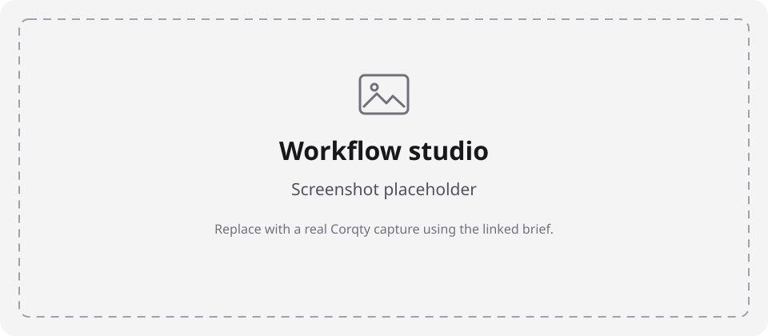

**Capture brief:** open `/orgs/{org}/workflows/{workflowId}` for a synthetic
workflow created from **Data processing**. Show the two connected steps, the
palette's **Add to canvas** controls, the saved revision/published-version
toolbar, and the inspector for Normalize payload. Use desktop 1440 × 900 CSS
pixels, 100% zoom. Use the canvas's Fit View control if needed so neither node
is cut off; leave the Runs drawer collapsed to make graph/configuration readable.
Use only harmless object data and the built-in mock executor. Do not bind real
credentials or show a shell command containing tokens.

**Target file:** `docs/assets/screenshots/studio.jpg`. The caption should name
the blueprint, show whether the draft is saved, and explain that the mock
returns configured output. Sources: [studio](../apps/web/src/studio/studio.tsx)
and [workflow model](workflows.md).

## Node catalog

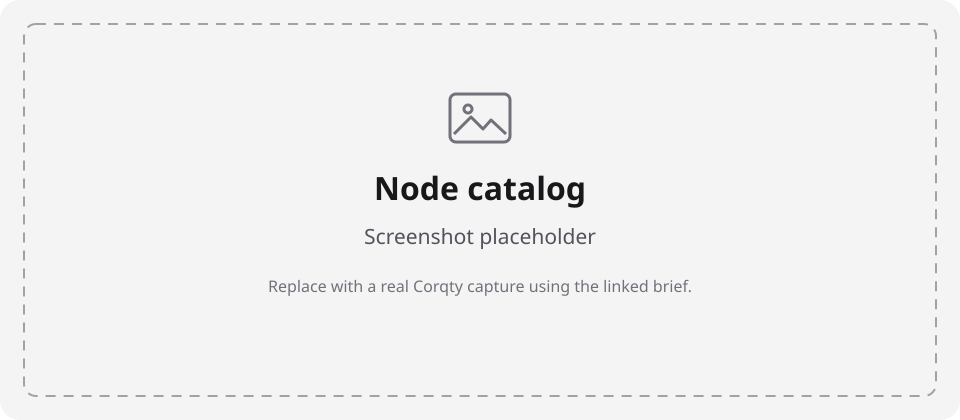

**Capture brief:** open `/orgs/{org}/catalog`. Show the node-definition table,
version/category fields, starter blueprints, and **New node definition** action
as an editor/admin. Include the harmless `Hello from WebAssembly` custom
definition if available. Keep the creation form closed for this overview; a
separate future detail capture can show its JSON form. Use 1440 × 900 CSS pixels,
100% zoom, or a full-page capture only if needed to include both tables. Never
invent a provider integration; seeded simulated infrastructure must retain its
**Simulated** labels.

**Target file:** `docs/assets/screenshots/catalog.jpg`. Source:
[catalog view](../apps/web/src/views/catalog-view.tsx).

## Runtime plugins

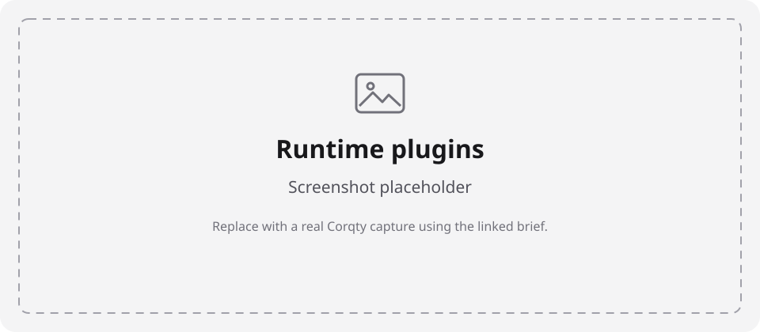

**Capture brief:** open `/orgs/{org}/plugins` as a synthetic admin. Show the
installed repository sample `hello@1.0.0`, its Enabled/Approved badges,
SHA-256 checksum, **Write logs** capability, and catalog creation link. Include
the upload/manifest form only with the public sample manifest. Use 1440 × 900
CSS pixels at 100% zoom. If illustrating capability review in a separate image,
use a test component with harmless declared capabilities; do not enable
command execution or network access merely to make a screenshot. A component
checksum is public integrity metadata; never show a private upload path or
secret embedded in a manifest.

**Target file:** `docs/assets/screenshots/plugins.jpg`. Sources:
[plugin view](../apps/web/src/views/plugins-view.tsx) and [plugins](plugins.md).

## Secret metadata

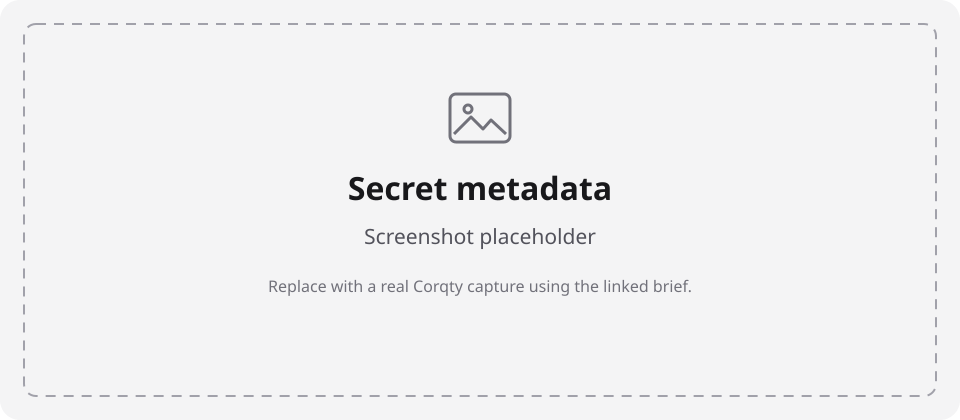

**Capture brief:** open `/orgs/{org}/secrets` with a synthetic secret named
`Demo API credential`. Show the metadata row, update time, admin replace/delete
controls, and redaction guidance. Leave the create form's Name and Value empty.
Do not focus/reveal a password field or capture a creation request in developer
tools. Use 1440 × 900 CSS pixels at 100% zoom. The secret can contain a dummy
value, but **no plaintext value should appear in the capture**, even synthetic.

**Target file:** `docs/assets/screenshots/secrets.jpg`. Sources:
[secrets view](../apps/web/src/views/secrets-view.tsx) and [secret model](secrets.md).

## Organization members

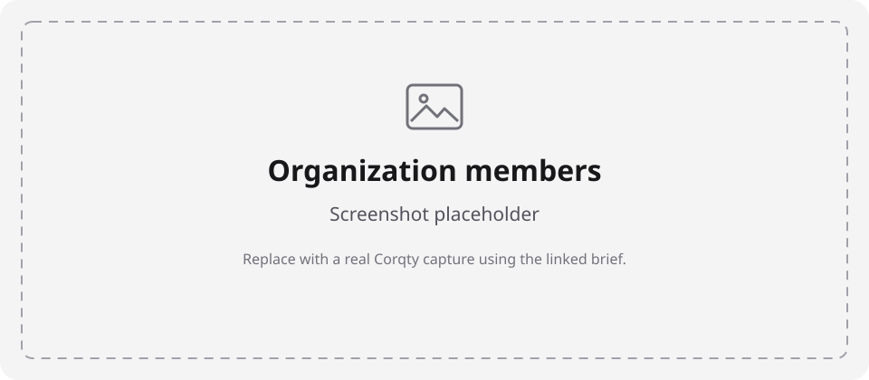

**Capture brief:** open `/orgs/{org}/members` in a synthetic organization with
an admin plus representative editor/runner/viewer memberships, all using
`example.test` addresses. Show role controls and **Invite member**, with the
invitation dialog closed. Use 1440 × 900 CSS pixels at 100% zoom. Do not expose
invitation links/tokens or real names/emails. Do not invite real recipients for
this capture; use already-created fixture memberships or explicitly authorized
local test setup.

**Target file:** `docs/assets/screenshots/members.jpg`. Sources:
[members view](../apps/web/src/views/members-view.tsx) and
[role table](user-guide.md#roles-and-access).

## Workspace settings

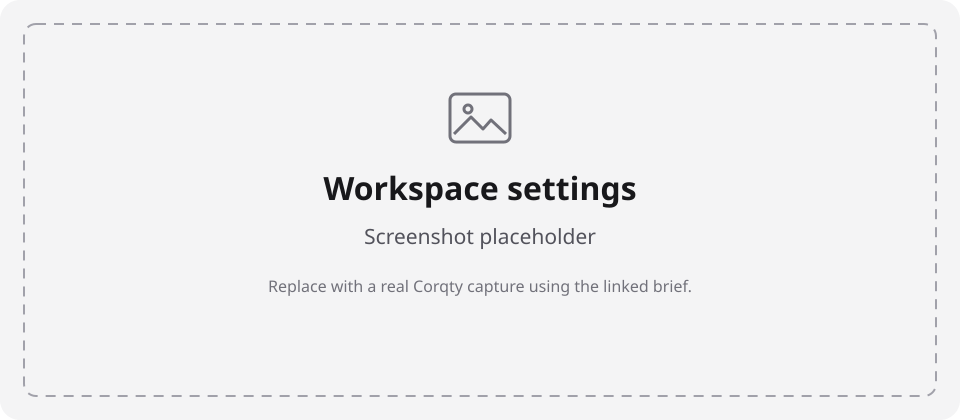

**Capture brief:** open `/orgs/{org}/settings` as a synthetic admin. Show the
Shell executor section and trust warning in its safe existing deployment state.
The preferred baseline is the message that shell is disabled for the deployment.
Do not turn on trusted execution just to display a toggle. Use 1440 × 900 CSS
pixels at 100% zoom, retaining navigation/context and the complete warning.

**Target file:** `docs/assets/screenshots/settings.jpg`. Sources:
[settings view](../apps/web/src/views/settings-view.tsx) and [security](security.md).

## Mobile management

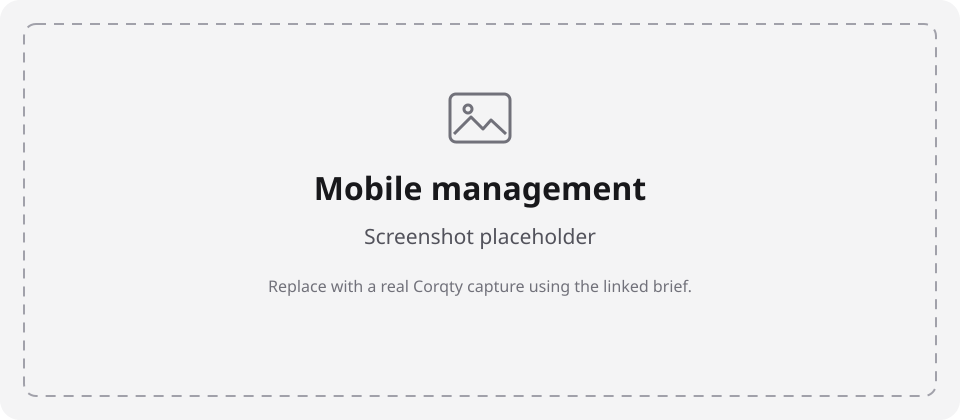

**Capture brief:** open `/orgs/{org}/service-tokens` at **390 × 844 CSS pixels**,
100% zoom, using the synthetic audit account. Show horizontal navigation,
the token creation form, and a synthetic **Revoked** token metadata card.
The one-time credential must already be dismissed. Do not create a fresh token
for the screenshot if a safe revoked record exists. A full-page mobile capture
can include the static request example; its `<your-token>` text must remain
the literal placeholder. Do not include any clipboard overlay, password-manager
popup, or actual Authorization value.

**Target file:** `docs/assets/screenshots/mobile-service-tokens.jpg`. Caption the
390 px layout and note that studio editing needs at least 1024 px. Sources:
[app shell](../apps/web/src/layout/app-shell.tsx) and
[service tokens](../apps/web/src/views/service-tokens-view.tsx).

## Replacing placeholders

Only a real capture of the running app should replace a screenshot placeholder.
Do not generate a realistic fake interface or silently describe a placeholder
as verified behavior. Save the reviewed image at its target filename, switch
the relevant Markdown image reference, and update the status/date/provenance
in [the asset inventory](assets/README.md). Keep alt text descriptive and the
nearby caption clear about what the captured state demonstrates. The detailed
brief may then become a maintenance note for later recapture.

The two existing captures are historical acceptance evidence, not a continuously
updated view of the running stack. Their visible dates/IDs are expected to age.
Changes to forms, labels, navigation, or capabilities should trigger a review
of both images and instructions before a release.
