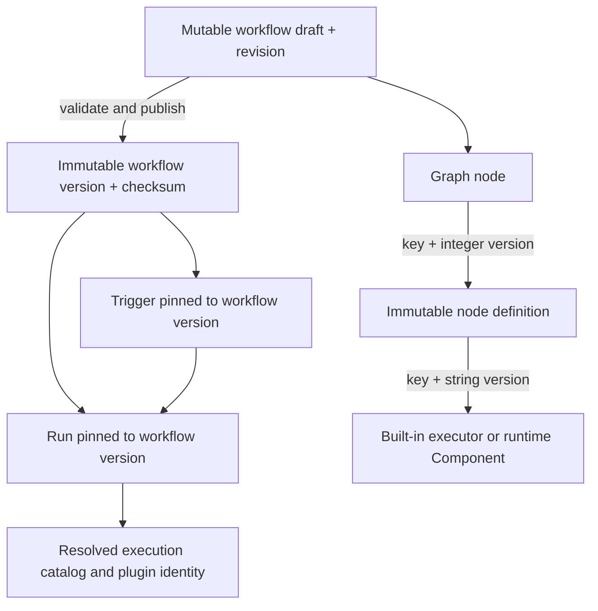
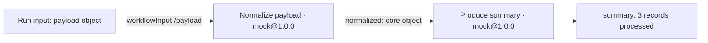
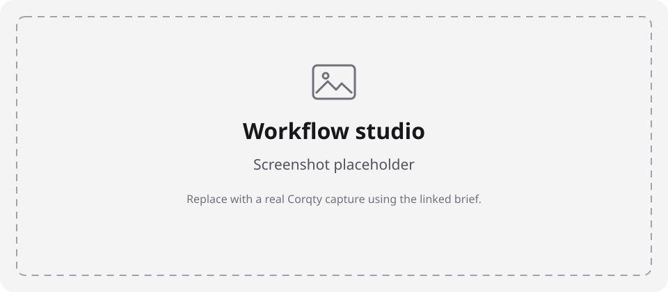
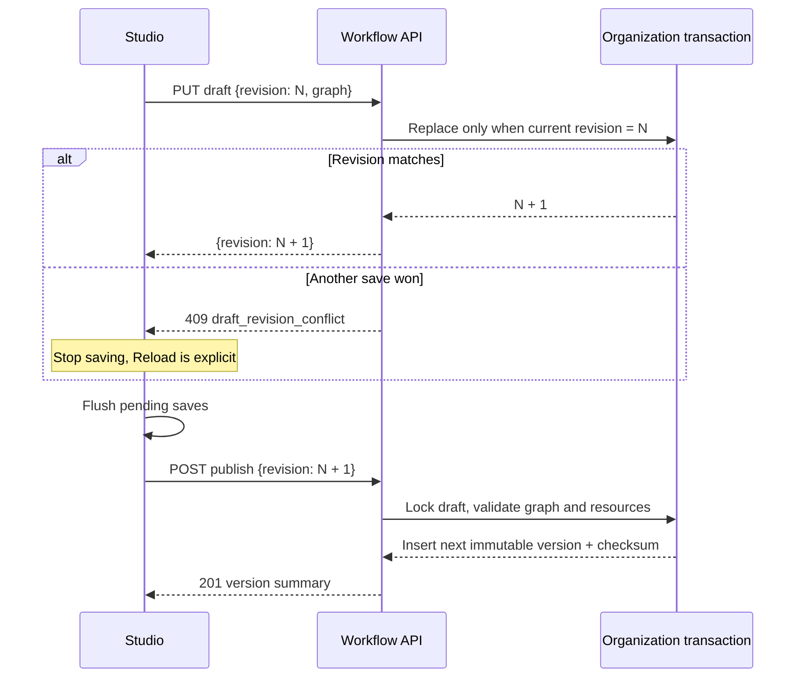

# Workflow and catalog contracts

This document describes the stored graph and the rules that make it executable.
For browser instructions see the [user guide](user-guide.md); for HTTP envelopes
and authorization see the [API](api.md). Runtime scheduling, retries, and worker
leases are covered in [execution](execution.md).

The authoritative definitions are [graph.rs](../crates/domain/src/graph.rs),
[catalog.rs](../crates/domain/src/catalog.rs),
[publish.rs](../crates/domain/src/publish.rs), and
[runtime.rs](../crates/domain/src/runtime.rs). The browser's
[types](../apps/web/src/api/types.ts) intentionally include only fields it uses;
API records can also contain scope, slug, and timestamp fields.

## Three different versions

| Identity | Example | Meaning |
| --- | --- | --- |
| Definition key + integer version | `acme.echo`, `1` | Immutable port/configuration specification referenced by a graph node |
| Executor key + string version | `mock`, `1.0.0` | Exact implementation required by that definition |
| Workflow ID + integer version | workflow UUID, `3` | Immutable published graph used by a run or trigger |

The graph's `schemaVersion: 1` is a serialization format version, independent of
all three. A workflow's mutable draft also has an optimistic-lock `revision`.
Publishing a draft creates the next workflow version; it does not increment
definition or executor versions.



## Node definitions

An organization definition combines metadata with a specification. Creating
another definition with the same organization key allocates the next integer
version. System definitions are available in every organization; their
`corqty.` prefix is reserved. Deprecation removes a definition from normal
palette selection, while references already pinned to that version remain
resolvable. Definitions are not editable in place.

| Field | Contract |
| --- | --- |
| `key` | At most 100 ASCII characters; lowercase letters/digits separated by single dots or hyphens; no `corqty.` prefix for organization definitions |
| `displayName` | Nonblank, 1–100 characters |
| `description` | Up to 1,000 characters; defaults to empty |
| `category` | Nonblank, 1–60 characters |
| `inputs`, `outputs` | At most 50 ports on each side |
| `configSchema` | Supported JSON Schema with top-level `"type":"object"` |
| `uiSchema` | Map of top-level configuration property names to widget descriptors |
| `defaults` | Configuration value that must satisfy `configSchema` and widget-specific contracts |
| `executor` | Exact `{key, version}` for a built-in or available runtime plugin |

A port contains `name`, `dataType`, `schema`, optional `required` (false), and
optional `description` (empty). Names start with an ASCII letter and then use
letters, digits, or underscores. Names must be unique within inputs and within
outputs; the two sides have separate namespaces.

`dataType` is a dotted lowercase name matching
`^[a-z][a-z0-9-]*(\.[a-z][a-z0-9-]*)+$`. It expresses connection compatibility;
the port's JSON Schema validates actual values. A familiar type name such as
`core.string` does not automatically add `{"type":"string"}` to its schema.

### A definition that echoes its input

This is a complete `POST /api/v1/orgs/{org}/node-definitions` body. It follows
the configuration contract implemented by the
[mock executor](../crates/executor-mock/src/lib.rs) and the catalog rules tested
in [catalog_rules.rs](../crates/domain/tests/catalog_rules.rs).

```json
{
  "key": "acme.echo",
  "displayName": "Echo input",
  "description": "Returns the resolved inputs under result.",
  "category": "Examples",
  "inputs": [
    {"name":"input","dataType":"core.any","schema":{},"required":true}
  ],
  "outputs": [
    {"name":"result","dataType":"core.object","schema":{"type":"object"}}
  ],
  "configSchema": {
    "type":"object",
    "properties": {
      "mode":{"type":"string","enum":["fixed","echo"]},
      "output":{"type":"object"},
      "delayMs":{"type":"integer","minimum":0,"maximum":60000}
    },
    "required":["mode","output","delayMs"],
    "additionalProperties":false
  },
  "uiSchema": {
    "mode":{"widget":"select","label":"Mode"},
    "output":{"widget":"code","label":"Fixed output"},
    "delayMs":{"widget":"number","label":"Delay (ms)"}
  },
  "defaults":{"mode":"echo","output":{},"delayMs":0},
  "executor":{"key":"mock","version":"1.0.0"}
}
```

The executor implements behavior. Defining ports or naming a node “Create VPC”
does not implement that operation. For a runtime component, install/approve
the implementation first and use its exact identity in `executor`; see
[plugins](plugins.md) and [the sample](../plugins/example-wasm/README.md).

### Configuration widgets

Each `uiSchema` key must name a `configSchema.properties` field. A descriptor
contains `widget` and optional `label`/`help`. The browser renders one control
per top-level configuration property.

| Widget | Browser value/editor |
| --- | --- |
| `text` | String input |
| `textarea` | Multiline string |
| `number` | Number input; empty becomes null, integer schemas truncate numeric values to whole numbers |
| `boolean` | Boolean checkbox |
| `select` | String choices from the property's `enum` |
| `multiSelect` | Array of strings chosen from `items.enum` |
| `secretReference` | Named secret picker storing `{kind:"secret",secretId:"UUID"}` or null |
| `code` | JSON editor; an object schema requires an object; invalid text retains the last valid value |
| `keyValue` | String-valued object editor; blank keys are omitted, duplicate keys resolve to the last row |
| `fileText` | String textarea or text imported from a file, maximum 262,144 bytes |

Without a widget override, string enum → select, string → text, number/integer
→ number, boolean → checkbox, array with string-enum items → multi-select, and
other schemas → JSON editor. Widgets help produce values; the backend schema
validator remains authoritative.

`secretReference` properties must declare `type: "object"` or
`type: ["object", "null"]` in that order. Non-null values must be valid opaque
references to secrets in the same organization. An arbitrary object or a
literal secret string does not satisfy the widget contract. See
[secrets](secrets.md).

## Graph document

Graph JSON uses camelCase. Graph, node, edge, retry, reference, and binding
objects reject unknown fields during deserialization. JSON Schema and config
are JSON values; draft saving deliberately permits semantically incomplete
values so work in progress can be stored. The browser normalizes non-object
workflow input schemas/configuration into objects for its editors.

| Field | Meaning |
| --- | --- |
| `schemaVersion` | Must be `1` at validation/publish |
| `workflowInputSchema` | Schema for a run's input object; top-level type must be object |
| `nodes` | Node instances, each referencing an exact definition version |
| `edges` | Directed source-output to target-input references |
| `viewport` | Saved canvas `{x,y,zoom}` presentation state |

A node stores `id`, `definition`, `displayName`, `position`, `config`, `inputs`,
`retry.maxAttempts`, and `timeoutSeconds`. Node and edge IDs are graph-local
strings, not necessarily UUIDs; the studio generates UUIDs for new instances.
Display names follow the 1–100 character rule. Positions and viewport are
presentation data, not execution dependencies.

Maximum attempts is **1–5**, including the first attempt. An explicit timeout
must be **1–14,400 seconds**, subject to a lower deployment limit. If the API
receives a node without `timeoutSeconds`, it fills the configured default
(900 seconds by default). The studio explicitly initializes new nodes to
one attempt and 900 seconds; if an operator lowers limits, adjust that field
before publishing. Defaults/ceilings are in [configuration](configuration.md).

### Complete graph using the seeded data-processing definitions

This graph mirrors the seeded blueprint represented in the
[frontend fixtures](../apps/web/src/test/handlers.ts). Both steps use fixed
mock output. It is suitable for a first run without external services.

```json
{
  "schemaVersion": 1,
  "workflowInputSchema": {
    "type":"object",
    "properties":{"payload":{"type":"object"}},
    "required":["payload"],
    "additionalProperties":false
  },
  "nodes": [
    {
      "id":"normalize",
      "definition":{"key":"corqty.mock.normalize-payload","version":1},
      "displayName":"Normalize payload",
      "position":{"x":0,"y":0},
      "config":{
        "mode":"fixed",
        "output":{"normalized":{"records":3}},
        "delayMs":500,
        "failureMessage":null
      },
      "inputs":{"payload":{"kind":"workflowInput","pointer":"/payload"}},
      "retry":{"maxAttempts":1},
      "timeoutSeconds":900
    },
    {
      "id":"summary",
      "definition":{"key":"corqty.mock.produce-summary","version":1},
      "displayName":"Produce summary",
      "position":{"x":300,"y":0},
      "config":{
        "mode":"fixed",
        "output":{"summary":"3 records processed"},
        "delayMs":500,
        "failureMessage":null
      },
      "inputs":{},
      "retry":{"maxAttempts":1},
      "timeoutSeconds":900
    }
  ],
  "edges":[
    {
      "id":"normalize-summary",
      "source":{"nodeId":"normalize","port":"normalized"},
      "target":{"nodeId":"summary","port":"normalized"}
    }
  ],
  "viewport":{"x":0,"y":0,"zoom":1}
}
```

A run input is `{"payload":{"records":[1,2,3]}}`. The second node's output is
`{"summary":"3 records processed"}` because that fixed result is configured;
the mock is not counting arbitrary records.





*A real studio capture is still needed; the exact capture brief and target
filename are in the [visual tour](visual-tour.md#workflow-studio).*

## Inputs, edges, and defaults

Each node input is fed by at most one edge **or** one explicit binding.
Required input ports need a source at publish time. Optional unbound inputs
are omitted at execution; `null` is a value and is preserved if its schema
accepts it. Output ports may fan out to multiple targets.

The only data-type compatibility rules are:

1. Equal source/target `dataType` names.
2. `core.integer` output → `core.number` input.
3. Any output → `core.any` input.

`core.any` output does not automatically feed a specific target type. Port
schemas are not checked for mathematical subset compatibility when connecting;
actual resolved values are validated against the receiving schema before
execution. No implicit value coercion occurs. Cycles, self-edges, unknown
node/port references, duplicate IDs, and multiply-bound inputs are invalid.

| Binding | JSON | Resolution |
| --- | --- | --- |
| Literal | `{"kind":"literal","value":null}` | Stored value, validated against the input port schema |
| Workflow input | `{"kind":"workflowInput","pointer":"/network/region"}` | RFC 6901 lookup in this run's input object |
| Secret | `{"kind":"secret","secretId":"00000000-0000-4000-8000-000000000001"}` | Existing organization secret, resolved by the worker; example UUID must be replaced |

Workflow-input pointer validation walks `properties` in the schema. It supports
nested object properties and RFC 6901 escaping (`~0` for `~`, `~1` for `/`).
The empty pointer means the whole input object. It does not traverse array
`items` or infer properties through `$ref`/schema composition. The UI offers
only top-level choices, retaining an existing non-top-level pointer. The nested
binding and nullable-literal behavior are exercised in
[publish_rules.rs](../crates/domain/tests/publish_rules.rs).

Do not confuse the following defaults:

- `NodeDefinition.defaults` is copied into a node's `config` when the studio
  creates it. Later definition versions do not update existing nodes.
- Choosing a new literal uses `schema.default`, or a widget blank value.
- The browser run form prepopulates required properties and properties with
  defaults. Empty optional fields are omitted; `0` and `false` are retained.
- Backend JSON Schema validation does not inject missing defaults. API callers
  must send the intended run input/configuration themselves.

Executors return an object keyed by declared output port names. Returned names
must be declared, values must satisfy their schemas, and nested U+0000 is
rejected. Declared outputs are allowed to be absent even if their port record
contains `required`; a downstream required input then fails as missing. See
[runtime validation](../crates/domain/src/runtime.rs).

## JSON Schema support

Schemas use **Draft 2020-12**, either without `$schema` or with
`https://json-schema.org/draft/2020-12/schema`. Other dialects are rejected.
Each schema's serialized JSON is limited to **16,384 bytes**. All string-valued
`$ref`, `$dynamicRef`, and `$recursiveRef` keywords are refused, including local
references. Compilation is offline; pattern matching uses a linear-time regex
engine. The limits bound validation work, not merely UI input size.

Workflow input and configuration schemas require a top-level object type.
Port schemas can express other values; `{}` accepts any JSON value. Backend
schema errors mask instance values rather than repeating submitted data.
Source: [schema.rs](../crates/domain/src/schema.rs).

## Validate, save, and publish



`PUT .../workflows/{id}/draft` replaces the graph only at the provided revision.
Draft saving enforces the graph's deserializable structure and deployment
node/edge limits, not all publish rules. Defaults allow **500 nodes** and
**1,000 edges**; deployments can lower these values.

`POST .../validate` checks a supplied graph without saving it and returns
`{valid, diagnostics}`. The browser flushes autosave before validation, but
the endpoint itself does not require publishing or mutate a version.

`POST .../publish` uses the stored draft at the requested revision. It resolves
system/organization definitions, secret references, available plugin identities,
shell availability, and runtime component configuration validation. It locks
the workflow so concurrent publishes cannot produce two versions for one
revision. A stale revision is `409 draft_revision_conflict`; republishing the
same revision is `409 draft_already_published`; invalid graphs return
`graph_invalid` with diagnostics.

Successful publication stores the graph plus SHA-256 of canonical JSON with
sorted object keys, the draft revision, version, and publish time. This is
revision uniqueness, not content deduplication: saving identical graph content
as another draft revision can still produce another workflow version.
Publication does not execute the workflow.

### Browser autosave behavior

The [autosave controller](../apps/web/src/studio/use-draft-autosave.ts) debounces
edits for 800 ms, serializes writes, and sends the newest pending graph using
the revision returned by the preceding save. It updates the cached workflow
on success. A 409 halts saving until Reload; another failure halts until the
next edit or explicit flush retries it. Validate and Publish await a complete
flush, so they cannot intentionally act on a superseded local save.

Leaving the editor initiates a flush. A browser unload warning is registered
while a save is pending/in flight. This is best effort: an abrupt tab/process
exit can interrupt a request, and the warning does not create offline storage.
There is no automatic draft merge. Reload after conflict discards local edits.

### Diagnostics

Every diagnostic has `{code, pointer, message}`; `pointer` is an RFC 6901
location in the submitted document. Graph diagnostics are sorted by pointer
and code. Reports keep the first 200 problems and can append one
`too_many_diagnostics` marker. Unknown definitions/ports suppress dependent
checks to avoid cascading noise. Deployment size failures stop deeper work.

```json
{
  "code":"missing_required_input",
  "pointer":"/nodes/0/inputs/payload",
  "message":"This input is required: connect an edge or add a binding."
}
```

Common codes include `unsupported_schema_version`, `invalid_schema`,
`unknown_definition`, `unknown_executor`, `unknown_node`, `unknown_port`,
`duplicate_node_id`, `duplicate_edge_id`, `self_edge`, `cycle`,
`incompatible_ports`, `multiply_bound_input`, `invalid_config`,
`invalid_literal`, `invalid_pointer`, `secret_not_found`, `invalid_retry`,
`invalid_timeout`, and `executor_disabled`. The studio maps pointers against
the graph it validated, preserving node/edge identity even if the canvas has
subsequently changed. See [diagnostic mapping](../apps/web/src/studio/diagnostics.ts).

## Blueprint copy semantics

A blueprint is reusable graph JSON plus metadata. Creating a workflow from a
blueprint copies its graph into a draft at revision 1. Inserting a blueprint
into an existing canvas is a separate browser operation: new UUIDs are assigned
to nodes/edges, edge endpoints are remapped, positions are offset by the
insertion point, top-level workflow properties are merged with existing
properties winning, and required-property names are unioned. Other existing
workflow schema keywords remain in place. Review the combined schema before
publishing; this merge is not a general JSON Schema composition algorithm.

The UI does not author blueprint records. The API validates a new blueprint
against available resources; see [catalog API implementation](../crates/api/src/catalog.rs)
and [graph insertion tests](../apps/web/src/studio/graph-model.test.ts).

## Verification and related contracts

The behavior above is covered by domain
[catalog](../crates/domain/tests/catalog_rules.rs)/
[publish](../crates/domain/tests/publish_rules.rs) tests and browser
[graph-model](../apps/web/src/studio/graph-model.test.ts),
[studio](../apps/web/src/studio/studio.test.tsx), and
[autosave](../apps/web/src/studio/use-draft-autosave.test.ts) tests.
For execution snapshots, scheduling, retries, secret resolution, and historical
data retention, continue with [execution](execution.md), [secrets](secrets.md),
[automation](automation.md), and [data model](data-model.md).
